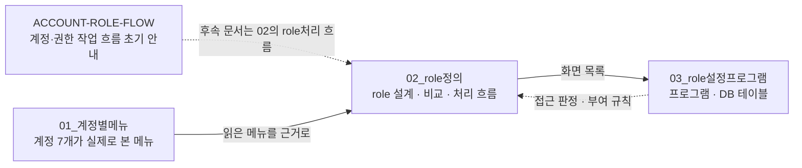

# claude 폴더 문서 네비게이션 (최상위)

> 정리 2026-11-16 · 위치: `…\works\2026\202611\20261116\claude` · erp-h(`http://localhost:8080`)의 계정·메뉴·role(권한) 작업 결과물 전체의 목차
> 하위 폴더 3개와 파일 1개가 있고, 폴더마다 자기 목차(`00_navigation.md`)가 있다. 이 문서는 폴더 단위의 안내만 하고 세부는 각 목차로 보낸다.
> 링크는 이 폴더 기준 상대 경로다.

## 1. 한눈에 보기

| 폴더 / 파일 | 한 줄 | 문서 수 | 목차 |
|---|---|---:|---|
| [01_계정별메뉴](01_계정별메뉴/) | 계정 7개로 로그인해 읽은 상단메뉴별 left메뉴 · 계정 간 비교 | 8 | [00_navigation.md](01_계정별메뉴/00_navigation.md) |
| [02_role정의](02_role정의/) | role 처리 흐름 · role 정의와 부여 규모 · `SYS_ADMIN`↔`BIZ_ADMIN` · 시스템↔공통 권한 비교 | 4 | [00_navigation.md](02_role정의/00_navigation.md) |
| [03_role설정프로그램](03_role설정프로그램/) | 권한 프로그램(화면 9개)이 읽고 쓰는 DB 테이블 · 다이어그램 | 2 | [00_navigation.md](03_role설정프로그램/00_navigation.md) |
| [ACCOUNT-ROLE-FLOW.md](ACCOUNT-ROLE-FLOW.md) | 계정 추가 → 권한 부여 → 로그인 작업 흐름 (초기 안내) | 1 | — |

## 2. 질문 → 폴더 · 문서

| 알고 싶은 것 | 갈 곳 |
|---|---|
| 새 계정을 만들고 권한을 줘서 로그인시키는 순서가 궁금하다 | [02_role정의 / erp-h role처리 흐름.md](02_role정의/erp-h%20role처리%20흐름.md) (최신) · 초기 안내 [ACCOUNT-ROLE-FLOW.md](ACCOUNT-ROLE-FLOW.md) |
| 계정마다 보이는 메뉴가 어떻게 다른가 | [01_계정별메뉴 / erph-menu-compare.md](01_계정별메뉴/erph-menu-compare.md) |
| 특정 계정의 left메뉴 트리 | [01_계정별메뉴 목차](01_계정별메뉴/00_navigation.md) §2 표 |
| role이 몇 개이고 각각 무엇을 열어 주나 | [02_role정의 / role별DOM메뉴비교.md](02_role정의/role별DOM메뉴비교.md) |
| `SYS_ADMIN`과 `BIZ_ADMIN`의 메뉴 차이 | [02_role정의 / role비교_SYSADMIN-ROLEADMIN.md](02_role정의/role비교_SYSADMIN-ROLEADMIN.md) |
| 시스템 탭과 공통 탭의 권한 메뉴가 같은가 (트리 · 폴더 키 포함) | [02_role정의 / 시스템-공통의권한프로그램비교.md](02_role정의/시스템-공통의권한프로그램비교.md) |
| 권한 화면이 어떤 DB 테이블을 쓰나 | [03_role설정프로그램 / erph-role-program-db-tables.md](03_role설정프로그램/erph-role-program-db-tables.md) |
| 프로그램↔테이블 관계를 그림으로 | [03_role설정프로그램 / erph-role-program-diagram.md](03_role설정프로그램/erph-role-program-diagram.md) |

## 3. 폴더 사이의 관계

- **01 → 02:** 01의 메뉴·등급 결과를 02가 role 설계(계획표)와 대조한다.
- **02 → 03:** 02의 role 흐름과 시스템↔공통 비교에 나온 권한 화면 9개를 03이 프로그램·테이블 단위로 정리한다. (「권한」 메뉴 트리 비교는 02의 시스템-공통 문서 3절에 합쳐져 있다.)

## 4. 권장 읽는 순서

1. **목적이 「작업 방법」이면:** `02_role정의 / erp-h role처리 흐름.md` → 필요할 때 `ACCOUNT-ROLE-FLOW.md`
2. **목적이 「누가 무엇을 보나」이면:** `01_계정별메뉴 / erph-menu-compare.md` → 계정별 문서
3. **목적이 「role 설계 이해」이면:** `02_role정의` 목차 순서(role처리 흐름 → role별 비교 → SYS_ADMIN↔BIZ_ADMIN → 시스템↔공통)
4. **목적이 「구현·DB」이면:** `03_role설정프로그램` 목차 순서(DB 테이블 → 다이어그램)

## 5. 주의할 점 (폴더를 가로질러)

- **`ACCOUNT-ROLE-FLOW.md`의 메뉴 경로는 현재 메뉴와 다르다.** 처음 안내할 때 설계 문서 기준으로 적었다. 예를 들어 「공통 › 권한 운영」은 현재 메뉴에 없고(현재는 「공통 › 권한 › 권한 부여」), `권한/메뉴매핑`(`ca-role-service`)은 「권한」이 아니라 「메뉴·업무그룹」 폴더에 있으며, `ca-user-role`의 메뉴 이름은 「사용자권한 관리」가 아니라 「권한/사용자매핑」이다. 최신 경로는 `02_role정의 / erp-h role처리 흐름.md`와 `02_role정의 / 시스템-공통의권한프로그램비교.md`를 따른다. 이 파일은 고치지 않고 남겨 두었다.
- **파일 이름과 내용이 어긋난 문서 2개(02 폴더):** `role별DOM메뉴비교.md`(내용은 저장소 기준 role 비교), `role비교_SYSADMIN-ROLEADMIN.md`(`ROLEADMIN`=`BIZ_ADMIN`).
- **공통 한계(전 폴더):**
  - DB를 직접 조회하지 않았다(접속 권한 거부). 표 관계·연쇄 삭제는 엔티티 매핑 기준이다.
  - 계정↔로그인 id↔role 대응은 화면 표시 이름으로 맞춘 추정이다.
  - 등급은 erpadmin·dev01 결과가 많고, 그 외 계정은 부여가 달라질 수 있다.
  - 계획표(P3, 11-09~10) 기준 값은 이후 패치·메뉴 재편을 모두 반영하지 못했다.
  - Mermaid 다이어그램은 렌더링을 확인하지 못했다(VS Code 기본 미리보기는 Mermaid를 그리지 않는다).
- **작업 중 Aside 로그인 계정이 여러 번 바뀌었다.** 계정별 문서는 읽은 시점의 계정 기준이다.

## 6. 다음에 할 일 (제안)

1. erpadmin으로 로그인해 「권한/메뉴매핑」·「사용자권한 조회」에서 role을 직접 읽어 02 폴더의 계획표 기준 값을 실제 값으로 바꾼다.
2. `ACCOUNT-ROLE-FLOW.md`의 메뉴 경로를 최신으로 고치거나 02의 role처리 흐름 문서로 대체한다.
3. 02 폴더의 이름이 어긋난 두 문서 이름을 정리한다.
4. 가능하면 DB 읽기 권한으로 `role_service`·`service.params`를 확인해 03 폴더의 확인하지 못한 항목을 채운다.
