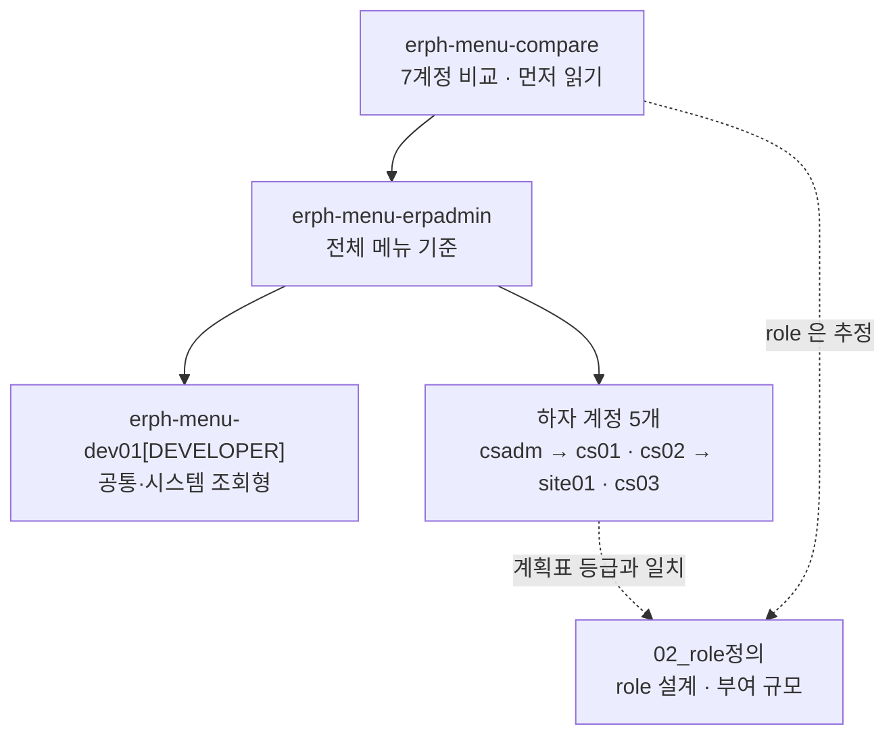

# 01_계정별메뉴 문서 네비게이션

> 정리 2026-11-16 · 대상 폴더: `01_계정별메뉴` 문서 8개 · erp-h(`http://localhost:8080`)에서 계정 7개로 로그인해 Aside 브라우저로 읽은 상단메뉴별 left메뉴(DOM)와 메뉴 API(`POST /sys/menu/list`) 결과
> 이 문서는 목차 역할만 한다. 읽은 방법과 한계는 맨 아래 §6 에 있다.
> 링크는 같은 폴더 기준 상대 경로다.

## 1. 질문 → 문서

| 알고 싶은 것 | 보는 문서 |
|---|---|
| 7개 계정의 메뉴를 한 번에 비교하고 싶다 (탭 · 화면 수 · 등급 분포 · 계정 간 차이) | [erph-menu-compare.md](erph-menu-compare.md) |
| 특정 계정이 어느 상단 탭에서 어떤 메뉴를 보는가 (트리와 화면별 경로 · serviceId · 화면 주소) | 아래 §2 표의 계정별 문서 |
| 가장 넓은 전체 메뉴가 무엇인가 | [erph-menu-erpadmin.md](erph-menu-erpadmin.md) (공통 49 · 하자 61 · 시스템 172 · 개인 25) |
| 하자(cs) 역할이 좁아질수록 메뉴가 어떻게 줄어드는가 | [erph-menu-compare.md](erph-menu-compare.md) 4절 매트릭스 → csadm → cs01·cs02 → site01·cs03 문서 |
| role 설계와 이 메뉴 결과를 연결해 보고 싶다 | [02_role정의](../02_role정의/00_navigation.md) |

## 2. 계정별 문서 한눈에

| 문서 | 로그인 계정(화면 표시 이름) | 추정 id · role | 상단 탭 | 화면 수 | 업무 탭 등급 1/2/3 |
|---|---|---|---|---:|---|
| [erph-menu-erpadmin.md](erph-menu-erpadmin.md) | erpadmin | `erpadmin` · `SYS_ADMIN`+`BIZ_ADMIN`+업무·하자 role 11개 | 공통 · 하자 · 시스템 | 307 | 1 / 0 / 281 |
| [erph-menu-dev01\[DEVELOPER\].md](erph-menu-dev01%5BDEVELOPER%5D.md) | 개발자1 (IT팀) | `h.dev01` · `DEVELOPER` | 공통 · 시스템 | 246 | 188 / 0 / 33 |
| [erph-menu-dev01\[BIZ_ADMIN\].md](erph-menu-dev01%5BBIZ_ADMIN%5D.md) | 개발자1 (IT팀) | `h.dev01` · `BIZ_ADMIN` 만 부여 (2026-11-17) | 공통 · 시스템 | 55 (개인 탭 제외) | 0 / 0 / 55 |
| [erph-menu-csadm.md](erph-menu-csadm.md) | CS팀장 (CS팀) | `h.csadm` · `CS_ADMIN` · `CS_APRV_01` · `CS_COMMON` | 하자 | 86 | 1 / 0 / 60 |
| [erph-menu-cs01.md](erph-menu-cs01.md) | CS본사담당 (CS팀) | `h.cs01` · `CS_MNG_01` · `CS_COMMON` | 하자 | 84 | 11 / 47 / 1 |
| [erph-menu-cs02.md](erph-menu-cs02.md) | CS본사담당(산업) (건설현장) | `h.cs02` · `CS_MNG_01` · `CS_COMMON` | 하자 | 84 | 11 / 47 / 1 |
| [erph-menu-cs03.md](erph-menu-cs03.md) | 하자지원담당 (CS팀) | `h.cs03` · `CS_MNG_02` · `CS_COMMON` | 하자 | 51 | 2 / 24 / 0 |
| [erph-menu-site01.md](erph-menu-site01.md) | 현장담당 (봉덕2차 휴먼아파트 신축공사) | `h.site01` · `CS_SITE_01` · `CS_COMMON` | 하자 | 55 | 15 / 15 / 0 |

- 화면 수는 「개인」 탭 25개를 포함한 값이다(모든 계정이 같은 25개). 등급 분포는 개인 탭을 뺀 업무 탭(공통·하자·시스템) 기준이다.
- 「추정 id · role」은 화면에 로그인 id가 안 나와 `TEST-ACCOUNTS-20261112.md`의 계정과 화면 표시 이름을 맞춘 것이다. 확인한 값이 아니다.
- 등급: 1 조회 · 2 저장 · 3 삭제·특수.

## 3. 읽는 순서

- 처음에는 `erph-menu-compare.md`에서 전체 그림을 잡고, 필요한 계정의 문서에서 트리를 본다.
- 하자 계정 5개는 `csadm`(61)이 가장 넓고 `cs01`·`cs02`(59)가 그다음이며, `site01`(30)과 `cs03`(26)은 더 좁다. `cs03`과 `site01`은 서로 포함 관계가 아니다(`site01`에만 있는 15개 · `cs03`에만 있는 11개).

## 4. 문서별 안내

### 4-1. [erph-menu-compare.md](erph-menu-compare.md) — 계정 비교

- **한 줄:** 7개 계정의 메뉴 노출·등급을 비교한다.
- **들어 있는 것:** 계정과 role(문서 기준 추정) · 상단 탭별 등급 분포 · 개인 탭 25개 · 하자 61개 화면×7계정 등급 매트릭스 · 공통·시스템 탭 erpadmin↔dev01 · 기능 허용(업로드·엑셀·다운로드·인쇄) 집계.
- **핵심:**
  - `cs01`과 `cs02`는 메뉴·등급·기능 허용이 완전히 같다(84개 모두 일치). 법인 범위는 메뉴가 아니라 데이터 쪽에서 갈려 이 비교에는 안 보인다.
  - `dev01`은 공통 49개를 전부 조회(1)로, 시스템은 개발도구 33개만 3으로 본다.
  - 개인 탭의 등급은 erpadmin만 다르다(`ca-role-request` 3 ↔ 2).
- **알아 둘 것:** 파일 이름은 처음 `erph-role-compare`였다가 `erph-menu-compare`로 바뀌었고, 제목도 메뉴 비교로 고쳤다. 1절의 role은 DB에서 읽은 값이 아니다.
- 절: 1 계정과 role · 2 상단 탭별 등급 분포 · 3 개인 탭 · 4 하자 탭 매트릭스 · 5 공통·시스템 탭 · 6 기능 허용 플래그 · 7 알아 둘 것

### 4-2. 계정별 메뉴 문서 7개 (공통 구조)

모든 계정 문서는 같은 두 절로 되어 있다.

| 절 | 내용 |
|---|---|
| 머리 표 | 상단 탭별 폴더·화면 수와 DOM↔API 대조 결과(이름·순서 일치 여부). `개인` 탭은 상단 탭에 안 나와 API에만 있다 |
| 1 트리 | 상단 탭별 폴더 트리. 화면마다 이름 · serviceId · 화면 주소(`/page/<serviceId>`) |
| 2 화면별 메뉴 경로 표 | 상단 탭 · 메뉴 경로 · serviceId · 화면 주소 |

계정별 특징

| 문서 | 특징 |
|---|---|
| [erpadmin](erph-menu-erpadmin.md) | 전체 메뉴 기준. 제목이 「(프로그램 경로 포함)」이고 다른 계정 문서와 달리 계정 이름이 제목에 없다. 가장 길다(724행) |
| [dev01 \[DEVELOPER\]](erph-menu-dev01%5BDEVELOPER%5D.md) | 공통 49 · 시스템 172 · 개인 25. 하자 탭 없음 |
| [dev01 \[BIZ_ADMIN\]](erph-menu-dev01%5BBIZ_ADMIN%5D.md) | `h.dev01` 에 `BIZ_ADMIN` 만 부여한 경우. 공통 48 · 시스템 7(개발도구 › 테스트) · 개인 탭은 읽지 않음. 전부 등급 3. `DEVELOPER` 문서와의 차이는 이 문서 §3 |
| [csadm](erph-menu-csadm.md) | 하자 61 — 기준정보 등록 승인(`cs_baseCdAprv`)·공동도급안분(`cs_jonitVenture`) 포함 |
| [cs01](erph-menu-cs01.md) · [cs02](erph-menu-cs02.md) | 하자 59 — 두 문서 내용이 같다. cs02의 화면 소속은 「건설현장」으로 시험 계정 문서의 로그인 조직(HI1300)과 달라 확인이 필요하다 |
| [cs03](erph-menu-cs03.md) | 하자 26 — 주로 조회·집계 화면이 빠진다 |
| [site01](erph-menu-site01.md) | 하자 30 — 현장 업무 화면. cs03에는 없는 화면 15개가 있다(cs03에만 있는 것은 11개) |

## 5. 계정 간 차이 요약

| 비교 | 결과 |
|---|---|
| csadm ↔ cs01·cs02 | csadm에만 2개(기준정보 등록 승인 · 공동도급안분) |
| cs01 ↔ cs03 | cs01에만 33개. cs03에만 있는 것은 없음 |
| cs01 ↔ site01 | cs01에만 29개. site01에만 있는 것은 없음 |
| cs03 ↔ site01 | cs03에만 11개 · site01에만 15개 |
| erpadmin ↔ csadm | erpadmin에 공통 49·시스템 172가 더 있음. 하자 61은 같음 |
| erpadmin ↔ dev01 | 메뉴(화면)는 같고 등급이 다름(erpadmin 3 · dev01 조회 1, 시스템 개발도구만 3). 하자 탭은 dev01에 없음 |

## 6. 공통 전제와 한계

- **읽은 방법:** Aside 브라우저로 로그인한 계정의 상단 탭을 하나씩 눌러 `.menu-tree` DOM(left메뉴)을 읽고, 같은 시점의 메뉴 API `POST /sys/menu/list`의 `serviceId`·`authLevel`·`allow*`와 이름·순서를 대조했다.
- **계정↔id↔role은 추정:** 화면에 로그인 id가 나오지 않았다. 이름이 비슷한 계정(예: `h.cs01`·`h.cs02`)을 화면 표시 이름으로만 구분했다.
- **화면 주소는 규칙 기준:** `/page/<serviceId>`는 `S2-screen-inventory.md`의 규칙이다. 메뉴를 눌러 주소창과 직접 대조하지는 않았다.
- **메뉴 노출만 본 결과:** 화면 안 버튼, 데이터 범위(법인·현장)는 이 문서들에 없다.
- **로그인 계정이 작업 중에 여러 번 바뀌었다.** 각 문서는 읽은 시점의 계정 기준이다. 읽은 순서는 erpadmin → dev01 → csadm → cs01 → cs02 → cs03 → site01이다.
- **개인 탭 25개**는 상단 탭 바에 나오지 않는 메뉴이고 API에만 있다. 어디서 여는지는 확인하지 못했다.
- **상단 탭 이름이 `하자`로 두 번 읽힌 계정이 있다**(DOM에 같은 요소가 하나 더 있는 것으로 보임). 메뉴 내용에는 영향이 없었다.

## 7. 다른 폴더

| 폴더 | 관계 |
|---|---|
| [02_role정의](../02_role정의/00_navigation.md) | 이 폴더의 메뉴 결과를 role 설계(계획표)와 대조한다. `role별DOM메뉴비교.md` 6절이 7계정의 읽은 메뉴를 쓴다 |
| [03_role설정프로그램](../03_role설정프로그램/00_navigation.md) | 권한 프로그램과 DB 테이블. 메뉴 트리 비교는 02 폴더의 시스템-공통 문서(3절)에 있다 |
