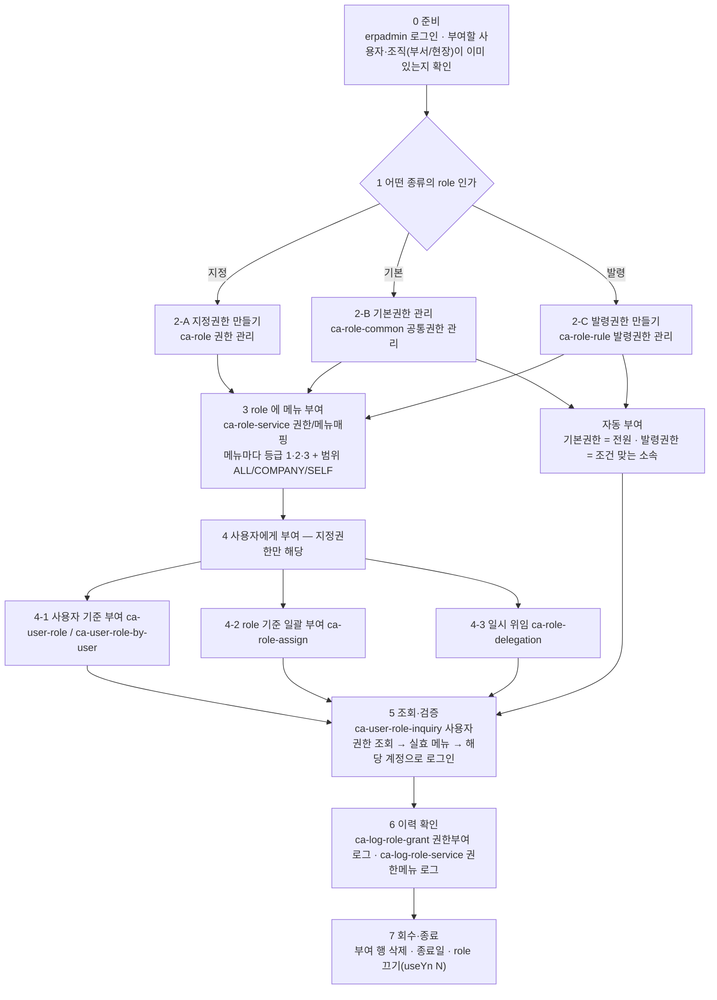

# erp-h role 처리 흐름 — 생성 → 메뉴 부여 → 계정 부여 → 조회 → 이력 → 회수

> 작성 2026-11-16 · 대상 `http://localhost:8080` (erp-h)
> 근거: ① 메뉴 경로·serviceId = Aside 로 읽은 메뉴 API `POST /sys/menu/list` (erpadmin 기준) ② 화면 용도·등급·서버 규칙 = `docs/work/common-admin/dev-guide/auth-def/*.md` 권한 정의표
> **화면을 직접 열어 확인한 것은 아니다.** 화면 이름·경로·주소는 메뉴에서 읽은 값이고, 화면이 하는 일은 문서 기준이다. 어긋나면 「확인 필요」 표시를 따른다.

## 0. 먼저 알아 둘 것

| 항목 | 내용 |
|---|---|
| 누가 하나 | 업무 전체 관리자(`BIZ_ADMIN`) 또는 시스템관리자. 화면에서 **등급 2 이상**(저장)이 있어야 만들고 부여할 수 있다. |
| 이 계정들로 되나 | **erpadmin**: 아래 화면 전부 등급 3 → 가능. **dev01**: 같은 화면이 모두 등급 1 → **조회만** 가능. csadm·cs01·cs02·cs03·site01: 이 메뉴 자체가 없음. |
| 같은 화면이 두 탭에 있다 | 「공통」 탭과 「시스템」 탭에 같은 이름의 메뉴가 있고, 시스템 쪽은 serviceId 앞에 `sys-` 가 붙는다 (예: `/page/ca-role` ↔ `/page/sys-ca-role`). 아래는 「공통」 탭 기준. |
| role 종류 | **ASSIGN(지정권한)**: 사람마다 직접 부여 · **COMMON(기본권한)**: 로그인 사용자 전원(사용자 유형별) 자동 · **RULE(발령권한)**: 본사 부서·현장 소속이면 자동 |

## 1. 전체 흐름

## 2. 단계별 화면과 경로

### 0단계 — 준비
| 확인 | 화면 | 경로 | 주소 |
|---|---|---|---|
| 부여할 사용자가 있는가 | 사용자 관리 | 공통 › 조직·사용자 › 사용자 › **사용자 관리** | `/page/ca-hmp-user-manage` |
| 사용자의 소속(부서·현장) 발령이 있는가 | 사용자 발령 관리 | 공통 › 조직·사용자 › 사용자 › **사용자 발령 관리** | `/page/ca-org-assignment` |

권한은 사람이 아니라 **조직**에 건다. 발령이 있어야 그 조직으로 로그인할 수 있다.

### 1~2단계 — role 만들기

| role 종류 | 화면 | 경로 | 주소 | 하는 일 |
|---|---|---|---|---|
| 지정(ASSIGN) | **권한 관리** | 공통 › 권한 › 권한 정의 › 권한 관리 | `/page/ca-role` | 역할 등록·수정·사용여부 끄기·다국어, 역할별 사용자 목록 |
| 기본(COMMON) | **공통권한 관리** | 공통 › 권한 › 권한 정의 › 공통권한 관리 | `/page/ca-role-common` | 전원에게 붙는 역할의 이름·대상 사용자 유형·사용여부 |
| 발령(RULE) | **발령권한 관리** | 공통 › 권한 › 권한 정의 › 발령권한 관리 | `/page/ca-role-rule` | 역할과 부여 조건(부서·직무·직급 등)을 관리 |

- 역할 코드는 `<층>_<직무>[_<번호>]` 형식이다 (예: `CS_MNG_01`). 층 = `SYS` · `BIZ` · `CS`.
- 역할 삭제(등급 3)는 위 세 화면과 지정권한 관리가 공통이다. 쓰는 역할은 **삭제하지 말고 사용여부 N 으로 끈다**. 삭제하면 이미 부여된 행이 고아로 남는다.
- COMMON 역할은 서버가 삭제를 거부한다. 끄기만 된다.
- 시스템관리자 역할(`SYS_ADMIN` 등)은 시스템관리자만 고칠 수 있다.

### 3단계 — role 에 메뉴 부여

| 화면 | 경로 | 주소 |
|---|---|---|
| **권한/메뉴매핑** | 공통 › 메뉴·업무그룹 › 권한/메뉴매핑 | `/page/ca-role-service` |

- 역할마다 어떤 메뉴를 쓰게 할지 정한다. 메뉴(서비스)마다 **등급**(1 조회 · 2 저장 · 3 삭제·특수)과 **범위**(ALL · COMPANY · SELF)를 정한다.
- 등급 2 에서 부여(→)와 회수(←), 「기본권한 생성」을 쓴다.
- 이 단계를 거치지 않은 새 role 은 부여해도 메뉴가 안 보인다.
- 하자(cs) 역할은 **`CS_COMMON`** 을 같이 준다 (cs 공용 팝업·파인더용, 유형 ASSIGN 이라 자동으로 붙지 않는다).
- 확인 필요: 이 화면의 정의표 이름은 「서비스 권한(역할↔서비스 부여)」이고 메뉴 이름은 「권한/메뉴매핑」이다. 같은 화면(`ca-role-service`)이다.

### 4단계 — 사용자에게 부여 (지정권한)

| 방식 | 화면 | 경로 | 주소 | 쓰는 때 |
|---|---|---|---|---|
| 사용자 기준 | **권한/사용자매핑** | 공통 › 권한 › 권한 부여 › 권한/사용자매핑 | `/page/ca-user-role` | 사용자 한 명을 골라 조직별로 role 을 배정·회수 |
| 사용자 기준(다른 화면) | **사용자/권한매핑** | 공통 › 권한 › 권한 부여 › 사용자/권한매핑 | `/page/ca-user-role-by-user` | 확인 필요 — 이 화면의 정의표는 없다 |
| role 기준 일괄 | **지정권한 관리** | 공통 › 권한 › 권한 부여 › 지정권한 관리 | `/page/ca-role-assign` | role 하나를 골라 받을 사용자를 여러 명 한꺼번에 등록 |
| 일시 위임 | **권한위임 관리** | 공통 › 권한 › 권한 부여 › 권한위임 관리 | `/page/ca-role-delegation` | 기간을 정해 내 권한을 다른 사람에게 위임 (본인 보유 권한만) |
| 모바일 | **사용자(모바일)** | 공통 › 권한 › 권한 부여 › 사용자(모바일) | `/page/co_mobileAuthMapp` | 모바일 사용자 권한 (`MOBILE_USER`) |

권한 신청 경로: 사용자가 직접 요청할 때는 「개인 › 내 요청 › **권한·겸직 신청**」(`/page/ca-role-request`)을 쓴다. IT 검토 → 결재 → 승인되면 자동 부여된다. 「개인」은 상단 탭 바에 나오지 않는 메뉴라 주소로 직접 연다.

부여 규칙 (서버가 막는다):
- 자기 자신에게 권한을 줄 수 없다.
- 시스템관리자 역할은 시스템관리자만 줄 수 있다.
- 같은 조직에 **본사 권한과 현장 권한을 함께** 줄 수 없다.
- 한 조직에 **현장 권한은 1개**만 줄 수 있다.
- 법인 관리자는 보이는 법인 범위 안에서만 줄 수 있다.
- 종료일이 지난 role 은 로그인에 쓰이지 않고, 매일 01:20 에 자동 회수된다.

기본권한(COMMON)과 발령권한(RULE)은 4단계가 없다. 조건에 맞으면 로그인할 때 자동으로 붙는다.

### 5단계 — 조회·검증

| 하는 일 | 화면 | 경로 | 주소 |
|---|---|---|---|
| 사용자·부서별 받은 role 과 실효 메뉴 | **사용자권한 조회** | 공통 › 권한 › 권한 부여 › 사용자권한 조회 | `/page/ca-user-role-inquiry` |
| 부여 직후 실효 메뉴 미리보기 | 사용자권한 관리 안의 「실효 메뉴 권한」 | 공통 › 권한 › 권한 부여 › 권한/사용자매핑 | `/page/ca-user-role` |
| 권한 정책 전체 보기 | **권한 매트릭스** | 시스템 › 보안 › 권한 정책 › 권한 매트릭스 | `/page/ca-auth-matrix` |

- 사용자권한 조회는 **조회 전용**이다. 사용자 기준 탭과 권한 기준 탭이 있고, 편집은 각 등록 화면으로 이동해서 한다.
- 마지막은 **그 계정으로 직접 로그인**해 상단 탭, 왼쪽 메뉴, 저장 버튼, 데이터 범위를 확인하는 것이다. 메뉴는 로그인 때 계산되므로 로그아웃 후 다시 들어가야 바뀐다.
- 확인 필요: 「권한 매트릭스」 화면이 무엇을 보여 주는지는 이름만 보고 적었다.

### 6단계 — 이력
| 하는 일 | 화면 | 경로 | 주소 |
|---|---|---|---|
| 누가 언제 누구에게 role 을 줬는지·회수했는지 | **권한부여 로그** | 시스템 › 운영·로그 › 로그 › 권한부여 로그 | `/page/ca-log-role-grant` |
| role 이 여는 메뉴를 바꾼 이력 | **권한메뉴 로그** | 시스템 › 운영·로그 › 로그 › 권한메뉴 로그 | `/page/ca-log-role-service` |

두 로그는 「시스템」 탭에만 있다. 조회·엑셀만 되고 지울 수 없다.

### 7단계 — 회수·종료
| 하는 일 | 방법 |
|---|---|
| 사용자에게서 role 회수 | 4단계 화면에서 배정을 해제(←)하거나 부여 행을 삭제 (등급 2). 이력에 REVOKE 로 남는다. |
| 기간 종료 | 부여 행에 종료일 지정 → 지나면 로그인에 쓰이지 않고 매일 01:20 자동 회수 |
| role 자체 중단 | 「권한 관리」에서 **사용여부 N** (등급 2) |
| role 삭제 | 「권한 관리」에서 삭제 (등급 3). 부여·메뉴 매핑이 남지 않는지 먼저 확인. |
| role 에서 메뉴 제거 | 「권한/메뉴매핑」에서 회수(←) |

## 3. 한눈에 보는 화면 목록

| 순서 | 단계 | 화면 | serviceId | 경로 | erpadmin | dev01 |
|---|---|---|---|---|---:|---:|
| 1 | 만들기 | 권한 관리 | `ca-role` | 공통 › 권한 › 권한 정의 | 3 | 1 |
| 1 | 만들기 | 공통권한 관리 | `ca-role-common` | 공통 › 권한 › 권한 정의 | 3 | 1 |
| 1 | 만들기 | 발령권한 관리 | `ca-role-rule` | 공통 › 권한 › 권한 정의 | 3 | 1 |
| 2 | 메뉴 부여 | 권한/메뉴매핑 | `ca-role-service` | 공통 › 메뉴·업무그룹 | 3 | 1 |
| 3 | 사용자 부여 | 권한/사용자매핑 | `ca-user-role` | 공통 › 권한 › 권한 부여 | 3 | 1 |
| 3 | 사용자 부여 | 사용자/권한매핑 | `ca-user-role-by-user` | 공통 › 권한 › 권한 부여 | 3 | 1 |
| 3 | 일괄 부여 | 지정권한 관리 | `ca-role-assign` | 공통 › 권한 › 권한 부여 | 3 | 1 |
| 3 | 위임 | 권한위임 관리 | `ca-role-delegation` | 공통 › 권한 › 권한 부여 | 3 | 1 |
| 3 | 모바일 | 사용자(모바일) | `co_mobileAuthMapp` | 공통 › 권한 › 권한 부여 | 3 | 1 |
| 4 | 조회 | 사용자권한 조회 | `ca-user-role-inquiry` | 공통 › 권한 › 권한 부여 | 3 | 1 |
| 5 | 이력 | 권한부여 로그 | `ca-log-role-grant` | 시스템 › 운영·로그 › 로그 | 3 | 1 |
| 5 | 이력 | 권한메뉴 로그 | `ca-log-role-service` | 시스템 › 운영·로그 › 로그 | 3 | 1 |
| 신청 | 사용자 요청 | 권한·겸직 신청 | `ca-role-request` | 개인 › 내 요청 | 3 | 2 |

등급은 Aside 로 읽은 메뉴 API 값이다. dev01 이 모든 화면에서 1 이므로 dev01 로는 role 을 만들거나 부여할 수 없다.

## 4. 확인하지 못한 것
- 위 화면을 실제로 열어 순서대로 해 보지 않았다. 화면의 버튼 이름과 입력 칸은 문서에 적힌 것 외에는 모른다.
- `ca-user-role-by-user`(사용자/권한매핑)는 정의표가 없어 용도를 이름으로만 추정했다. `ca-user-role`(권한/사용자매핑)이 문서에서는 「사용자 한 명을 골라 조직별 권한 부여」 화면인데 메뉴 이름은 「권한/사용자매핑」이라 이름과 설명이 어긋난다. 어느 화면이 어느 방향인지 화면에서 확인해야 한다.
- 시스템 탭에 있는 `sys-` 접두어 화면이 공통 탭 화면과 같은 동작인지는 확인하지 못했다.
- 권한 신청(`ca-role-request`)의 승인 후 자동 부여 흐름은 문서 기준이다.
