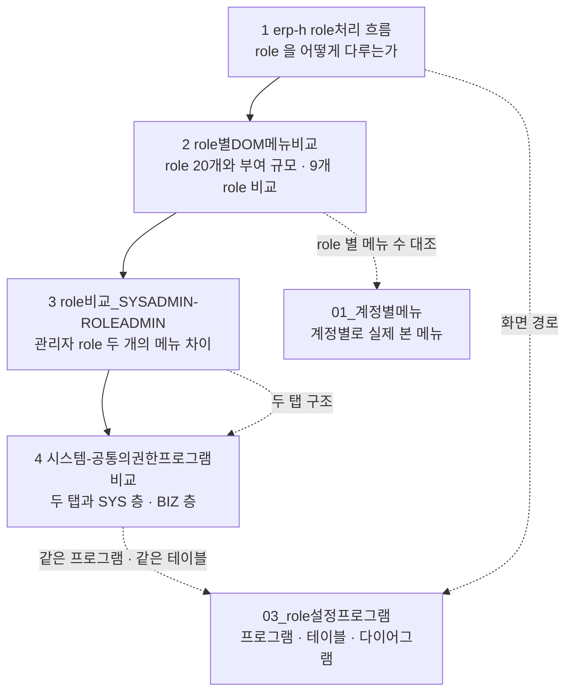

# 02_role정의 문서 네비게이션

> 정리 2026-11-16 · 대상 폴더: `02_role정의` 문서 4개 · erp-h(`http://localhost:8080`)의 role(권한) 정의와 비교
> 이 문서는 목차 역할만 한다. 각 문서가 DB 를 직접 조회하지 않고 저장소·메뉴 API·화면에서 읽은 값으로 썼다는 공통 한계는 맨 아래 §5 에 있다.
> 링크는 같은 폴더 기준 상대 경로이며, 이름에 공백이 있는 파일은 `<...>` 로 감쌌다.

## 1. 질문 → 문서

| 알고 싶은 것 | 보는 문서 |
|---|---|
| role 은 어떻게 만들고, 사용자에게 주고, 확인하고, 회수하나? (화면·메뉴 경로 순서) | [erp-h role처리 흐름.md](<erp-h role처리 흐름.md>) |
| erp-h 에 role 이 몇 개이고, 각각 무엇을 열어 주나? 요청한 9개 role 의 차이는? | [role별DOM메뉴비교.md](role별DOM메뉴비교.md) |
| `SYS_ADMIN` 과 `BIZ_ADMIN` 은 같은 메뉴가 어디고 다른 메뉴가 어디인가? 어디서 확인하나? | [role비교_SYSADMIN-ROLEADMIN.md](role비교_SYSADMIN-ROLEADMIN.md) |
| 「시스템」 탭의 권한 메뉴와 「공통」 탭의 권한 메뉴는 같은가? SYS 층 role 과 BIZ 층 role 은 어떻게 다른가? | [시스템-공통의권한프로그램비교.md](시스템-공통의권한프로그램비교.md) |

## 2. 권장 읽는 순서

실선은 읽는 순서, 점선은 근거나 이어 보는 문서다.

## 3. 문서별 안내

### 3-1. [erp-h role처리 흐름.md](<erp-h role처리 흐름.md>)

- **한 줄:** role 생성 → role 에 메뉴 부여 → 사용자에게 부여 → 조회·검증 → 이력 → 회수까지를 단계 순서로, 화면 이름·메뉴 경로·화면 주소와 함께 정리했다.
- **들어 있는 것:** 흐름도, 단계별 화면(권한 관리 · 공통권한 관리 · 발령권한 관리 · 권한/메뉴매핑 · 권한/사용자매핑 · 지정권한 관리 · 권한위임 관리 · 사용자권한 조회 · 권한 로그), 서버가 막는 규칙, 화면 목록 표.
- **핵심:**
  - role 종류는 지정(ASSIGN) · 기본(COMMON) · 발령(RULE)이고 부여가 필요한 것은 지정권한뿐이다.
  - 새 role 은 「권한/메뉴매핑」으로 메뉴를 부여하지 않으면 보이지 않는다.
  - 이 흐름을 수행하려면 erpadmin 급 계정(등급 2 이상)이 필요하고, dev01 은 조회만 된다.
- **참고:** 문서 작성 시점의 메뉴 경로이며, 「권한/메뉴매핑」이 「권한」 폴더가 아니라 「메뉴·업무그룹」에 있다는 점은 [03 폴더의 메뉴트리 비교](../03_role설정프로그램/erph-role-menu-tree-common-vs-system.md)에서 다룬다.
- 절: 0 먼저 알아 둘 것 · 1 전체 흐름 · 2 단계별 화면과 경로 · 3 화면 목록 · 4 확인하지 못한 것

### 3-2. [role별DOM메뉴비교.md](role별DOM메뉴비교.md)

- **파일 이름 주의:** 이름은 「DOM 메뉴 비교」이지만 내용은 **저장소(시드 SQL · 계획표 · 문서) 기준의 role 정의·부여 비교**이고, 화면에서 읽은 메뉴(Aside 7계정)는 6절에서 대조용으로만 쓴다. 문서 안 제목은 「erp-h role 비교 — 저장소(시드 SQL·계획표·문서) 기준」이다.
- **한 줄:** 시드에 정의된 role 20개의 정의와 role↔서비스 부여 규모, 요청한 role 9개의 비교.
- **들어 있는 것:** role 정의표(유형·관리자 여부) · role별 화면 수·등급 분포·범위 · 9개 role 화면 겹침/포함 관계 · 하자 화면별 등급 표 · 영역별 비교 · 계획표 이후 패치 · 실제 메뉴와의 대조.
- **핵심:**
  - cs 역할은 `CS_ADMIN` ⊃ `CS_MNG_01` ⊃ `CS_MNG_02`·`CS_SITE_01` 포함 관계이고 범위는 ALL / 법인 / 현장이다.
  - `DEVELOPER` 는 개발도구 3 + 그 밖 조회 1 이고 `SYS_ADMIN` 은 「시스템」 전체다.
  - 계획표의 등급은 7계정에서 읽은 실제 메뉴 등급과 거의 일치한다(불일치 1건).
- 절: 1 role 정의 · 2 부여 규모 · 3 9개 role 비교 · 4 요약 · 5 이후 패치 · 6 실제 메뉴와 대조 · 7 알 수 있는 것/없는 것 · 8 확인하지 못한 것

### 3-3. [role비교_SYSADMIN-ROLEADMIN.md](role비교_SYSADMIN-ROLEADMIN.md)

- **파일 이름 주의:** 이름의 `ROLEADMIN` 은 `BIZ_ADMIN` 을 가리킨다. 문서 안 제목은 「`SYS_ADMIN` ↔ `BIZ_ADMIN` 메뉴 비교 (같은 메뉴 · 다른 메뉴)」다.
- **한 줄:** 관리자 role 두 개의 메뉴를 같은 것 / 다른 것으로 나누고, 직접 확인하는 화면을 안내한다.
- **핵심:**
  - 폴더 구조(공통 6개 영역)는 같지만 부여 대상 serviceId 가 다르다(`BIZ_ADMIN`=`ca-*`, `SYS_ADMIN`=`sys-ca-*`).
  - 같은 serviceId 에 두 role 이 모두 부여된 것은 5개뿐이고 모두 등급이 다르다.
  - `SYS_ADMIN` 에만: 시스템 전용 폴더 7개(약 115화면). `BIZ_ADMIN` 에만: 공통 탭 화면 · 권한·겸직 신청 · 시스템 보안 2개.
  - `SYS_ADMIN` 보유자는 `BIZ_ADMIN` 도 받으므로(P3-27) erpadmin 은 두 탭을 모두 본다.
- **직접 확인:** 7절에 「권한/메뉴매핑」 · 「사용자권한 조회」 · 「사용자권한 관리」로 확인하는 순서가 있다.
- 절: 1 결론 · 2 한눈에 비교 · 3 같은 메뉴 · 4 다른 메뉴 · 5 지금 계정 결과 · 6 정리 · 7 직접 확인 프로그램 · 8 확인하지 못한 것

### 3-4. [시스템-공통의권한프로그램비교.md](시스템-공통의권한프로그램비교.md)

- **한 줄:** 「시스템」 탭과 「공통」 탭의 같은 이름 권한 메뉴를 비교하고, 두 탭이 쓰는 role 층(`SYS_*` ↔ `BIZ_*`)을 정리했다.
- **핵심:**
  - 공통(49개 화면)은 시스템(172개)의 부분집합이고, 같은 화면 소스를 쓰는 `sys-` 별칭이 있다.
  - 「권한」 폴더는 양쪽이 같은 9개 화면이다. 권한 정책·감사 화면은 시스템 탭에만 있다.
  - 권한은 serviceId 별로 따로 부여된다.
- **알려진 보정:** 이 문서의 「등급은 두 탭이 같다」는 erpadmin·dev01 두 계정에서 읽은 결과이고, 다른 계정에서는 달라질 수 있다. 같은 보정은 [03 폴더 DB 테이블 문서의 1-1절·6절](../03_role설정프로그램/erph-role-program-db-tables.md)에 있다. 또 기능 허용(업로드·엑셀 등) 차이는 「권한」 폴더에서는 없고 「메뉴·업무그룹」 폴더에서 나타난다.
- 절: 1 한눈에 · 2 구조 비교 · 3 「권한」 메뉴 비교 · 4 등급 비교 · 5 계정별 보이는 탭 · 6 role 층 비교 · 7 정리 · 8 확인하지 못한 것

## 4. 다른 폴더와의 관계

| 폴더 | 문서 | 이 폴더 문서와의 관계 |
|---|---|---|
| [01_계정별메뉴](../01_계정별메뉴/) | `erph-menu-compare.md` · `erph-menu-<계정>.md` 7개 | 계정 7개가 실제로 본 메뉴·등급. 3-2 의 6절과 3-3 의 5절이 이 결과를 쓴다 |
| [03_role설정프로그램](../03_role설정프로그램/) | `erph-role-menu-tree-common-vs-system.md` | 「권한」 폴더 메뉴트리를 공통·시스템으로 나란히 비교 |
| 〃 | `erph-role-program-db-tables.md` | 권한 프로그램 9개가 읽고 쓰는 DB 테이블(백엔드 소스 기준) |
| 〃 | `erph-role-program-diagram.md` | 프로그램 ↔ 테이블 다이어그램(공통 탭·시스템 탭, 테이블 중심 배치 포함) |

## 5. 공통 전제와 한계 (4개 문서 모두 해당)

- **등급:** 1 조회 · 2 저장 · 3 삭제·특수. 범위는 ALL · COMPANY(법인) · SELF(현장).
- **공통 탭 / 시스템 탭:** 같은 구조의 두 메뉴 트리. 시스템 탭은 `sys-` 가 붙은 별칭이며 같은 프로그램·같은 쿼리를 쓰고, 부여(`role_service`)는 serviceId 별로 따로 한다.
- **계획표(P3):** `P3-plan-role-service.tsv` 는 2026-11-09~10 시점의 부여 계획이다. 이후 패치(P3-27 · P3-28 · P3-29 · P16 · P17 · P28)와 메뉴 재편은 문서마다 따로 표시했다.
- **계정↔role 대응은 추정:** 화면에 로그인 ID 가 나오지 않아 시험 계정 문서의 role 을 화면 표시 이름과 맞췄다.
- **DB 를 직접 조회하지 않았다.** DB 접속은 권한 거부되어 하지 않았다.
- **현재 로그인:** 문서 작성 중 Aside 의 로그인 계정이 여러 번 바뀌었다. 단독 role 계정(`h.sysadm` · `h.bizadm`)은 삭제되어 없다.
- **상호 참조:** `role별DOM메뉴비교.md` 196행이 `01_계정별메뉴/erph-menu-erpadmin.md` 를 가리킨다(이 폴더 기준으로는 `../01_계정별메뉴/...`). 그 외 이 폴더 문서끼리 가리키는 파일 이름은 없어 이름 변경으로 깨진 참조는 찾지 못했다.

## 6. 다음에 할 일 (제안)

1. erpadmin 으로 로그인해 「권한/메뉴매핑」 · 「사용자권한 조회」에서 `SYS_ADMIN` · `BIZ_ADMIN` · 요청한 9개 role 을 직접 읽어 3-2 · 3-3 의 계획표 기준 값을 실제 값으로 바꾼다.
2. 3-4 의 「등급은 두 탭이 같다」 문구를 보정한다.
3. 파일 이름이 내용과 어긋난 두 문서(`role별DOM메뉴비교.md` · `role비교_SYSADMIN-ROLEADMIN.md`)의 이름을 정리할지 정한다.
