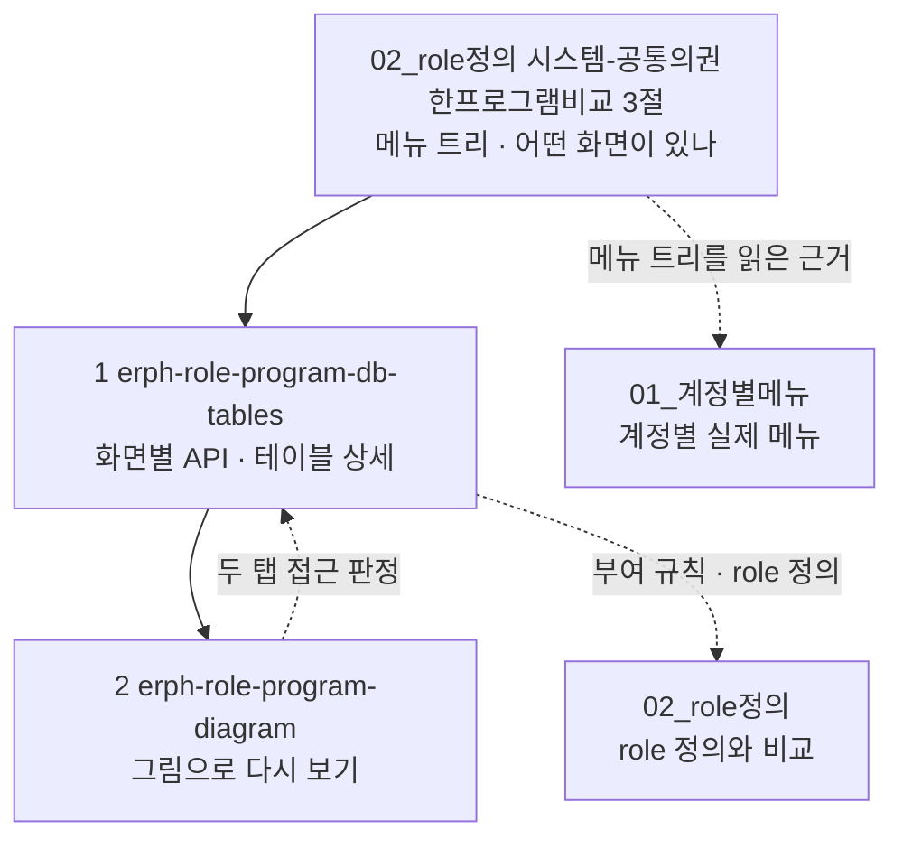

# 03_role설정프로그램 문서 네비게이션

> 정리 2026-11-16 · 대상 폴더: `03_role설정프로그램` 문서 2개 · erp-h 「권한」 메뉴 트리의 화면 9개(공통 탭 `ca-*` · 시스템 탭 `sys-ca-*` 별칭)와 그 화면이 쓰는 DB 테이블
> 이 문서는 목차 역할만 한다. 한계는 맨 아래 §5 에 있다.
> 링크는 같은 폴더 기준 상대 경로다. 「권한」 메뉴 트리 비교 문서는 02_role정의의 시스템-공통 문서(3절)에 합쳐졌다.

## 1. 질문 → 문서

| 알고 싶은 것 | 보는 문서 |
|---|---|
| 공통 탭의 「권한」 메뉴 트리와 시스템 탭의 「권한」 메뉴 트리는 어떻게 같고 다른가? (폴더 키 · serviceId · 등급 · 기능 허용) | [02_role정의 시스템-공통의권한프로그램비교.md](../02_role정의/시스템-공통의권한프로그램비교.md) 3절 |
| 권한 프로그램 하나하나가 어떤 DB 테이블을 읽고 쓰나? (API → 서비스 → 테이블) | [erph-role-program-db-tables.md](erph-role-program-db-tables.md) |
| 프로그램과 테이블 관계를 그림으로 보고 싶다. 공통 탭과 시스템 탭이 같은 테이블을 쓰는 모습은? | [erph-role-program-diagram.md](erph-role-program-diagram.md) |

## 2. 권장 읽는 순서

실선은 읽는 순서, 점선은 이어 보는 자료다.

## 3. 문서별 안내

### 3-1. [erph-role-program-db-tables.md](erph-role-program-db-tables.md)

- **한 줄:** 화면 9개가 쓰는 DB 테이블을 `platform-hmp`(hmp-core) 백엔드 소스에서 따라가 정리했다. `co_mobileAuthMapp`만 erp-h 소스다.
- **들어 있는 것:** 프로그램 ↔ 소스 대응, 공통·시스템 탭 관계(1-1), 프로그램별 요약, 프로그램별 API·서비스·테이블 상세, 테이블×프로그램 매트릭스, 테이블 사전, 소스에서 발견한 점.
- **핵심:**
  - 쓰기가 가장 많은 프로그램은 `ca-role-assign`(`role` · `role_i18n` · `log_role` · `user_role` · `log_role_grant`), 쓰기가 없는 프로그램은 `ca-user-role-inquiry`다.
  - `ca-user-role`과 `ca-user-role-by-user`는 같은 화면 소스(`user-role`)이고 방향(`mode=byRole`/`byUser`)만 다르다.
  - 공통 탭과 시스템 탭은 같은 테이블·같은 쿼리를 쓰고, 다른 것은 호출 화면의 serviceId에 받은 `role_service` 부여(허용 판정)다(1-1절).
  - 역할을 삭제하면 `role_i18n`·`role_condition`·`role_service`는 연쇄 삭제되고 `user_role`은 남는다(6절).
- **근거 소스 버전:** erp-h가 쓰는 hmp-core 2.2.109. 권한 관련 파일은 platform-hmp HEAD와 차이가 없다.
- 절: 1 프로그램 ↔ 소스 대응(1-1 공통·시스템 탭) · 2 프로그램별 요약 · 3 프로그램별 상세(3-1~3-6) · 4 테이블×프로그램 매트릭스 · 5 테이블 사전 · 6 소스에서 발견한 점 · 7 확인하지 못한 것

### 3-2. [erph-role-program-diagram.md](erph-role-program-diagram.md)

- **한 줄:** 3-1 의 내용을 Mermaid 다이어그램 5종으로 그렸다.
- **들어 있는 것:**
  | 절 | 다이어그램 | 보여 주는 것 |
  |---|---|---|
  | 1 | 흐름도 | 공통 탭 9개 · 시스템 탭 9개 화면이 프로그램 8개로 모이는 구조 |
  | 1-1 | 흐름도 | **테이블을 가운데, 왼쪽 시스템 탭 · 오른쪽 공통 탭** (굵은 선 쓰기 · 점선 읽기) |
  | 2 | 시퀀스 | 접근 판정 — `X-Service-Id`로 serviceId 등급 확인 후 같은 쿼리 실행 |
  | 3 | 흐름도 | 프로그램 → 테이블 쓰기(백그라운드 작업 포함) |
  | 4 | 흐름도 | 프로그램 → 테이블 읽기(표를 성격별로 묶음) |
  | 5 | ER | 표 사이 관계와 역할 삭제 시 연쇄 범위 |
- **보는 법:** VS Code 기본 미리보기는 Mermaid를 그리지 않는다. Mermaid 지원 확장(예: Markdown Preview Mermaid Support)이나 GitHub·GitLab에서 열어야 한다. 이 문서의 다이어그램은 렌더링을 확인하지 못했다.
- 절: 1 메뉴 화면 → 프로그램 · 1-1 테이블 중심 배치 · 2 접근 판정 · 3 쓰기 관계 · 4 읽기 관계 · 5 표 사이 관계 · 6 정리 · 7 확인하지 못한 것

## 4. 한눈에 보는 연결

| 주제 | 메뉴 트리(02 시스템-공통 문서) | 테이블 문서 | 다이어그램 |
|---|---|---|---|
| 공통 탭 ↔ 시스템 탭이 같은가 | 3-3 비교 결과 | 1-1절 | 1절 · 1-1절 |
| 화면 9개 목록과 serviceId | 3-2 노드 대응표 | 1절 | 1절 |
| 테이블 읽기·쓰기 | — | 2·3·4절 | 1-1절 · 3절 · 4절 |
| 접근 판정(serviceId별 부여) | — | 1-1절 · 6절 8번 | 2절 |
| 역할 삭제의 연쇄 범위 | — | 6절 1번 | 5절 |

## 5. 공통 전제와 한계 (2개 문서 모두 해당)

- **DB 를 직접 조회하지 않았다.** DB 접속은 권한 거부되어 하지 않았다. 표 사이 관계와 연쇄 삭제는 엔티티 매핑 기준이고 실제 FK는 확인하지 못했다.
- **화면을 열어 동작을 비교하지 않았다.** 메뉴 트리는 메뉴 API 응답이고, 화면 동작은 소스 읽기 기준이다.
- **별칭의 `service.params`를 읽지 못했다.** `sys-*`가 원본과 같은 `params`(`mode` · `systemScope`)를 갖는지는 확인하지 못했다.
- **두 탭 사이 부여가 다른 계정이 없다.** serviceId별 판정 차이를 실제 계정으로 시험하지 못했다.
- **조직 이름 풀이·법인 범위 검사의 하부 쿼리와 스케줄러 크론식**은 따라가지 않았다.

## 6. 다른 폴더

| 폴더 | 안내 | 관계 |
|---|---|---|
| [02_role정의](../02_role정의/00_navigation.md) | role 정의 · 부여 규모 · `SYS_ADMIN` ↔ `BIZ_ADMIN` · 시스템 ↔ 공통 비교 | 이 폴더가 「화면과 테이블」이면 02는 「role과 메뉴」다 |
| [01_계정별메뉴](../01_계정별메뉴/) | 계정 7개가 실제로 본 메뉴 | 메뉴 트리를 읽은 근거 |

## 7. 다음에 할 일 (제안)

1. 별칭의 `service.params`와 두 탭 부여 차이를 DB(`service` · `role_service`)로 확인해 3-1·3-2 의 확인하지 못한 항목을 채운다.
2. 다이어그램 문서를 Mermaid 렌더러로 열어 그려지는지 확인한다(선이 76개인 1-1절이 빽빽하면 읽기 선을 줄인다).
