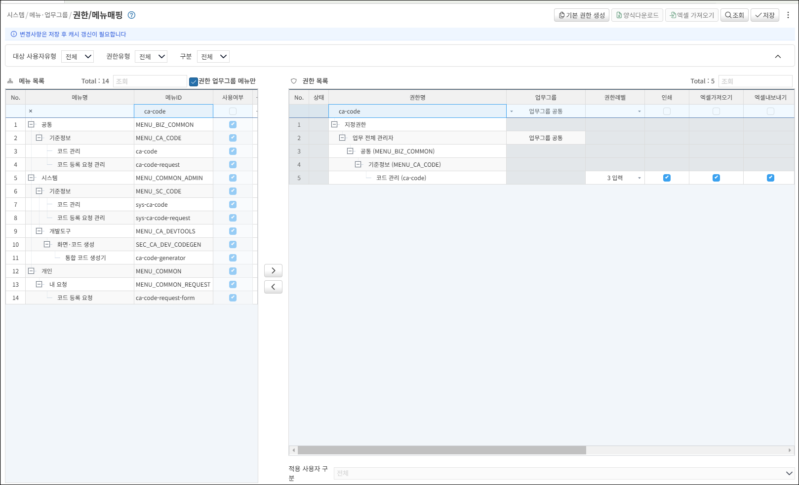
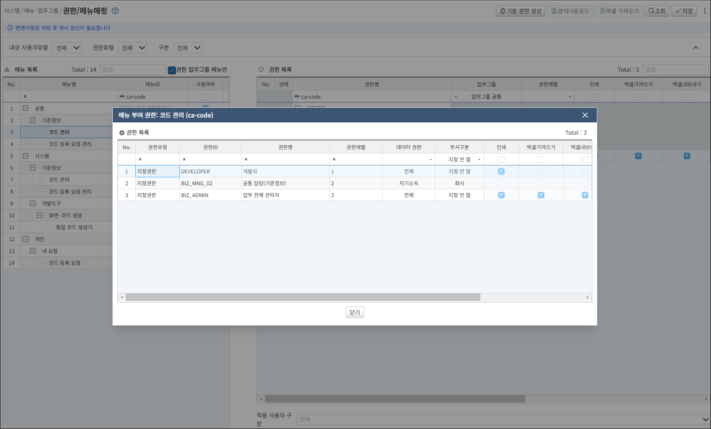

- 메뉴경로 : [시스템] 메뉴·업무그룹 > 권한/메뉴매핑
- 프로그램이름 : sys-ca-role-service
- 프로그램경로 : /page/sys-ca-role-service
- 화면

  
  

# TODOS
## 프로그램 찾기 컬럼 통일
- 메뉴목록 그리드는 메뉴ID컬럼에서 ca-code를 필터하고 권한목록 그리드는 권한명컬럼에서 ca-code를 필터한다. 가이드문구가 없어 인지 불가.
- 권한목록 그리드 아래의 적용 사용자 구분 항목 용도 가이드 필요.
- 메뉴목록 그리드의 메뉴명, 메뉴ID, 사용여부 컬럼을 더블클릭하면 메뉴 부여 권한 팝업이 표시되는데 이에 대한 가이드 필요.
- 권한목록 그리드의 업무그룹컬럼의 selectbox는 권한레벨, 부서구분, 데이터권한의 selectbox와 다르게 selectbox객체인식 불가로 조치필요.