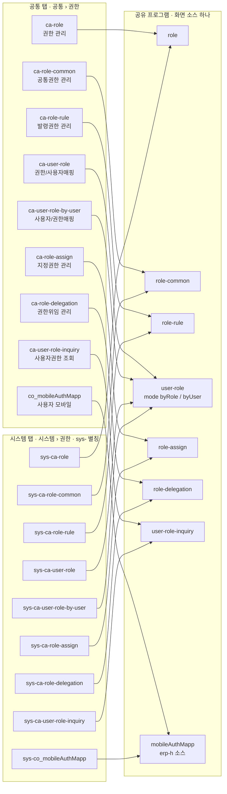
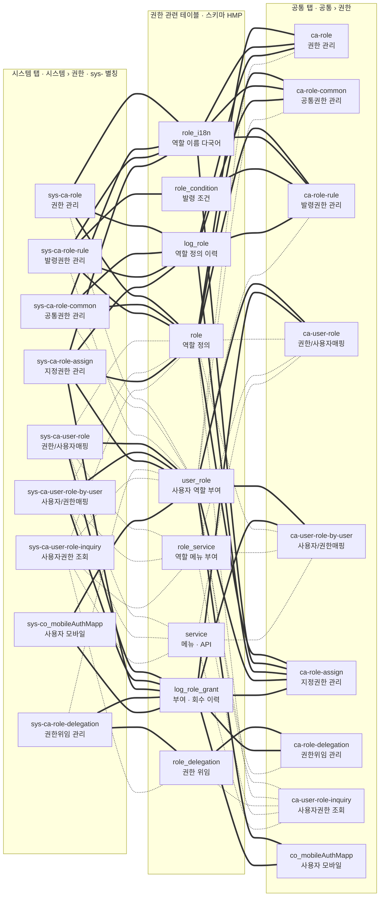
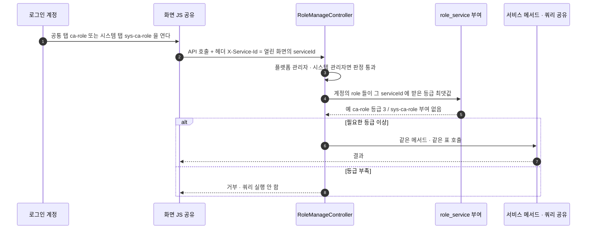
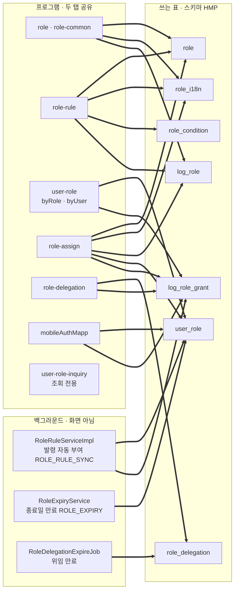
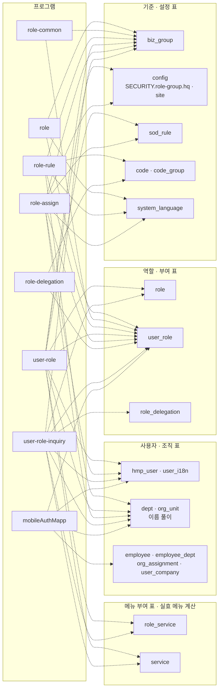
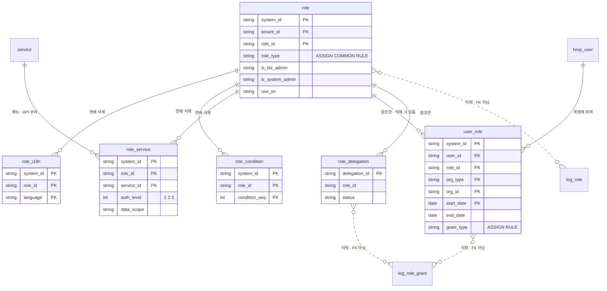

# erp-h 권한 프로그램 ↔ DB 테이블 관계 다이어그램 (공통 탭 · 시스템 탭)

> 작성 2026-11-16 · 근거: `erph-role-program-db-tables.md`(백엔드 소스 기준 정리) · 소스 `platform-hmp`(hmp-core) · erp-h `co_mobileAuthMapp`
> Mermaid 다이어그램이다. VS Code 는 기본 미리보기에서 그리지 않으므로 Mermaid 지원 확장(예: Markdown Preview Mermaid Support)이나 GitHub·GitLab 에서 본다.
> 소스를 읽어 만든 것이고 DB 를 조회해 확인하지 않았다. 표의 FK 는 확인하지 못해 엔티티 매핑 기준으로 그렸다.

## 1. 메뉴 화면 → 프로그램: 두 탭이 같은 프로그램을 공유한다

공통 탭의 화면 9개와 시스템 탭의 `sys-*` 별칭 9개가 **프로그램 8개**를 함께 쓴다. 사용자권한 매핑 두 화면(`byRole`/`byUser`)은 프로그램 `user-role` 하나다.

- 별칭은 원본의 `program_id` 를 복사하고 `params` 에 `sharedProgram:true` 를 더한 행이다.
- 같은 프로그램이라 부르는 API · 서비스 · 쿼리 · 표가 모두 같다(아래 2·3절).

## 1-1. 테이블을 가운데 두고 보기: 왼쪽 시스템 탭 · 오른쪽 공통 탭

권한 관련 테이블 9개를 가운데 두고, 왼쪽에 시스템 탭의 `sys-*` 화면, 오른쪽에 공통 탭의 화면을 놓았다. 두 쪽의 같은 화면이 **같은 테이블에 같은 방식으로 연결**된다.

- 굵은 선 `===` : 쓰기(INSERT·UPDATE·DELETE) · 점선 `-.-` : 읽기(SELECT)
- 가운데 표는 이 9개 프로그램이 읽거나 쓰는 권한 관련 표만 골랐다. 기준·설정 표(`biz_group` · `config` · `code` …)와 사용자·조직 표는 4절에 있다.
- `role_service` · `service` 는 이 프로그램들이 읽기만 한다(실효 메뉴 계산). 쓰는 화면은 「권한/메뉴매핑」이다.

읽는 법
- 왼쪽과 오른쪽에서 같은 이름의 화면(예: `sys-ca-role` ↔ `ca-role`)은 **선이 닿는 표가 같다.** 이것이 「같은 테이블 · 같은 쿼리」의 그림이다.
- 다른 것은 선이 아니라 화면 쪽 노드가 받은 `role_service` 부여다(2절). 선 자체는 두 쪽이 같아도 계정에 따라 왼쪽만 또는 오른쪽만 열릴 수 있다.
- `user_role` 에 굵은 선이 모이는 화면: `ca-user-role` · `ca-user-role-by-user` · `ca-role-assign` · `co_mobileAuthMapp`. `role` 에 굵은 선이 모이는 화면: `ca-role` · `ca-role-common` · `ca-role-rule` · `ca-role-assign`.
- 가운데 선이 가장 많은 화면은 `ca-role-assign`(쓰기 5)과 `ca-user-role-inquiry`(읽기 5)다.

## 2. 접근 판정: 쿼리는 같고 허용 여부만 serviceId 별로 다르다

- 판정 기준은 **호출한 화면의 serviceId** 이고 쿼리 파라미터가 아니다. 쿼리 파라미터는 로그인 정보(법인 범위 · 시스템 ID)와 화면 `params`(`mode` · `systemScope`)로 정해진다.
- `AL0` 표시가 붙은 읽기 API 는 이 판정 대신 메서드 안의 역할 관리자 판정을 쓴다.

## 3. 프로그램 → 테이블 쓰기 관계

굵은 선은 INSERT·UPDATE·DELETE 이다. 조회 전용 프로그램(`user-role-inquiry`)은 쓰는 표가 없다.

- `user_role` 에 쓰는 경로는 이 외에 권한 신청 승인(`ca-role-request`, 이 문서 범위 밖)도 있다.
- 부여·회수·위임 이력(`log_role_grant`)과 역할 정의 이력(`log_role`)은 별도 트랜잭션(`logTx`)으로 저장된다.

## 4. 프로그램 → 테이블 읽기 관계 (표를 묶어서)

점선은 SELECT 이다. 쓰는 프로그램도 읽기 대상이 많아 표를 성격별로 묶었다.

## 5. 표 사이의 관계 (엔티티 매핑 기준)

`Role` 엔티티의 `i18ns` · `conditions` · `roleServices` 는 `cascade = ALL, orphanRemoval = true` 이다. `user_role` · `role_delegation` 은 역할 쪽에서 연쇄되지 않고 `role` 을 가리키기만 한다(`@ManyToOne`).

- 점선 관계(`log_*`)는 이력 기록이며 DB 가 외래키로 묶는지는 확인하지 못했다.
- `role_service` 는 이 9개 프로그램이 직접 쓰지 않는다. 쓰는 화면은 「메뉴·업무그룹 › 권한/메뉴매핑」(`ca-role-service`)이고, 이 문서의 대상에서 뺐다.
- **역할을 삭제하면** `role_i18n` · `role_condition` · `role_service` 가 함께 지워지고 `user_role` 은 남는다. 삭제 전에 `user_role` 을 정리하는 것이 안전하다.

## 6. 정리

| 질문 | 답 |
|---|---|
| 공통 탭과 시스템 탭이 같은 표를 쓰는가 | 같다. 같은 프로그램 · 같은 API · 같은 쿼리 |
| 두 탭의 차이 | 호출 화면 serviceId 에 받은 `role_service` 부여(허용 판정)와 화면 `params` |
| 쓰기가 가장 많은 프로그램 | `ca-role-assign` — 역할 정의 4표 + 부여 2표 |
| 쓰기가 없는 프로그램 | `ca-user-role-inquiry` |
| `user_role` 을 쓰는 프로그램 | `user-role`(두 화면) · `role-assign` · `mobileAuthMapp` + 백그라운드 `RoleRuleServiceImpl` · `RoleExpiryService` |
| 이 9개가 쓰지 않는 관련 표 | `role_service`(권한/메뉴매핑 화면) · `role_request`·`role_request_target`(권한 신청) · `log_role_service` |

## 7. 확인하지 못한 것

- 실제 DB 의 FK·인덱스. 5절의 관계선은 엔티티의 `@OneToMany`/`@ManyToOne` 매핑이다.
- `role_delegation` 의 컬럼 이름(`delegation_id` 등)은 정확한 PK 칸을 확인하지 않고 단순화했다.
- 별칭 `sys-*` 의 `service.params` 값이 원본과 같은지.
- 4절의 `user_role` · `role` 읽기 중 일부(법인 범위 검사 등)는 하부 쿼리를 따라가지 않아 생략했다.
