# 01 시나리오
## 0101 계정 h.dev01에는 role이 DEVELOPER만 있다.
-  [0301_권한관리](../03_role설정프로그램/0301_권한관리/0301_권한관리.md)보다는  [0304_권한-사용자매핑](../03_role설정프로그램/0304_권한-사용자매핑/0304_권한-사용자매핑.md)와 [0305_사용자-권한매핑](../03_role설정프로그램/0305_사용자-권한매핑/0305_사용자-권한매핑.md)에서 확인이 유리하다.
## 0102 h.dev01 계정에 role CS_MNG_01를 추가한다.
## 0103 h.dev01으로 로그인된 웹브라우저를 새로고침하여 메뉴변경여부 확인.
## 0104 h.dev01으로 다시 로그인하여 메뉴변경여부 확인.
## 0105 h.dev01에 대하여 DEVELOPER, CS_MNG_01를 제거후 BIZ_ADMIN만 적용
## 0106 h.dev01에 대하여 BIZ_ADMIN를 제거후 SYS_ADMIN만 적용
## 0107 h.dev01에 대하여 SYS_ADMIN 제거후 DEVELOPER만 적용

---

# 확인
## 0201 계정 h.dev01의 role 확인.
- 사용자-권한매핑
  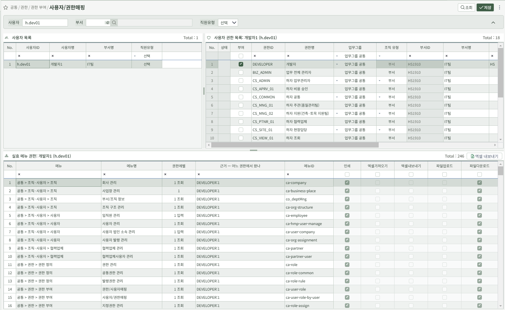
- 권한-사용자매핑에서 확인.
  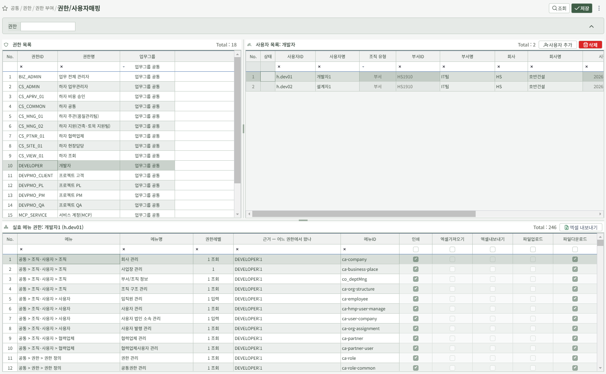

## 0202 h.dev01 계정에 role CS_MNG_01를 추가.
- 실효 메뉴 권한이 246개에서 305개로 증가.  
  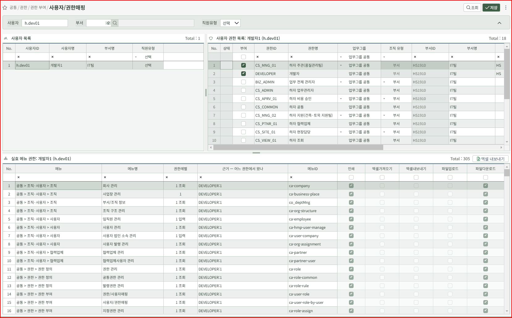
  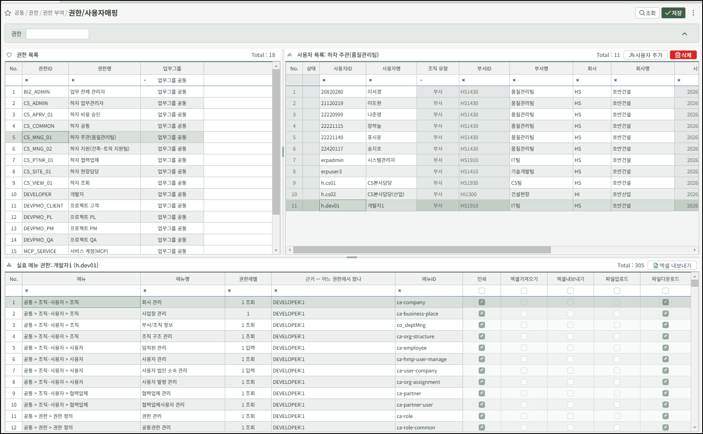

## 0203 h.dev01으로 로그인된 웹브라우저를 새로고침하여 메뉴변경여부 확인.  

## 0204 h.dev01으로 다시 로그인하여 메뉴변경여부 확인.
- 하자의 상단메뉴와 왼쪽 메뉴트리 확인.
  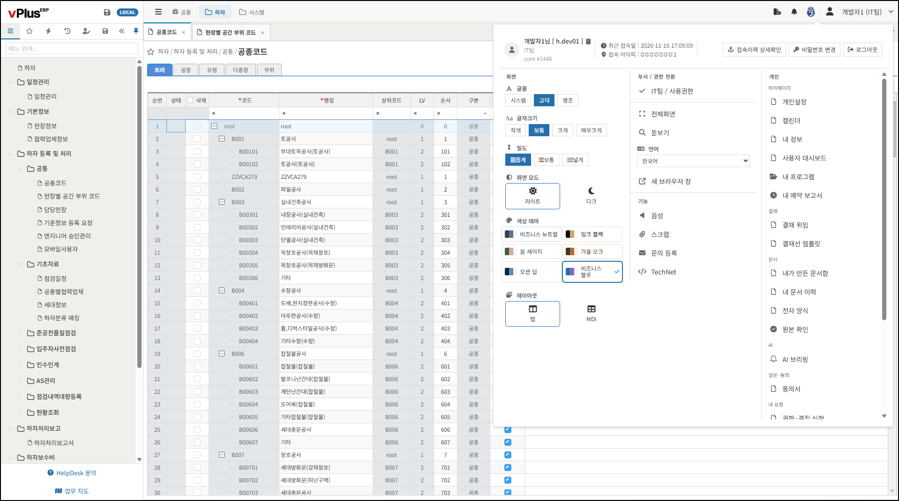
- 조회만 가능.
  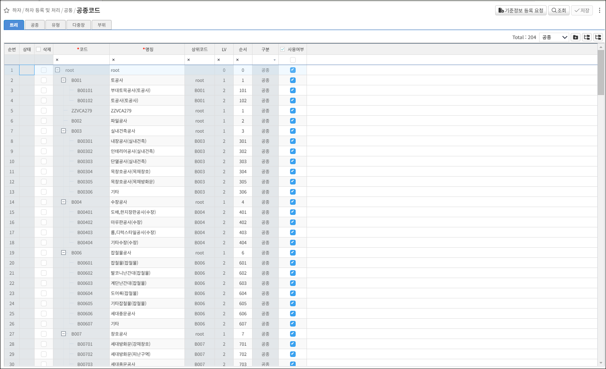
- 현장코드파인더 조회 없음.  
  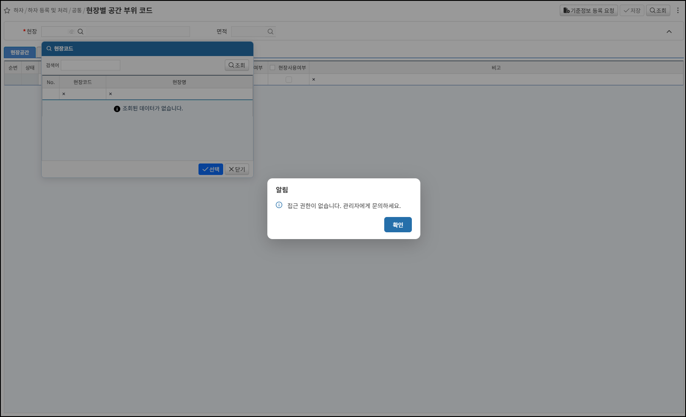

 ## 0205 h.dev01에 대하여 DEVELOPER, CS_MNG_01를 제거후 BIZ_ADMIN만 적용 
- 실효 메뉴 권한이 305개에서 80개로 증가.
  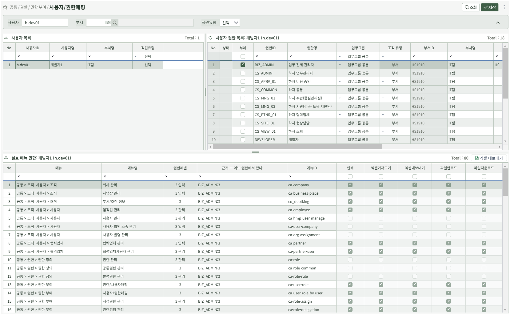
- 각 role에서 적용 확인
  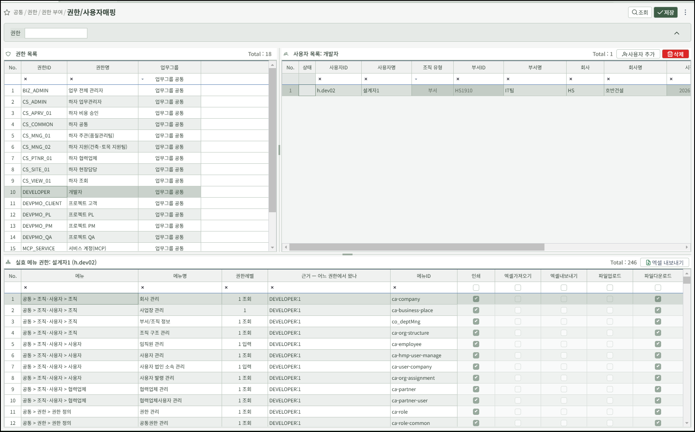
  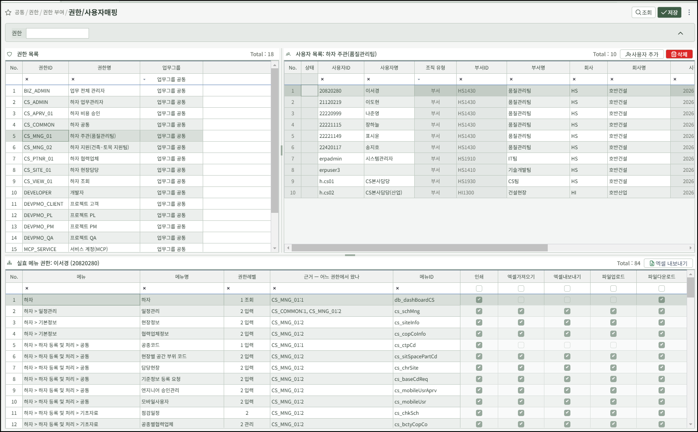
  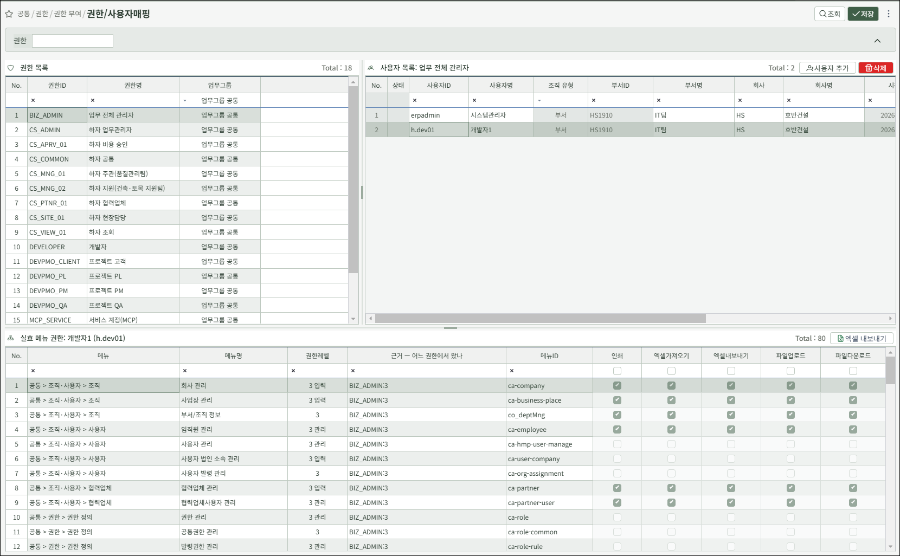
- h.dev01에 대하여 다시 로그인후 메뉴 확인
  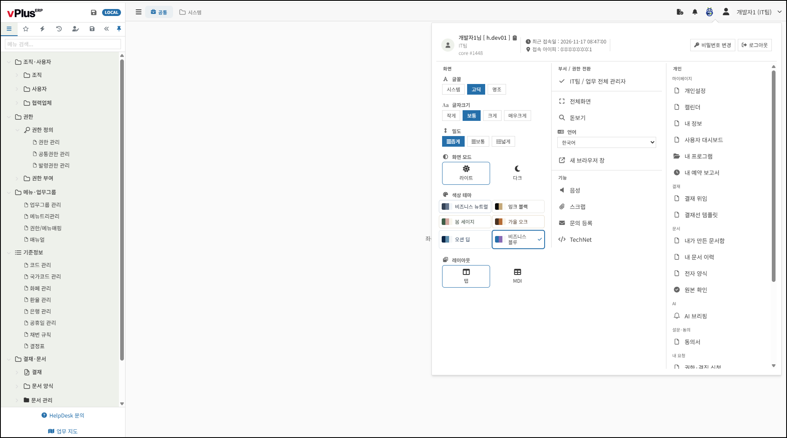
- h.dev01에 대하여 공통(상단)의 메뉴트리와 저장권한 확인.
  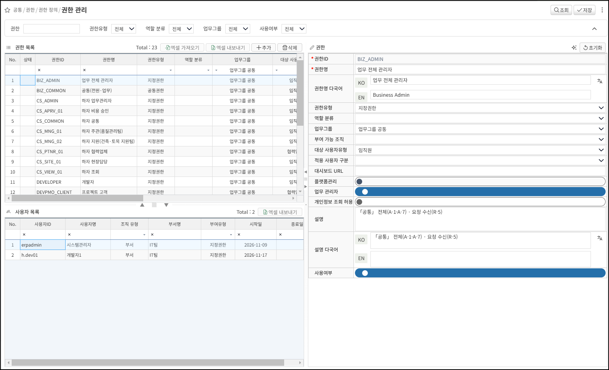
- h.dev01에 대하여 시스템(상단)의 메뉴트리는 개발도구의 테스트노드 일부항목(erpadmin은 10개)만 표시됨을 확인.
  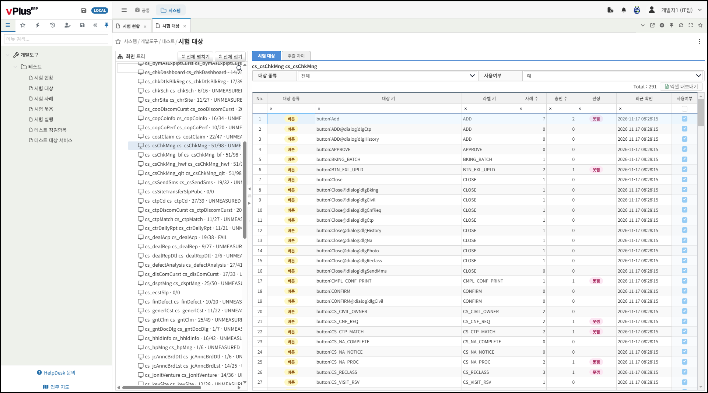)
  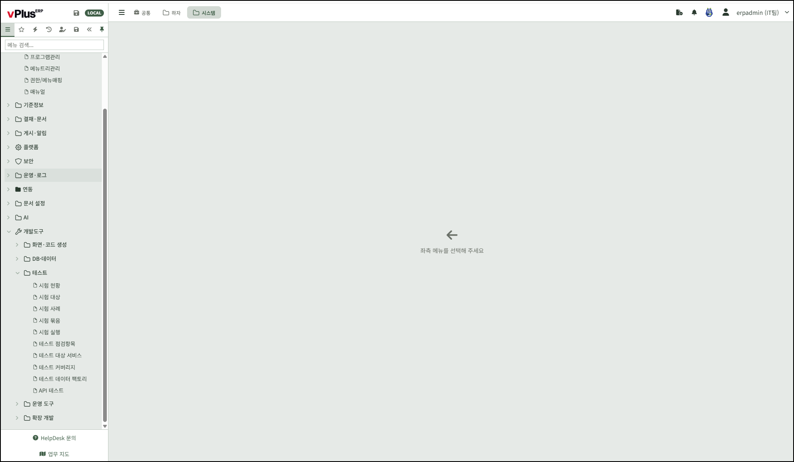)  

## 0206 h.dev01에 대하여 BIZ_ADMIN를 제거후 SYS_ADMIN만 적용  