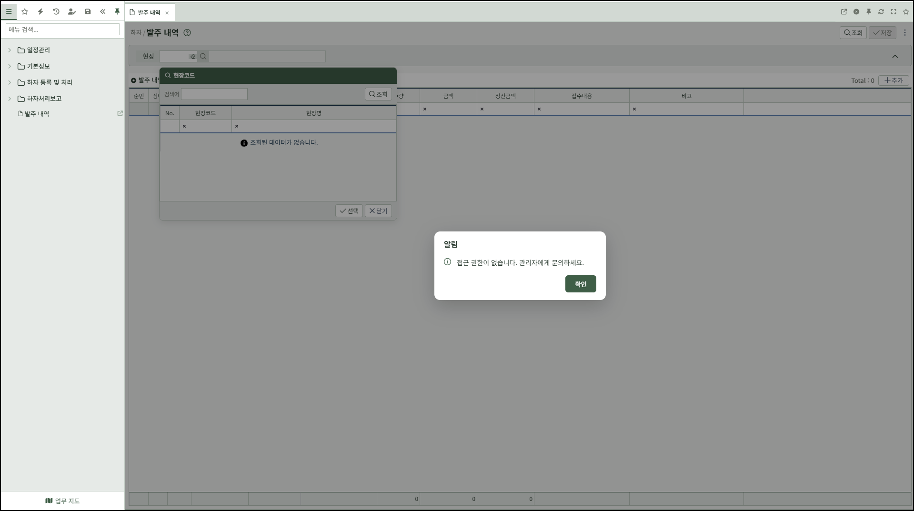
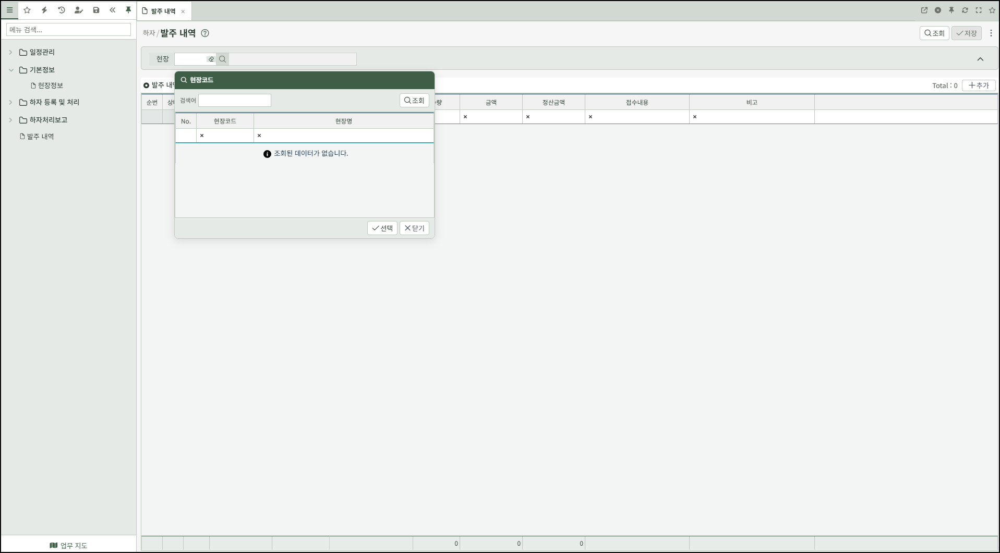
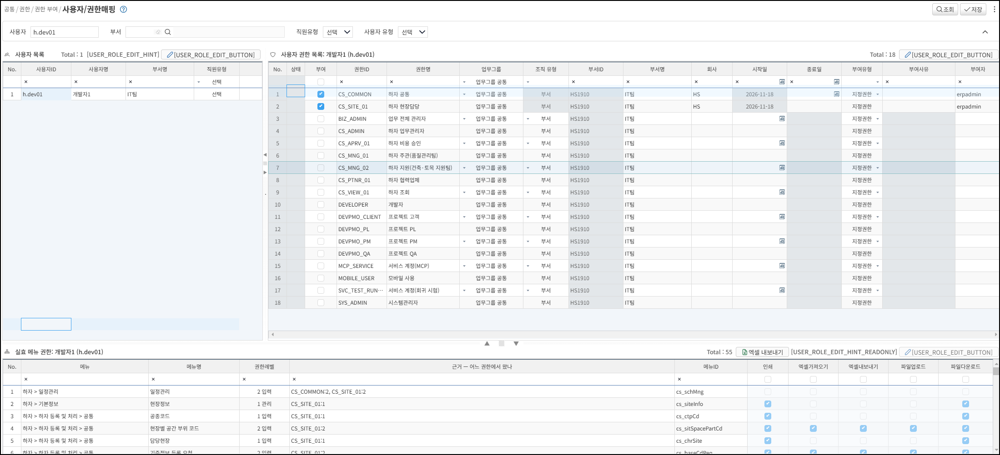
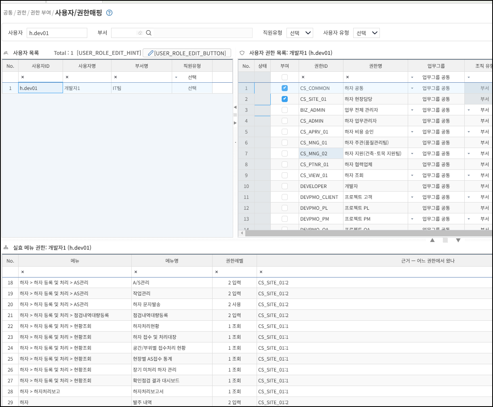
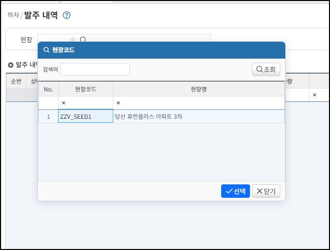
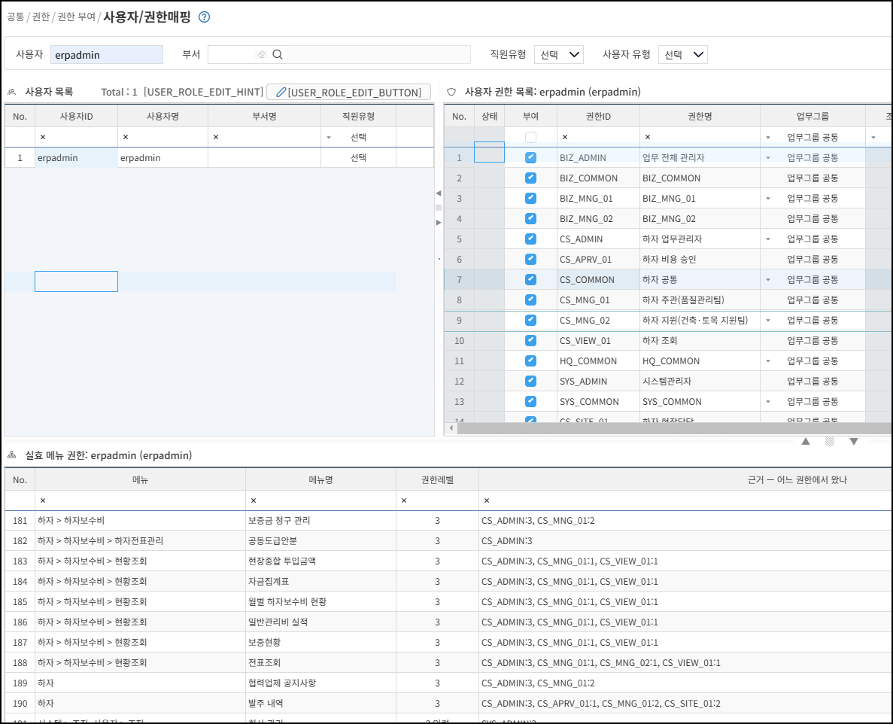
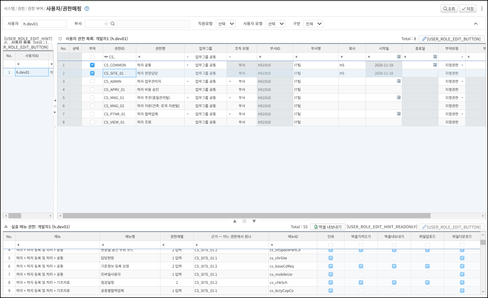
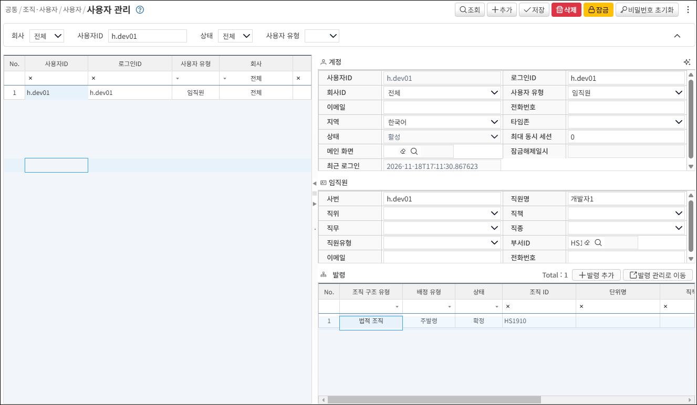
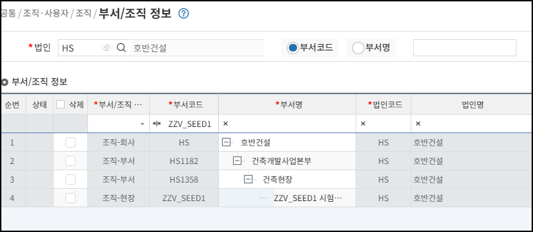

# 03 h.dev01 — 하자 › 발주 내역의 현장코드 파인더 접근 (CS_SITE_01 + CS_COMMON)

> 정리 2026-11-18 · 소스·문서 근거는 `products-erp-h`(db/common-admin · app/src/main · docs/work/common-admin) · 이 문서의 원인 설명은 **소스·시드 파일·화면 캡처 기준**이고 DB를 직접 조회하지 않았다.
> 앞 문서: [01.md](01.md)(role 변경 시나리오) · 메뉴 트리 저장: `../01_계정별메뉴/erph-menu-dev01[CS_SITE_01].md` · `erph-menu-dev01[CS_SITE_01+CS_COMMON].md`

## 0301 상황
- `h.dev01`에 role `CS_SITE_01`(하자 현장담당)을 설정하고 하자 › **발주 내역**(`cs_ordDtls`)을 연다. 이 role로 하자 메뉴 29개가 보인다.
- 발주 내역의 조회조건 **현장코드 파인더**(`CsSiteFinder`)가 동작하지 않는다. 같은 화면을 erpadmin으로 열면 파인더에 `ZZV_SEED1`(당산 휴먼플러스 아파트 3차)이 보인다.
- 두 단계로 증상이 바뀌었다 → 0302(접근권한 없음) → 0303(경고는 없는데 목록이 빔).

## 0302 증상 1 — `CS_SITE_01`만 있을 때: 「접근 권한이 없습니다」

- **원인:** 파인더가 `/csz/getGrd_CsCodeFind`를 호출한다. 서버는 URL 첫 마디 `csz`를 대상 서비스로 보고 role의 `role_service`에서 `csz` 부여를 찾는다.
  - `CS_SITE_01`은 `csa`·`csb`·`csc`·`csd`·`cse`·`csg`만 갖고 `csx`·`csz`는 **`CS_COMMON`만** 갖는다(`P3-05-role-service.sql` 1131~1134행).
  - 설계서(`S6-role-codes.md`)도 `CS_COMMON`을 「cs 역할 보유자 전원에게 동반 부여」하는 공용 API 앵커·파인더·팝업 role로 적고 있다.
  - 화면(`cs_ordDtls`)은 `CS_SITE_01`에도 부여돼 있어 메뉴로 열리고 파인더만 막힌다.
- **직접 확인:** `X-Service-Id: cs_ordDtls`로 호출하면 `/csz/getGrd_CsCodeFind`는 **403**, 발주 조회 `/csc/getGrd_OrdDtls`는 200이었다.
- **조치:** `h.dev01`에 `CS_COMMON`을 함께 부여(사용자/권한매핑) → 재로그인. 이후 같은 호출이 **200**으로 바뀌었다.

## 0303 증상 2 — `CS_COMMON`을 더한 뒤: 경고는 없는데 목록이 빔

- **직접 확인:** 파인더 API 응답이 `{"data":[]}`(200). 현장정보 목록 `/csb/getGrd_SiteInfoList`·담당현장 `/csc/getGrd_ChrSite`도 0행이었다. 접근은 되는데 **보이는 현장이 0개**라는 뜻이다.
- **원인(데이터 범위):**
  - 현장 표 `TCSA_SITE_INFO`는 `DATA_SCOPE`에 `dept+org=SITE_CD`로 선언돼 있어(`P20-data-scope-tables-mssql.sql`) 로그인 계정의 범위 안 현장만 나온다.
  - `CS_SITE_01`의 `cs_ordDtls` 데이터 범위는 **`SELF` / `PROJECT`**(`P30-row-scope-intent-mssql.sql`) — 「내가 role을 부여받은 조직(현장)」만 보인다.
  - `h.dev01`의 `CS_SITE_01` 부여 조직은 **부서 `HS1910`(IT팀)** 이다(아래 캡처 조직 유형 `부서`). 이 범위에는 현장이 없다. 담당현장 등록도 0건이다(11/09 결정: 0건이면 현장을 못 본다).
  
  
  - 현장담당 시험계정 `h.site01`은 부여 조직이 현장 `B6H132`라서 그 현장만 보인다(`TEST-USERS.md`).

### erpadmin과 비교 (role에 의한 차이)

| | erpadmin | h.dev01 |
|---|---|---|
| 보유 role | `BIZ_ADMIN` · `CS_ADMIN` · `CS_MNG_01/02` · `CS_APRV_01` · `CS_VIEW_01` · `CS_SITE_01` · `CS_COMMON` · `SYS_ADMIN` 등 14개 이상 | `CS_COMMON` · `CS_SITE_01` |
| 발주 내역 근거 | `CS_ADMIN:3 · CS_APRV_01:1 · CS_MNG_01:2 · CS_SITE_01:2` | `CS_SITE_01:2` |
| 현장 범위 | `CS_ADMIN`이 `ALL`(시드 기준) → 제한 없음 | `CS_SITE_01` `SELF`/`PROJECT` + 부여 조직 부서 → 0개 |

- 판정 규칙(`PLATFORM.md` §6-5): 지금 연 화면의 `role_service` 행을 role별로 모아 판정하고 **한 role이라도 `ALL`이면 제한 없음**이다.
- 주의: `CS_SITE_01`의 발주 내역 등급이 캡처는 2, 시드 파일(`P3-05`)은 1이다. 시드와 현재 DB가 다르므로 현재 데이터 범위 값은 시스템 › 메뉴·업무그룹 › **권한/메뉴매핑**에서 `cs_ordDtls`의 데이터 권한·부서구분 열로 확인한다.

## 0304 같이 확인된 점 (담당현장 등록 전)
- **담당자ID 팝업에서 `h.dev01`이 안 나온다.** 담당현장의 담당자 파인더(`csUser`)는 레거시 `VPLUS40.TCOZ_USR_INFO`에서 `USE_YN='1'` 이고 `USR_ID LIKE '3%'` 인 계정만 찾는다(`erp-csz-csCodeFind.xml selectCsUser`). `h.`로 시작하는 HMP 사용자는 설계상 나오지 않는다. → **담당자ID 칸에 직접 입력**하면 된다(저장 때 존재 검사 없음).
- **사용자/권한매핑에서 `CS_SITE_01`의 조직을 현장으로 바꾸는 기능이 보이지 않는다.** 부여된 행의 조직 유형·부서ID 칸이 잠겨 있다(`부서` / `HS1910`).
  
  - 현장 단위 부여는 **담당현장 등록이 대신** 한다. 담당현장을 저장하면 `ChrSiteGrantService`가 `CS_SITE_01`을 그 현장 조직단위로 자동 부여한다(출처 `CS_CHR_SITE`, 11/17 구현 · `ISSUES-20261109.md` 399행 이하).
  - 자동 부여는 계정 유형이 직원(`EMPLOYEE`)이면 `CS_SITE_01`을 고른다. `h.dev01`은 사용자 유형 임직원이다.
  
- 기존 `CS_SITE_01`(부서 `HS1910`, 종료일 없음)은 새 현장 부여와 충돌하지 않는다. 중복 판정 키가 `조직단위 + 현장코드 + 역할 + 시작일`이라 서로 다른 행이다.

## 0305 해결 방법 (두 가지)
| | 방법 A | 방법 B |
|---|---|---|
| 내용 | 담당현장 등록 → `ZZV_SEED1` 현장 단위로 `CS_SITE_01` 자동 부여 | 사용자/권한매핑에서 범위가 넓은 role 추가 (`CS_MNG_01` 법인 `SELF`/`COMPANY` · `CS_ADMIN` `ALL`) |
| 범위 | 지정한 현장 하나 | 법인 전체 또는 전체 |
| 한시적 | 담당현장 종료일 · 행 삭제로 회수 | 사용자/권한매핑의 종료일 칸 |
| 부작용 | 적음 | 메뉴가 크게 늘어남(`CS_ADMIN` 등급 3). `CS_SITE_01`과 본사 성격 role을 같은 조직에 주면 거부될 수 있음(문서 기록 · 이 조합은 미확인) |

- 특정 현장만 한시적으로 열려면 **방법 A**, 파인더 동작만 빨리 시험하려면 방법 B.

## 0306 방법 A 진행 순서와 현재 상태
1. **현장 존재 확인 — 완료.** 공통 › 조직·사용자 › 조직 › **부서/조직 정보**(`co_deptMng`, `/page/co_deptMng`)에서 `ZZV_SEED1`이 조직-현장으로 있고 `HS`(호반건설) › 건축개발사업본부(`HS1182`) › 건축현장(`HS1358`) 아래임을 확인했다.
   
   - 처음에 「조직 구조 관리」(`ca-org-structure`)로 안내했으나 그 화면은 조직 **구조 유형**(기본·겸직 등)을 정의하는 곳이라 맞지 않았다. 담당현장 저장은 `HMP.org_unit`의 PROJECT 구조에 현장이 있는지 검사한다(`assertProjectSite`).
2. **담당현장 등록 — 대기.** erpadmin으로 하자 › 하자 등록 및 처리 › 공통 › 담당현장 → 추가 → 현장 `ZZV_SEED1`(파인더) → 담당자ID `h.dev01` 직접 입력 후 Tab(Enter를 누르면 팝업이 열림) → 종료일 → 저장.
3. **부여 확인 — 대기.** 사용자/권한매핑에서 `h.dev01`의 `CS_SITE_01`이 현장 단위로 추가됐는지 확인.
4. **재로그인 후 확인 — 대기.** `h.dev01`로 다시 로그인해 발주 내역 현장코드 파인더에 `ZZV_SEED1` 1건이 보이는지 확인.

## 0307 남은 확인과 주의
- **종료일:** 담당현장의 종료일 칸은 화면에서 숨겨져(`hidden`) 있고 새 행 기본값이 **오늘**이다. 그대로 저장하면 부여가 오늘 하루만 유효하다. 며칠 이상 열려면 `chrSite.js`의 `END_DT` 열을 보이게 하는 수정이 필요하다(열 표시 기능으로 보이는지는 미확인).
- **자동 부여 배포 여부 미확인:** 11/17 erp-h 배포(`8e849ec`)와 sql-h `P34` 설정 적용이 전제다. 저장 뒤 부여 행이 안 생기면 배포 상태부터 확인한다.
- **저장 오류 코드:** `CSB_END_DT_REQUIRED`(종료일 비움) · `CS_CHR_SITE_NO_ORG_UNIT`(현장이 PROJECT 조직단위 아님) · `CS_CHR_SITE_NO_GRANT_ROLE`(계정 유형에 맞는 역할 없음).
- **권한:** `h.dev01`은 `CS_SITE_01`의 `cs_chrSite` 등급이 1(조회)이라 담당현장을 저장할 수 없다. 담당현장 등록은 erpadmin 등 관리자로 한다.
- **종료 후:** 현장 부여가 끝나도 기존 `HS1910` 단위 `CS_SITE_01`(종료일 없음)이 남아 하자 메뉴 29개는 계속 보이고 현장 데이터만 0개가 된다. 메뉴까지 닫으려면 그 부여의 체크를 해제하고 저장한다.
- **방법 B 참고:** `ZZV_SEED1`은 법인 `HS` 소속이고 `h.dev01`의 부서 `HS1910`도 `HS`라서 `CS_MNG_01`(법인 범위)로 보일 가능성이 있으나 시험하지 않았다.
