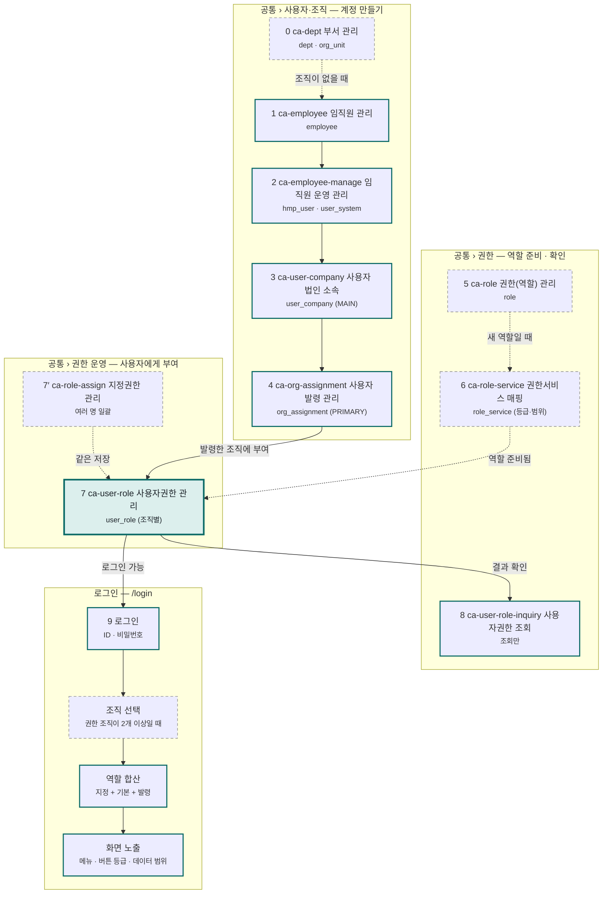
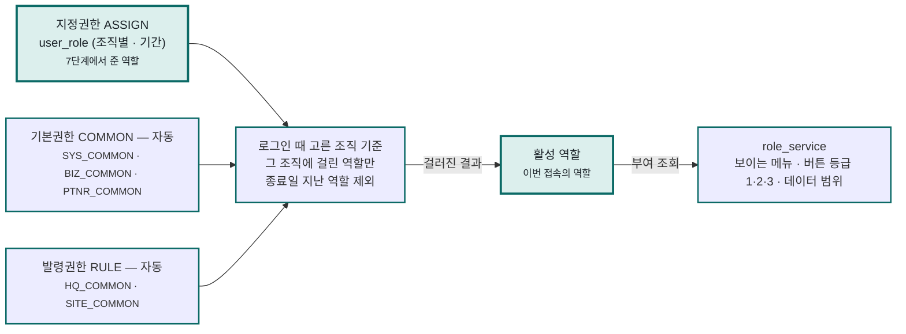
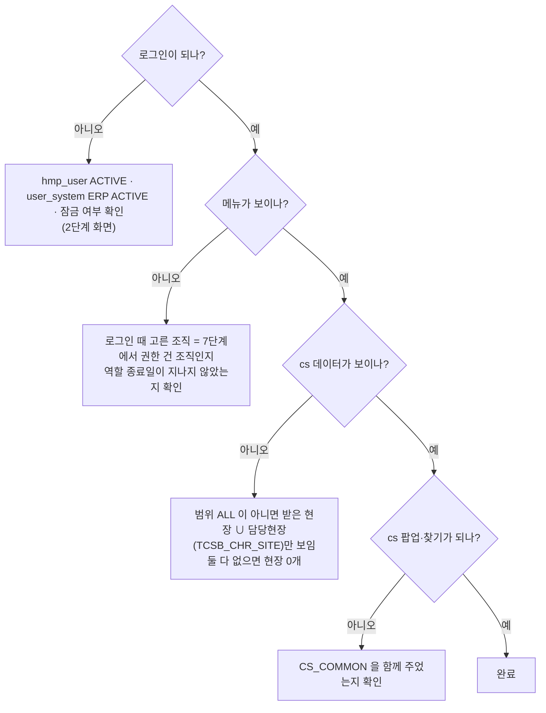

# erp-h 계정 추가 → 권한 부여 → 로그인 작업 흐름

> 작업자: 업무 전체 관리자(`BIZ_ADMIN`) · 작업 장소: 개발서버 `https://erp-h.hmplus.io`
> 근거: 메뉴 경로 `S6-menu.tsv` · 화면 설명 `dev-guide/SCREENS-COMMON.md` · 등급 `dev-guide/auth-def/*.md` · 계정 구성 `db/common-admin/P3-03-users.sql`
> 비밀번호는 이 문서에 적지 않는다(`dev-guide/TEST-USERS.md` 규칙).

## 1. 메뉴 경로별 작업 흐름

- 상자 하나가 화면 하나다. 번호는 작업 순서다. 둘째 줄은 그 화면이 저장하는 표다.
- 실선 상자 = 꼭 하는 단계 · 점선 상자 = 필요할 때만 · 굵은 상자 = 권한이 실제로 생기는 곳.

- 권한은 사람이 아니라 **조직**에 걸린다. 4단계에서 발령한 부서·현장을 7단계에서 그대로 골라 역할을 준다.
- 이미 있는 역할(`CS_MNG_01` 등)을 줄 때는 5·6단계를 건너뛴다.

## 2. 로그인할 때 권한이 정해지는 방식

- 기본권한·발령권한은 부여하지 않는다(자동).
- 하자(cs) 역할을 줄 때는 `CS_COMMON` 을 **직접 함께** 준다 — 유형이 ASSIGN 이라 자동으로 붙지 않는다.

## 3. 화면별 작업 내용

| 단계 | 메뉴 경로 | 화면 | 할 일 | 저장하는 표 | 필요한 등급 |
|---|---|---|---|---|---|
| 0 | 공통 › 사용자·조직 | `ca-dept` 부서 관리 *(조직이 없을 때)* | 소속시킬 부서·현장이 없으면 먼저 만든다 | `dept` · `org_unit` | 저장 2 |
| 1 | 공통 › 사용자·조직 | `ca-employee` 임직원 관리 | 사번·이름·법인·부서 등록. 예: HS / HS1930 CS팀 | `employee` | 저장 2 |
| 2 | 공통 › 사용자·조직 | `ca-employee-manage` 임직원 운영 관리 | 로그인 계정 등록(`h.<직무><번호>` · ACTIVE) · 비밀번호 초기화로 첫 비밀번호 설정 | `hmp_user` · `user_system`(ERP) · `user_i18n` | 저장 2 · 초기화 3 |
| 3 | 공통 › 사용자·조직 | `ca-user-company` 사용자 법인 소속 | 주소속 법인(MAIN) 확인 · 없으면 넣는다 | `user_company` | 저장 3 |
| 4 | 공통 › 사용자·조직 | `ca-org-assignment` 사용자 발령 관리 | 부서 또는 현장에 주소속(PRIMARY) 발령 | `org_assignment` | 발령 2 |
| 5 | 공통 › 권한 | `ca-role` 권한 관리 *(새 역할일 때)* | 지정권한(ASSIGN) 역할을 새로 만든다 | `role` | 저장 2 · 삭제 3 |
| 6 | 공통 › 권한 | `ca-role-service` 권한서비스 매핑 *(새 역할일 때)* | 역할에 메뉴 부여 · 메뉴마다 등급(1 조회 · 2 저장 · 3 삭제·특수)과 범위(ALL · COMPANY · SELF) | `role_service` | 부여 2 |
| 7 | 공통 › 권한 운영 | `ca-user-role` 사용자권한 관리 | 사용자 → 4단계의 조직 → 역할 배정(→) → 저장 · 「실효 메뉴 권한」으로 미리보기 | `user_role` · `log_role_grant` | 부여 2 |
| 7′ | 공통 › 권한 운영 | `ca-role-assign` 지정권한 관리 *(일괄)* | 역할 하나를 골라 받을 사용자를 한꺼번에 등록 | `user_role` | 부여 2 |
| 8 | 공통 › 권한 | `ca-user-role-inquiry` 사용자권한 조회 | 부여 결과(조직·역할·기간) 확인 | 조회만 | 조회 1 |
| 9 | 로그인 | `/login` | 새 계정으로 로그인 · 조직이 여럿이면 하나 고름 · 메뉴·저장 버튼·데이터 범위 확인 | — | — |

**서버가 막는 일**: 자기 자신에게 권한 주기 · `SYS_ADMIN` 역할 주기(시스템관리자만) · 같은 조직에 본사·현장 권한 함께 주기 · 한 조직에 현장 권한 2개.

## 4. 메뉴나 데이터가 안 보일 때

## 5. 확인하지 못한 것
- 2단계 등록 화면에 비밀번호 칸이 있는지는 보지 못했다(화면 소스가 hmp 에 있음). 칸이 없으면 「비밀번호 초기화」로 정한다.
- 화면 이름·등급은 문서 기준이며 개발서버 화면과 직접 대조하지 않았다.
