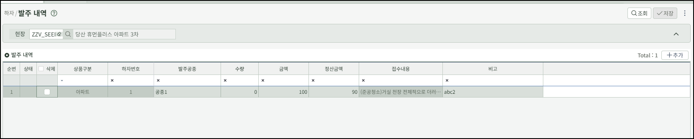

# 하자 > 발주 내역 요약 (2026-11-20)

---
## 0. 리뷰
- CRUD는 정상.
- 상품구분 컬럼의 selectbox에 공통코드는 적용되어 있으나 발주공종 컬럼에는 적용되지 않았다.
- 하자번호 채번 로직없음.

---

## 1. 화면
- 메뉴: 하자 › 발주 내역 (`cs_ordDtls`, `/page/cs_ordDtls`)
- 현장 선택 후 조회 → 하자 건별 발주 내역을 조회·추가·수정·삭제
- 그리드 컬럼: 순번 · 상태 · 삭제 · 상품구분 · 하자번호 · 발주공종 · 수량 · 금액 · 정산금액 등

## 2. AS-IS 컨버전 여부
**새로 작성된 화면** (컨버전 아님)
- `SCREEN-STATUS.md` 「이번 작업에서 새로 만든 것 (컨버전 화면 아님)」 목록에 포함
- 권한 판정 문서에 「AS-IS 매퍼 대응 없음」으로 명시
- 신규 메뉴 14개 중 하나 (등록 SQL `cs-44-ord-dtls-register.sql`)

## 3. 작성 이유
- H사 요구사항 **H-REQ-229 · 245 · 267** (RFP 6.2.3.5.2 · 6.2.3.6.2 · 6.2.3.8.7) 구현
- 요구 내용: 실행예산 상품구분(아파트·상가·오피스텔) 아래에 하자 건별 AS 상세 내역(공종·수량·금액) 등록
- AS-IS에 해당 기능이 없어 보강 기능 9번(배정·보수)으로 분류, 상태 「반영(A1~A3·A9·A18)」

## 4. 구현 요약
- 신규 테이블 `TCSB_ORD_DTLS` (하자 건 `ACP_SEQ` + 상품구분 `PRDT_DIV` 기준)
- 상품구분 선택지: 설정 `budget.product-divs`, 목록 밖 값은 서버가 저장 거부
- API: `/csc/getProductDivs` · `/csc/getGrd_OrdDtls` · `/csc/setGrd_OrdDtls`
- 하자처리 등록(`dealRepDtl`)·작업관리(`wrkCmplMng`)의 「발주 내역 탭」이 같은 API 사용
- 테이블(ERD)·Query·화면 구성·이벤트 흐름 다이어그램 등 상세 구조는 [02_발주내역_분석.md](02_발주내역_분석.md) 참고

## 5. 개발 현황
**구현·배포 완료, 일부 검증 남음** (문서 기록 기준: 2026-11-05~06 갱신, 이후 변경·배포 상태는 미확인)

| 구분 | 내용 | 근거 |
|---|---|---|
| 완료 | 화면·API·테이블 구현, 화면 저장 시험 통과(빌드 #9) | `SCREEN-STATUS.md` |
| 완료 | 조회·추가·수정·삭제 / 상품구분 선택·서버 검증 화면 확인 (시험 행 2건 제거) | `ADDED-FEATURES.md` A1~A3 |
| 완료 | 기능 9번(배정·보수) 「반영(A1~A3·A9·A18)」, 설계서 기능 1~18 구현 완료 | `H-CS-REDESIGN.md` |
| 검증 남음 | 정산금액(`SETL_AMT`): 나중(`cs-62`)에 추가된 칸이며 시험 절차(§3-1)에 항목 없음 → 저장 시험 기록 없는 것으로 보임(추정) | `ADDED-FEATURES.md` §3-1 |
| 검증 남음 | 하자처리 등록·작업관리의 발주 내역 탭: 「열기·조회 오류 0」까지만 확인 | `ADDED-FEATURES.md` A18 |
| 검증 남음 | 정산 품의 결재 상신: 화면은 있으나 상신 미실측 | `PI-AS-GAP-DESIGN.md` |
| 검증 남음 | 행 추가 방식 `:onAdd` 전환(11/06): 「다음 빌드 후 화면 재확인 대상」, 재확인 기록 못 찾음 | `ADDED-FEATURES.md` |
| 검증 남음 | 업무 데이터 시험: 시험 현장 `70H905` 접수 0건 → 실제 하자 건 연결 시험 없음 | `ADDED-FEATURES.md` §3 |

## 6. 확인 필요
- RFP 원문과 요구 대응표(`05-요구-화면-대응표.md`)는 저장소에 없음 (`D:/project/_archive/` 11/03 묶음에 보관) → 요구 문구 원문 대조 미실시
- 권한 시드가 SYS_ADMIN에만 있고 업무 역할은 비어 있음 (S5-cs-review P5 지적)

## 근거 파일 (products-erp-h)
- `docs/cs/SCREEN-STATUS.md` · `docs/cs/ADDED-FEATURES.md` · `docs/cs/H-CS-REDESIGN.md`
- `docs/work/common-admin/P30-ROW-SCOPE-JUDGEMENT-20261116.md` · `S5-cs-review.md`
- `app/src/main/resources/db/module/erp/install/mssql/cs-42-ord-dtls.sql`
- `app/src/main/java/hmplus/erp/cs/csb/service/OrdDtlsService.java`
