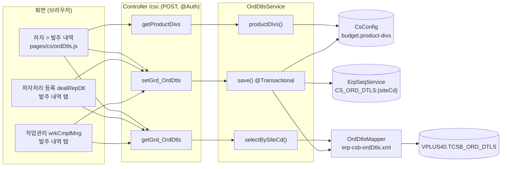
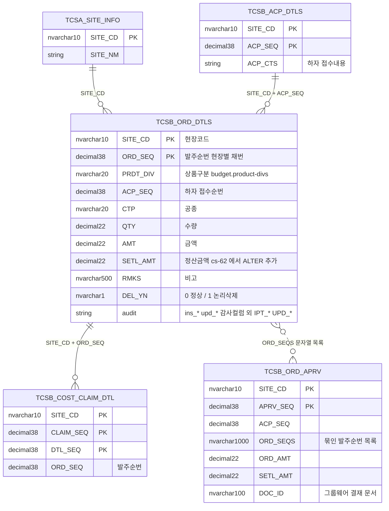
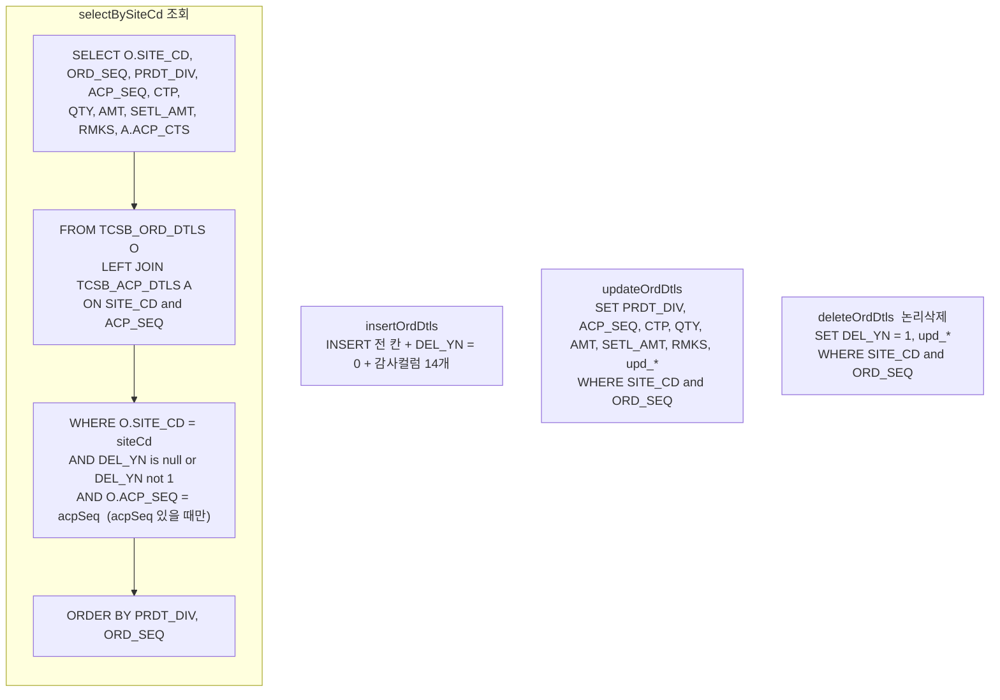
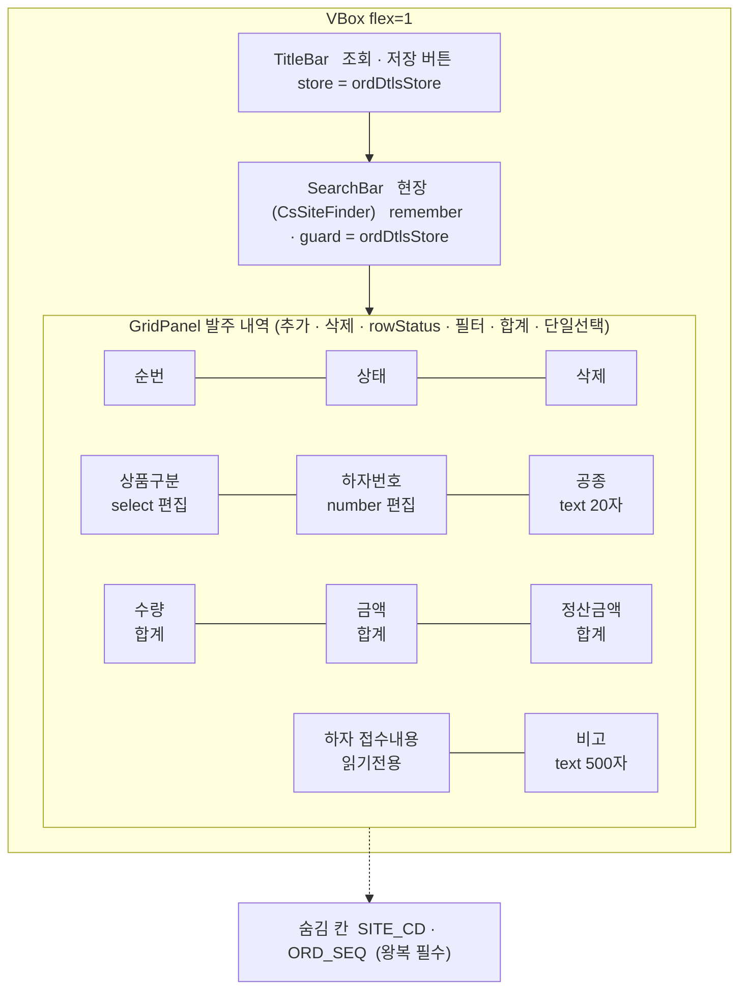
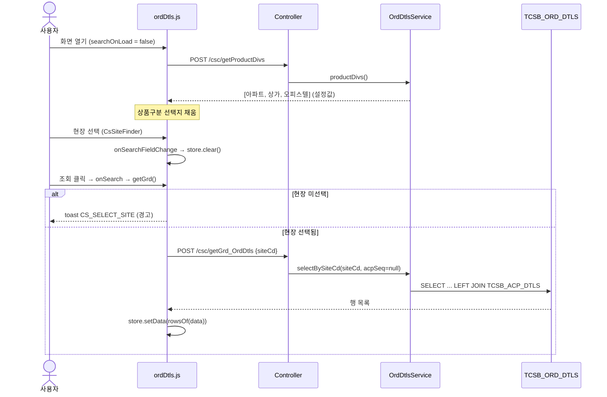
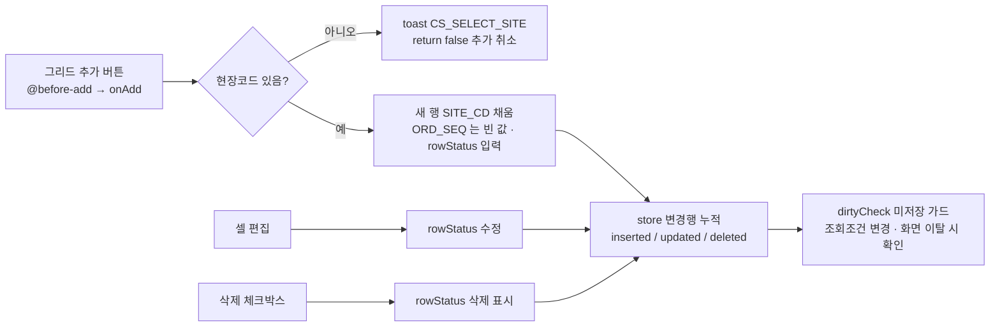
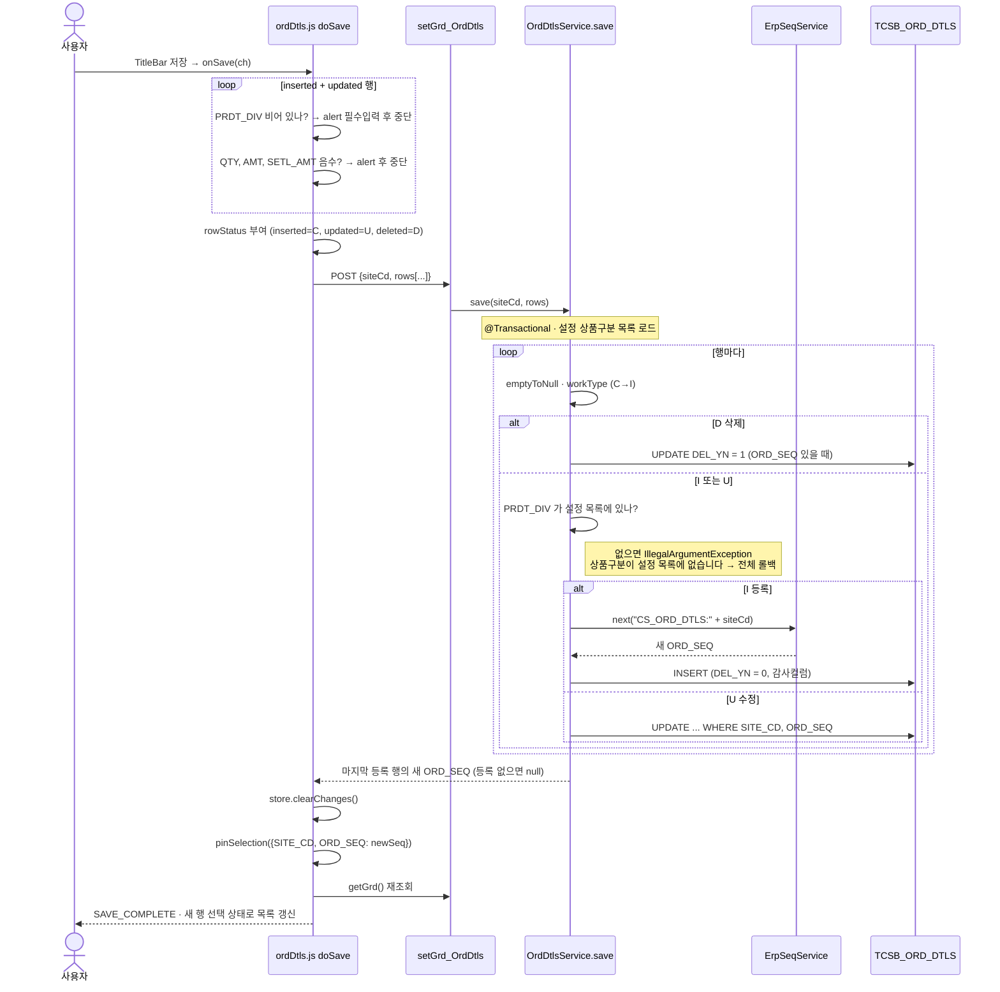

# 하자 > 발주 내역 — 테이블 · Query · 화면 · 이벤트 흐름 (2026-11-20)

> 대상: `products-erp-h` 의 `cs_ordDtls` (요구 H-REQ-229·245·267). 아래 다이어그램은 Mermaid 입니다(VS Code Markdown Preview Mermaid 확장, GitHub 등에서 렌더링).
> 근거 파일: `pages/cs/ordDtls.js` · `OrdDtlsController` · `OrdDtlsService` · `OrdDtlsMapper` · `mybatis/mapper/erp-csb-ordDtls.xml` · `install/mssql/cs-42-ord-dtls.sql` · `cs-62-wrk-plan.sql`

---

## 1. 전체 계층 구조

---

## 2. 테이블 (ERD)

`TCSB_ORD_DTLS` 가 중심이며, 하자 접수·비용 청구·정산 품의 표와 SITE_CD + 순번 키로 이어집니다. 실제 DB 외래키(FK)는 없고 쿼리 조인으로만 연결됩니다.

---

## 3. Query 구성 (`erp-csb-ordDtls.xml`)

| 쿼리 | 호출 시점 | 비고 |
|---|---|---|
| `selectBySiteCd` | 조회 · 저장 후 재조회 · 탭 열기 | `acpSeq` 를 주면 그 하자 건만 (탭에서 사용). `ACP_CTS` 는 접수 표에서 가져오는 조회 전용 파생 칸 |
| `insertOrdDtls` | 행 상태 `C`→`I` | `ORD_SEQ` 는 서버가 채번 |
| `updateOrdDtls` | 행 상태 `U` | `SITE_CD`·`ORD_SEQ` 는 키라 변경 안 함 |
| `deleteOrdDtls` | 행 상태 `D` | 물리 삭제 없음, `DEL_YN='1'` |

다른 화면에서의 읽기: 비용 집행(`erp-csb-costClaim`) · 발주·정산 품의(`erp-csb-ordAprv`) · 처리 추적(`erp-csc-piGap`) · 현장 총비용(`erp-csd-siteTotCstQ` 의 공종별 금액 합계).

---

## 4. 화면 구성 (`ordDtls.js`)

| 구성 | 설명 |
|---|---|
| ViewModel | `search{csSiteCd, csSiteNm}` · `lookup.prdtDiv`(`/csc/getProductDivs`) · `ordDtlsStore`(key `ORD_SEQ`) |
| 그리드 틀 | 앞 2열 고정(frozen) · 순번 헤더 · 필터 가능 · 단일 선택 · `keep-selection="SITE_CD,ORD_SEQ"` |
| 편집 규칙 | 상품구분·하자번호는 **신규 행에서만** 편집(`editOnInsert`). 공종·수량·금액·정산금액·비고는 수정 가능. 하자 접수내용은 읽기 전용 |
| 화면 속성 | `dirtyCheck: true`(미저장 가드) · `searchOnLoad: false`(열 때 자동 조회 안 함) |

---

## 5. 이벤트 흐름

### 5-1. 조회

### 5-2. 행 추가 · 수정 · 삭제 (저장 전, 화면 안에서만)

### 5-3. 저장

---

## 6. 같은 API 를 쓰는 다른 화면

| 화면 | 사용 방식 |
|---|---|
| 하자처리 등록 `dealRepDtl` (탭 1 「발주 내역」) | 보고서 현장 기준 조회·저장. 결재 잠금이면 읽기 전용 |
| 작업관리 `wrkCmplMng` (발주 내역 탭) | `acpSeq` 를 함께 보내 그 하자 건만 조회 |
| 발주·정산 품의 `apprv_OrdAprv` | `TCSB_ORD_DTLS` 를 읽어 품의 대상 선택 (`ORD_SEQS` 에 묶음 저장) |
| 비용 집행 `costClaim` | 청구 상세 `ORD_SEQ` 로 발주 내역과 연결 |

---

## 7. 코드를 읽으며 확인한 점

- **DDL 분리**: `cs-42-ord-dtls.sql` 의 `CREATE TABLE` 에는 `SETL_AMT` 가 없고, `cs-62-wrk-plan.sql` 이 `ALTER TABLE ... ADD SETL_AMT` 로 나중에 추가합니다. 신규 설치 때 42 → 62 순서로 실행되어야 매퍼가 동작합니다.
- **검증 위치**: 상품구분 필수·수량/금액 음수 금지는 화면에서만 검사합니다. 서버는 상품구분의 설정 목록 포함 여부만 검사하며 음수는 검사하지 않습니다.
- **오류 문구**: 화면에서 `SETL_AMT` 만 음수일 때도 안내 문구의 항목명은 「금액」(`ORD_AMT`)으로 나옵니다 ([ordDtls.js:111](products-erp-h/app/src/main/resources/pages/cs/ordDtls.js#L111)).
- **하자번호 무결성**: `ACP_SEQ` 는 FK 없이 `LEFT JOIN` 으로만 연결되어, 존재하지 않는 하자번호를 입력해도 저장은 됩니다(접수내용만 빈 값).
- **서비스 중복 코드**: `OrdDtlsService.params()` 에 `p.put("setlAmt", ...)` 가 두 줄 연속으로 있습니다([OrdDtlsService.java:97-98](products-erp-h/app/src/main/java/hmplus/erp/cs/csb/service/OrdDtlsService.java#L97-L98)). 동작에는 영향이 없습니다.
- **새 순번 반환**: 서버는 여러 건을 등록해도 마지막 등록 행의 `ORD_SEQ` 하나만 돌려주므로, 저장 뒤 선택되는 행은 마지막 신규 행입니다.
