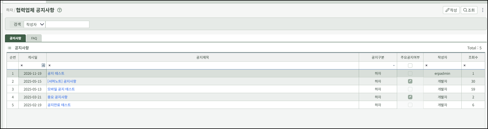

# 하자 > 협력업체 공지사항 요약 (2026-11-20)

---
## 0. 리뷰
- (검토 후 작성)

---

## 1. 화면
- 메뉴: 하자 › 협력업체 공지사항 (`cs_jcAnncBrdLst`, `/page/cs_jcAnncBrdLst`, 메뉴 `MENU_CS_NOTICE`)
- 탭 2개: **공지사항**(`BLT_DIV=CS3101`) · **FAQ**(`CS3102`). 화면에 보이는 것은 공지사항 탭, 총 5건
- 검색: 구분 선택(작성자 / 제목+글내용) + 검색어(50자 이내). 오른쪽 위 「조회」 · 「작성」 버튼
- 그리드 컬럼: 순번 · 게시일 · 공지제목(링크) · 공지구분(모듈구분 `CS32`, 예: 하자) · 주요공지여부(체크, 읽기 전용) · 작성자 · 조회수
- 목록은 읽기 전용(저장·삭제 버튼 없음). 제목 더블클릭 → 상세 팝업, 「작성」 → 작성 팝업
- 상세/작성 팝업 `cs_jcAnncBrdDtl`(960×680): 제목(200바이트) · 본문(에디터) · 게시일 · 게시기간 · 주요공지 · 첨부파일. 조회 모드에서 수정·삭제

## 2. AS-IS 컨버전 여부
**AS-IS에서 컨버전된 화면** (신규 작성 아님)
- Oracle 프로시저 `PCSA_SUBJECT_Q`(조회) · `PCSA_SUBJECT_S`(저장)를 Java 서비스 + MyBatis 매퍼로 옮김 (`erp-csa-subject.xml` 주석)
- AS-IS `JcAnncBrdLstController` 엔드포인트 경로(`/cse/...`) 그대로 유지
- `SCREEN-STATUS.md` 화면 표에 `jcAnncBrdLst`·`jcAnncBrdDtl` 포함 (「새로 만든 것」 목록에는 없음)
- 발주 내역과 달리 H사 요구(H-REQ)로 새로 만든 화면이 아님

## 3. 구현 요약
- 테이블 `VPLUS40.TCSA_SUBJECT` (PK `BLT_NO`) — 공지사항·FAQ 공용
  - 주요 칸: `MDL_DIV`(CS32) · `BLT_DIV`(CS31) · `BLT_TTL` · `DTL_CTS` · `BLT_PSN`(게시자) · `BLT_DT` · `INQ_NO`(조회수) · `ATFL_GRP`(첨부) · `ANNC_STR_DD`/`ANNC_END_DD`(공지기간) · `MAINANNC_YN`
- API (전부 POST, `SubjectController`)

| 엔드포인트 | 용도 |
|---|---|
| `/cse/getGrd_JcAnncBrdLst` | 목록 조회 (`mdlDiv`·`bltDiv`·`searchDiv`·`searchText`) |
| `/cse/getFrm_JcAnncBrdDtl` | 상세 조회 + 조회수 증가 (게시자 본인 제외) |
| `/cse/setFrm_JcAnncBrdLst` | 저장(I/U) · 삭제(D) |

- 목록 쿼리: `MDL_DIV` + `BLT_DIV` 필터, 작성자명은 `TCOZ_USR_INFO` 조인, `BLT_DT DESC` 정렬
- 진입 값: `PAGE_ID='CS'`, `MDL_DIV='CS3201'`(하자). `PAGE_ID='GC'`이면 FAQ 탭 숨김
- 채번: `MAX(BLT_NO)+1`. 게시자는 로그인 사용자로 서버가 채움
- 수정·삭제는 게시자 본인만 가능 (게시자 없는 이관 글은 허용). 삭제는 물리 삭제
- 본문 저장 시 HTML 허용목록 처리, 제목·본문 `<script`·`javascript:` 입력 차단(XSS)
- 첨부: 공통 `FilePanel`(`fileGroupId=cs_jcAnncBrdDtl`)
- 테이블(ERD)·Query·화면 구성·이벤트 흐름 다이어그램 등 상세 구조는 [02_협력업체공지사항_분석.md](02_협력업체공지사항_분석.md) 참고

## 4. 개발 현황
**구현·배포 완료, 화면 확인은 미실시로 기록됨** (문서 기록 기준)

| 구분 | 내용 | 근거 |
|---|---|---|
| 완료 | 화면 2개(목록·상세) · 컨트롤러 · 서비스 · 매퍼 · 테이블 구현 | 소스 확인 |
| 완료 | 재컨버전 후 보정 반영 (게시자 NULL 소거 방지, 조회수 되돌림 방지, 작성자만 수정·삭제 `G3-104`) | `erp-csa-subject.xml` 주석 |
| 검증 남음 | 화면 확인 상태 「미확인」 | `SCREEN-STATUS.md` |
| 참고 | 이미지의 「공지 테스트」(2026-11-19, 작성자 `erpadmin`)로 보아 최근 등록 시험은 한 것으로 보임(추정) | 화면 캡처 |

## 5. 확인 필요
- 목록 쿼리에 **공지기간(`ANNC_STR_DD`~`ANNC_END_DD`) 조건이 없음** → 기간이 지난 글(예: 「공지만료 테스트」)도 목록에 계속 표시됨. AS-IS 동작과 같은지 대조 필요
- 게시번호가 `MAX+1` 방식이라 동시에 작성하면 번호 충돌 가능성 있음 (AS-IS 프로시저와 같은 방식)
- 권한: 목록 `cs_jcAnncBrdLst`는 협력업체 역할(`CS_PTNR_01`)에 부여, 상세 `cs_jcAnncBrdDtl`은 업무 역할 부여가 비어 있음 (S5-cs-review P5 지적)
- `MAINANNC_YN`(주요공지, 모바일 메인 공지)을 읽는 쪽(앱) 연결은 이 저장소에서 확인하지 못함

## 근거 파일 (products-erp-h)
- `docs/cs/SCREEN-STATUS.md` · `docs/cs/SERVICE-NAMES.md`
- `docs/work/common-admin/P30-ROW-SCOPE-JUDGEMENT-20261116.md` · `S5-cs-review.md`
- `app/src/main/resources/pages/cs/jcAnncBrdLst.js` · `jcAnncBrdDtl.js`
- `app/src/main/java/hmplus/erp/cs/csa/controller/SubjectController.java` · `service/SubjectService.java`
- `app/src/main/resources/mybatis/mapper/erp-csa-subject.xml`
- `app/src/main/resources/db/module/erp/install/mssql/cs-01-cs-tables.sql` (`TCSA_SUBJECT`)
