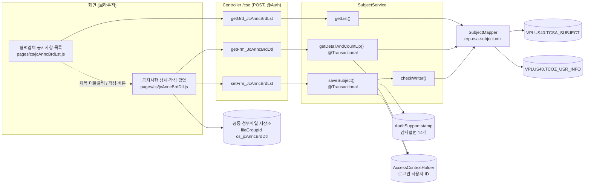
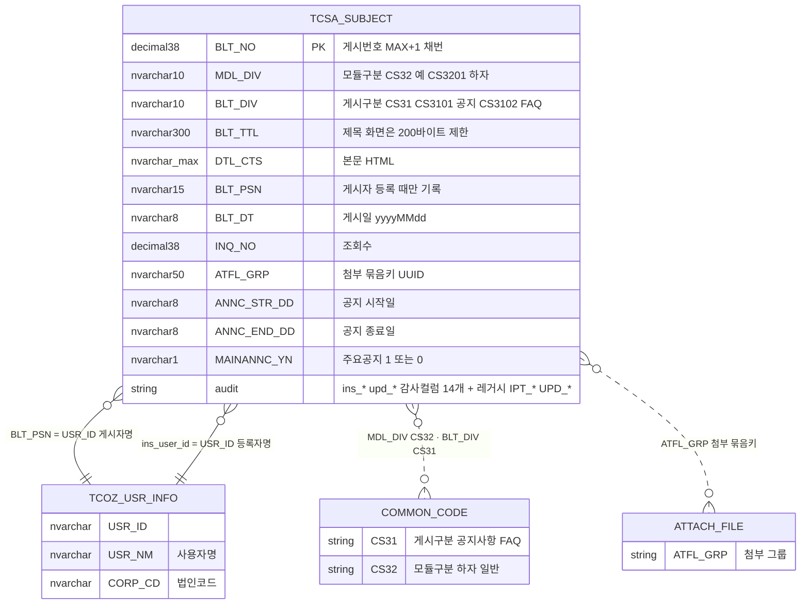
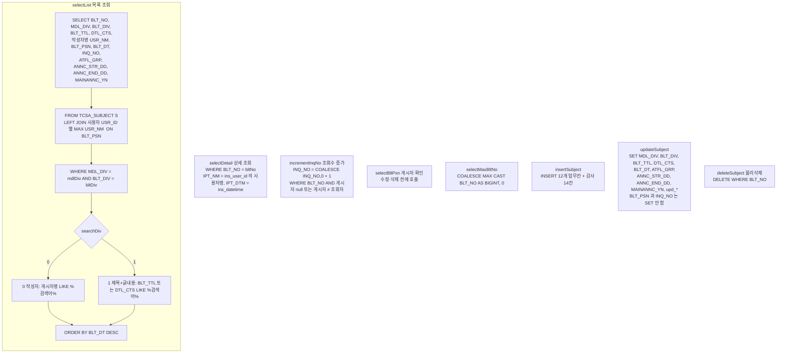
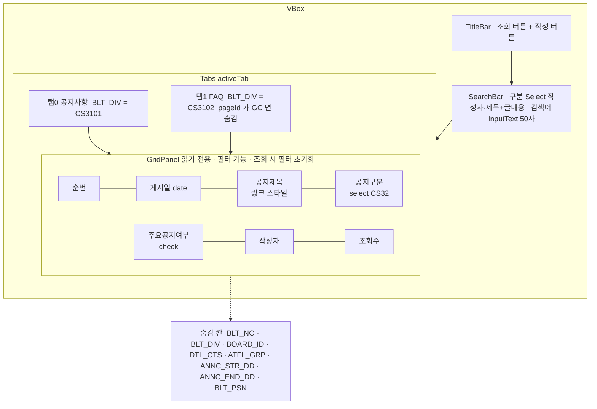
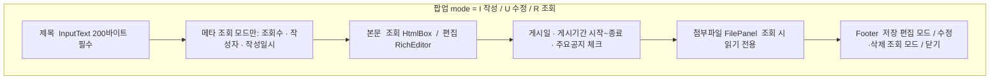
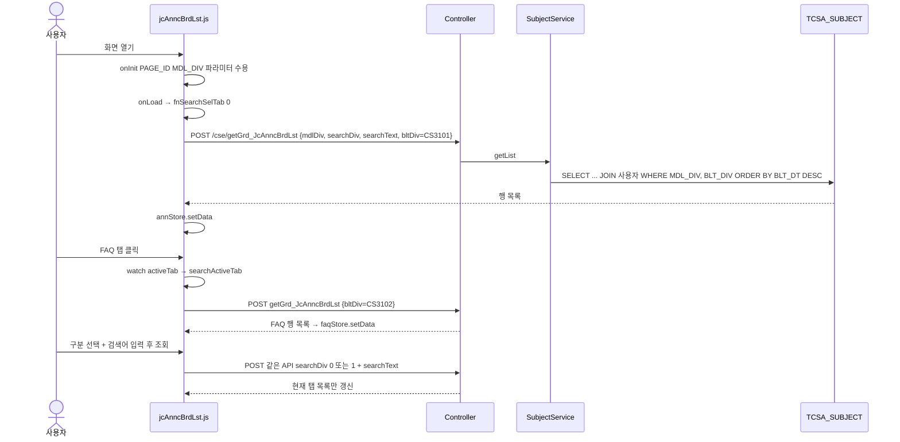
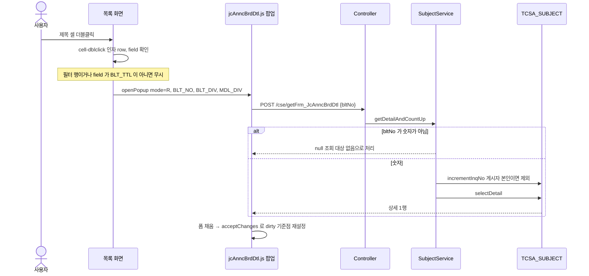
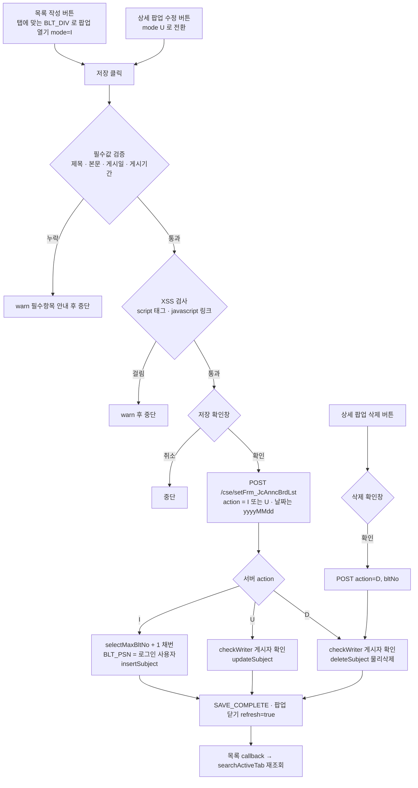

# 하자 > 협력업체 공지사항 — 테이블 · Query · 화면 · 이벤트 흐름 (2026-11-20)

> 대상: `products-erp-h` 의 `cs_jcAnncBrdLst`(목록) · `cs_jcAnncBrdDtl`(상세·작성 팝업). AS-IS 프로시저 `PCSA_SUBJECT_Q`·`_S` 를 옮긴 **컨버전 화면**입니다.
> 아래 다이어그램은 Mermaid 입니다(VS Code Markdown Preview Mermaid 확장, GitHub 등에서 렌더링).
> 근거 파일: `pages/cs/jcAnncBrdLst.js` · `jcAnncBrdDtl.js` · `SubjectController` · `SubjectService` · `SubjectMapper` · `mybatis/mapper/erp-csa-subject.xml` · `install/mssql/cs-01-cs-tables.sql`

---

## 1. 전체 계층 구조

---

## 2. 테이블 (ERD)

공지사항과 FAQ 가 **같은 테이블 `TCSA_SUBJECT`** 를 쓰며 `BLT_DIV` 로 구분합니다. 외래키(FK)는 없고 쿼리 조인으로만 연결됩니다.

| 칸 | 설명 |
|---|---|
| `BLT_PSN` | 게시자. 등록 때 로그인 사용자로 한 번만 기록하고 수정 시에는 건드리지 않음 |
| `ins_user_id` · `ins_datetime` | HMP 표준 감사컬럼. 상세 팝업의 작성자·작성일(`IPT_NM`·`IPT_DTM` 별칭)로 사용 |
| `IPT_*` · `UPD_*` | 레거시 감사컬럼. 표에는 남아 있지만 쿼리는 더 이상 읽고 쓰지 않음(V3-10) |

---

## 3. Query 구성 (`erp-csa-subject.xml`)

| 쿼리 | 호출 시점 | 비고 |
|---|---|---|
| `selectList` | 첫 로드(공지사항 탭) · 탭 전환 · 조회 · 팝업 닫힌 뒤 | 두 탭이 같은 쿼리를 `bltDiv` 만 바꿔 호출. 정렬은 게시일 내림차순뿐이라 같은 날짜 글의 순서는 정해져 있지 않음 |
| `incrementInqNo` → `selectDetail` | 상세 팝업 열릴 때 (한 트랜잭션) | 게시자 본인이 볼 때는 조회수가 오르지 않음 |
| `selectBltPsn` | 수정(U)·삭제(D) 직전 | 게시자와 로그인 사용자가 다르면 `CSA_SUBJECT_NOT_WRITER` 오류 |
| `selectMaxBltNo` → `insertSubject` | 작성(I) | `MAX+1` 채번. 별도 시퀀스·잠금 없음 |
| `updateSubject` | 수정(U) | 게시자·조회수는 덮어쓰지 않음(G3-104 보정) |
| `deleteSubject` | 삭제(D) | 물리 삭제. 첨부파일 정리 호출은 이 서비스에 보이지 않음 |

---

## 4. 화면 구성

### 4-1. 목록 `jcAnncBrdLst.js`

| 구성 | 설명 |
|---|---|
| ViewModel | `param{pageId, mdlDiv}` · `search{SEARCH_DIV, SEARCH_TEXT}` · `annStore` · `faqStore`(둘 다 key `BLT_NO`) · `activeTab` |
| 진입 값 | `PAGE_ID`·`MDL_DIV` 를 URL 파라미터로 받음. 기본값 `CS` / `CS3201`(하자) |
| 화면 속성 | `dirtyCheck: false` · `searchOnLoad: false`(첫 조회는 `onLoad` 에서 한 번만) |
| 이미지와 대응 | 「공지구분 = 하자」는 `MDL_DIV`(CS32), 「작성자」는 `BLT_PSN` 의 사용자명, 체크박스는 `MAINANNC_YN` |

### 4-2. 상세·작성 팝업 `jcAnncBrdDtl.js` (960 × 680)

| 모드 | 화면 상태 |
|---|---|
| `I` 작성 | 게시일 = 오늘, 게시기간 = 오늘 ~ +1개월, 첨부 묶음키 UUID 를 미리 생성. 버튼: 저장·닫기 |
| `R` 조회 | 입력 전부 비활성, 본문은 HtmlBox. 버튼: 수정·삭제(`authLevel 2`)·닫기 |
| `U` 수정 | 조회 모드에서 「수정」을 누르면 전환. 상세를 다시 읽지 않고 같은 폼을 편집 가능 상태로 바꿈. 버튼: 저장·닫기 |

---

## 5. 이벤트 흐름

### 5-1. 조회 (첫 로드 · 탭 전환 · 검색)

### 5-2. 상세 열기 (조회수 증가)

### 5-3. 작성 · 수정 · 삭제

저장 요청의 `action` 값은 화면의 `mode`(I/U)를 그대로 보내며, 서버는 `D`·`U` 가 아니면 모두 등록(INSERT)으로 처리합니다.

---

## 6. 같은 서버 코드를 쓰는 다른 화면

| 화면 | 관계 |
|---|---|
| `cs_jcAnncBrdLst` ↔ `cs_jcAnncBrdDtl` | 목록이 상세를 팝업으로 열고, 저장·삭제 후 닫히면서 목록을 다시 조회 |
| 공통 공지사항 `co_noticeList` · 개인 `common-notice` | 별도 화면(`co/noticeList`)·개인 화면으로 분리되어 있음. 이 화면은 하자(CS) 모듈의 `TCSA_SUBJECT` 를 사용하며, 두 화면이 같은 테이블을 쓰는지는 확인하지 않음 |
| 모바일 앱 | `MAINANNC_YN`(모바일 메인 공지) 값을 읽는 쪽은 이 저장소에서 확인하지 못함 |

---

## 7. 코드를 읽으며 확인한 점

- **공지기간 미반영**: 목록 쿼리는 `ANNC_STR_DD`~`ANNC_END_DD` 를 조건으로 쓰지 않습니다. 기간이 지난 글도 목록에 남고(이미지의 「공지만료 테스트」), 기간은 상세에서만 보입니다. AS-IS 프로시저 `Q` 분기를 그대로 옮긴 결과로 보이나 AS-IS 원문과 대조하지는 못했습니다.
- **채번 방식**: `MAX(BLT_NO)+1` 이라 두 사용자가 동시에 작성하면 같은 번호가 나올 수 있고, 그 경우 기본키 오류로 한쪽이 실패합니다. 원본 프로시저(`NVL(MAX(BLT_NO),0)+1`)와 같은 방식입니다.
- **수정·삭제 권한**: 원본은 누구나 가능했으나 G3-104 보정으로 게시자 본인만 가능합니다. 게시자가 비어 있는 이관 글(`BLT_PSN NULL`)은 누구나 수정·삭제할 수 있습니다.
- **삭제 시 첨부**: `deleteSubject` 는 `TCSA_SUBJECT` 행만 지웁니다. 첨부(`ATFL_GRP`) 정리 호출은 서비스에 없어서 첨부 파일이 남을 수 있는지는 파일 저장소 쪽 확인이 필요합니다.
- **상세 요청 파라미터**: 상세 API 는 `bltNo` 만 사용하고 `bltDiv`·`mdlDiv` 는 받아도 쓰지 않습니다. `BOARD_ID` 는 서버가 반환하지 않아 항상 빈 값이며 팝업 파라미터로만 남아 있습니다.
- **탭별 컬럼 차이**: 공지사항 탭은 게시번호 칸이 숨김이고 FAQ 탭은 표시됩니다(`jcAnncBrdLst.js` 탭별 컬럼 정의).
- **작성자명 출처 2가지**: 목록의 작성자는 `BLT_PSN`(게시자), 상세 팝업의 작성자는 `ins_user_id`(등록자)에서 가져옵니다. 이관 글처럼 두 값이 다르면 목록과 상세의 작성자가 다르게 보일 수 있습니다.
- **조회수 반영 시점**: 상세는 조회수 증가 후 같은 트랜잭션에서 읽으므로 팝업에 보이는 값은 증가된 값입니다. 목록은 팝업이 닫힌 뒤 재조회되어 갱신됩니다.
