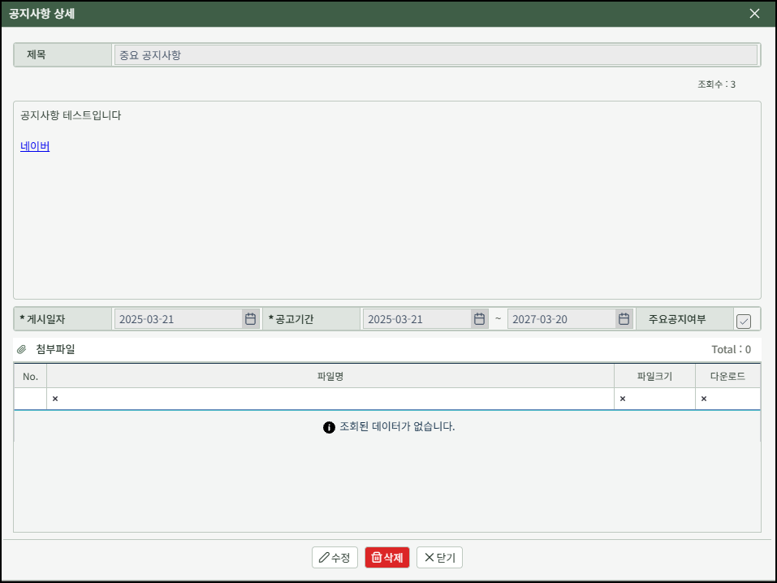

# 하자 > 협력업체 공지사항 > 공지사항 상세 요약 (2026-11-20)

> 목록 화면 문서: [01_협력업체공지사항_요약.md](01_협력업체공지사항_요약.md) · [02_협력업체공지사항_분석.md](02_협력업체공지사항_분석.md)

---
## 0. 리뷰
- (검토 후 작성)

---

## 1. 화면
- 서비스: `cs_jcAnncBrdDtl` (메뉴에 나오지 않는 **팝업 화면**, 부모 = `cs_jcAnncBrdLst`)
- 진입: 목록에서 **제목 더블클릭**(조회 모드) 또는 **작성 버튼**(작성 모드). 팝업 크기 960 × 680
- 팝업 제목: 「공지사항 상세」(FAQ 탭에서 열면 FAQ 상세, 작성이면 「작성」)
- 이미지(조회 모드) 구성

| 영역 | 내용 | 이미지 값 |
|---|---|---|
| 제목 | 읽기 전용 입력 | 중요 공지사항 |
| 메타 | 조회수 (작성자·작성일시 자리 있음) | 조회수 : 3 |
| 본문 | HTML 그대로 표시, 링크 클릭 가능 | 「공지사항 테스트입니다」 + 「네이버」 링크 |
| 게시 속성 | 게시일자* · 공고기간*(시작~종료) · 주요공지여부 체크 | 2025-03-21 · 2025-03-21 ~ 2027-03-20 · 체크됨 |
| 첨부파일 | 그리드(No. · 파일명 · 파일크기 · 다운로드) | Total : 0 · 「조회된 데이터가 없습니다.」 |
| 버튼 | 수정 · 삭제(빨강) · 닫기 | — |

- 모드는 3가지: **R 조회**(수정·삭제·닫기) / **U 수정**(저장·닫기) / **I 작성**(저장·닫기)

## 2. AS-IS 컨버전 여부
**AS-IS에서 컨버전된 화면** (신규 작성 아님)
- 원천 `PCSA_SUBJECT_Q`(Q1 상세) · `PCSA_SUBJECT_S`(저장) + AS-IS 상세 처리(조회수 증가 `set_JcAnncBrdCount`)를 서버 한 번 호출로 합침
- AS-IS `jcAnncBrdDtl.jsp` 화면 규격(필수 검증 문구, 제목 200바이트, 게시기간 기본값 등)을 따름 (화면 소스 주석)

## 3. 구현 요약
- 같은 테이블 `VPLUS40.TCSA_SUBJECT`, 같은 컨트롤러 `SubjectController`(`/cse`) 사용. 별도 서버 코드 없음
- API

| 엔드포인트 | 용도 |
|---|---|
| `/cse/getFrm_JcAnncBrdDtl` | 상세 조회 + 조회수 증가 (한 번 호출) |
| `/cse/setFrm_JcAnncBrdLst` | 저장(I/U) · 삭제(D) |

- 조회수: 팝업을 열 때마다 +1, **게시자 본인이 열 때는 증가 안 함**
- 수정·삭제: **게시자 본인만** 가능 (게시자 없는 이관 글은 누구나)
- 삭제는 물리 삭제. 삭제 · 저장 성공 시 팝업이 닫히고 부모 목록이 다시 조회됨
- 저장 전 검사: 필수값(제목·본문·게시일·공고기간) → XSS(`<script`, `javascript:`) → 확인창
- 본문 편집은 RichEditor, 서버 저장 시 HTML 허용목록 처리(`@AllowHtml` + `HtmlSanitizer`)
- 첨부: 공통 `FilePanel`(`fileGroupId=cs_jcAnncBrdDtl`). 작성 시 첨부 묶음키(UUID)를 팝업이 열릴 때 미리 생성
- 상세 구조·흐름 다이어그램은 → [04_협력업체공지사항상세_분석.md](04_협력업체공지사항상세_분석.md) 참고

## 4. 개발 현황
**구현·배포 완료, 신규·수정·첨부 확인 완료(2026-11-20), 삭제·권한 차단 확인은 남음**

| 구분 | 내용 | 근거 |
|---|---|---|
| 완료 | 상세·작성·수정·삭제 팝업, 서버 API, 첨부 연결 구현 | 소스 확인 |
| 완료 | 조회 모드 화면 표시 확인 (제목·본문·게시속성·첨부 영역 정상 표시) | 화면 캡처 |
| 완료 | 조회수 증가 동작 확인: 목록에서 2 → 상세에서 3 | 목록·상세 캡처 비교 |
| 완료 | **신규 · 수정 · 첨부파일 기능 확인 완료** (2026-11-20). 「20261120 제목」 등록 후 상세에서 작성자 `erpadmin` · 작성일시 `2026-11-20 13:53` 표시, 첨부 pdf(754.5 KB) 1건 표시 | 사용자 확인 + 화면 캡처 |
| 완료 | 게시자 본인이 연 상세의 조회수 0 → 「게시자 본인은 조회수 증가 제외」 규칙과 일치 | 화면 캡처 |
| 검증 남음 | 삭제 시험 기록 없음 (`SCREEN-STATUS.md`는 여전히 「미확인」) | — |
| 검증 남음 | 게시자 아닌 사용자의 수정·삭제 차단 시험 기록 없음 | — |

## 5. 확인 필요
- **작성자·작성일시가 보이지 않음**: 소스상 조회 모드는 조회수 옆에 작성자·작성일시도 표시하는데, 이미지에는 조회수만 있음. 작성자·작성일시는 등록자(`ins_user_id`·`ins_datetime`)에서 읽으므로 이관 데이터(2025-03-21 글)에 이 값이 비어 있는 것으로 추정. 목록에서는 같은 글의 작성자가 「개발자」(게시자 `BLT_PSN`)로 보임
- 수정·삭제 버튼은 **게시자가 아니어도 보이고**, 눌러서 저장·삭제할 때 서버가 「작성자만 수정·삭제할 수 있습니다.」로 거부함
- 삭제 시 첨부파일 정리 호출이 서비스에 보이지 않음 → 첨부가 남는지 파일 저장소 쪽 확인 필요
- 상세 팝업 `cs_jcAnncBrdDtl`은 업무 역할 부여가 비어 있음 (S5-cs-review P5 지적)

## 근거 파일 (products-erp-h)
- `app/src/main/resources/pages/cs/jcAnncBrdDtl.js` · `jcAnncBrdLst.js`
- `app/src/main/java/hmplus/erp/cs/csa/controller/SubjectController.java` · `service/SubjectService.java` · `dto/SubjectSaveReq.java`
- `app/src/main/resources/mybatis/mapper/erp-csa-subject.xml`
- `docs/cs/SCREEN-STATUS.md` · `docs/work/common-admin/S5-cs-review.md` · `P30-ROW-SCOPE-JUDGEMENT-20261116.md`
