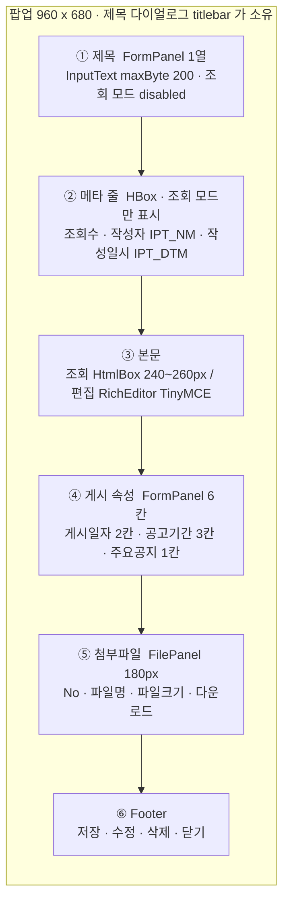
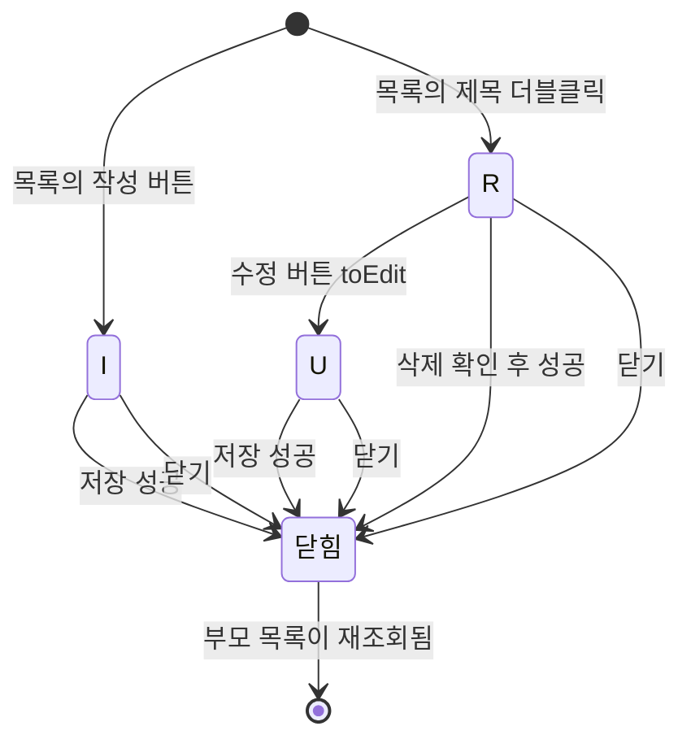
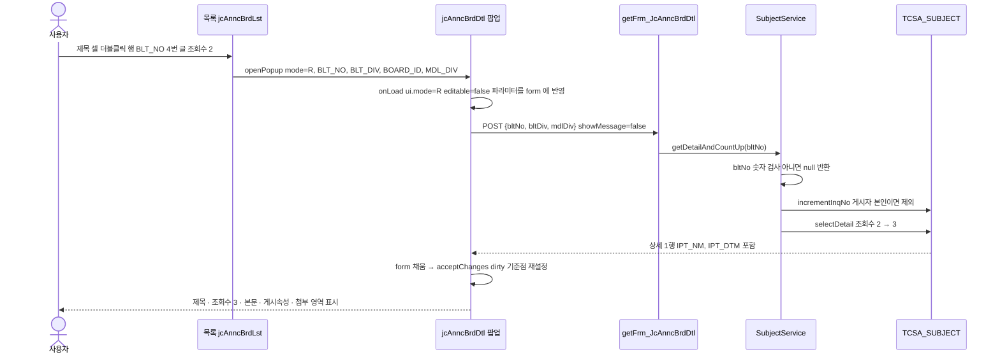
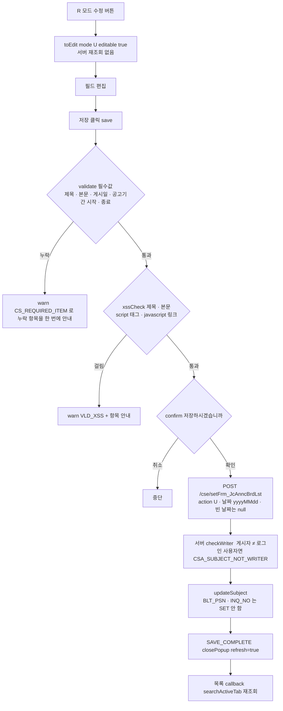
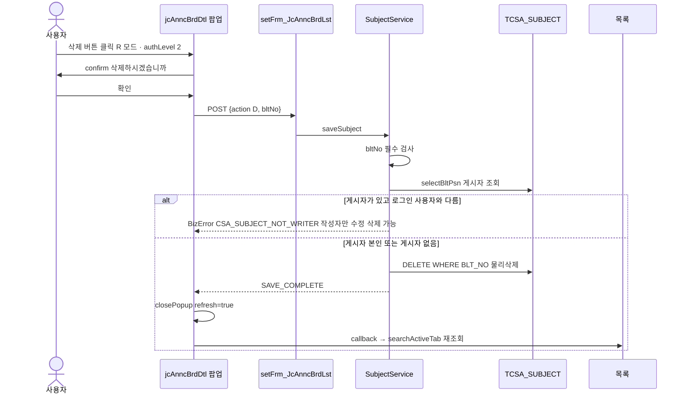

# 하자 > 협력업체 공지사항 > 공지사항 상세 — 화면 · 모드 · 이벤트 흐름 (2026-11-20)

> 대상: `cs_jcAnncBrdDtl`(`pages/cs/jcAnncBrdDtl.js`) 팝업. 서버(`SubjectController`·`SubjectService`)·테이블(`TCSA_SUBJECT`)·SQL 은 목록 화면과 공유하므로 [02_협력업체공지사항_분석.md](02_협력업체공지사항_분석.md) 의 §1~3 을 참고하세요.
> 아래 다이어그램은 Mermaid 입니다(VS Code Markdown Preview Mermaid 확장, GitHub 등에서 렌더링).

---

## 1. 화면 구성 (이미지 ↔ 코드)

| 번호 | 화면 라벨 | form 필드 | DB 칸 | 컴포넌트 | 비고 |
|---|---|---|---|---|---|
| ① | 제목 | `BLT_TTL` | `BLT_TTL` | InputText | 편집 시 필수 · 200바이트 실시간 절단 |
| ② | 조회수 | `INQ_NO` | `INQ_NO` | Text | 조회 모드만. 이미지 값 3 |
| ② | (작성자) | `IPT_NM` | `ins_user_id` → `TCOZ_USR_INFO.USR_NM` | Text | 이미지에서는 비어 있음 |
| ② | (작성일시) | `IPT_DTM` | `ins_datetime` | Text | 이미지에서는 비어 있음 |
| ③ | (본문) | `DTL_CTS` | `DTL_CTS` | HtmlBox / RichEditor | 필수. 이미지는 HTML 링크 포함 |
| ④ | * 게시일자 | `BLT_DT` | `BLT_DT` nvarchar(8) | DatePicker | 표시 `yy-mm-dd`, 값 `yyyyMMdd` |
| ④ | * 공고기간 | `ANNC_STR_DD` ~ `ANNC_END_DD` | 같은 이름 nvarchar(8) | DateRange | 둘 다 필수 |
| ④ | 주요공지여부 | `MAINANNC_YN` | `MAINANNC_YN` | Checkbox | 1 / 0, 모바일 메인 공지 |
| ⑤ | 첨부파일 | `ATFL_GRP` | `ATFL_GRP` | FilePanel | `fileGroupId=cs_jcAnncBrdDtl`, 조회 시 읽기 전용 |
| — | (숨김) | `BLT_NO` · `BLT_DIV` · `MDL_DIV` · `BOARD_ID` · `BLT_PSN` | 각 칸 | form 만 | 진입 파라미터·수정 대상 키 |

이미지에서 라벨 앞의 `*`(게시일자·공고기간)는 필수 표시이며, 조회 모드(`disabled`)에서도 그대로 그려집니다.

---

## 2. 모드와 버튼

| 모드 | `ui.editable` | 입력칸 | Footer 버튼 | 시작 값 |
|---|---|---|---|---|
| `R` 조회 | false | 전부 disabled, 본문 HtmlBox | **수정** · **삭제**(`authLevel 2`) · 닫기 | 서버 상세값 |
| `U` 수정 | true | 편집 가능, 본문 RichEditor | **저장** · 닫기 | R 에서 읽은 값 그대로(재조회 없음) |
| `I` 작성 | true | 편집 가능 | **저장** · 닫기 | 게시일 = 오늘, 공고기간 = 오늘 ~ +1개월, 첨부 UUID 미리 생성, `BLT_NO='1'` 자리표시 |

수정(U)에는 별도 「취소」 버튼이 없어 변경을 버리려면 「닫기」를 눌러야 합니다. 화면 속성이 `dirtyCheck: true` 라서 변경 후 닫을 때 확인창이 뜰 것으로 보이나, 프레임워크 동작이라 직접 확인하지는 못했습니다.

---

## 3. 이벤트 흐름

### 3-1. 열기와 조회 (이미지의 상태)

- 상세 응답이 늦게 도착해 「변경된 데이터가 있습니다」가 오탐되지 않도록 폼을 채운 직후 `acceptChanges()` 로 기준점을 다시 잡습니다.
- 첨부 그리드는 공통 `FilePanel` 이 `ATFL_GRP` 묶음키로 채우며, 이 글은 첨부가 0건이라 「조회된 데이터가 없습니다.」가 표시됩니다(`FilePanel` 내부 조회 방식은 확인하지 않음).

### 3-2. 수정 · 저장

작성(I)은 같은 흐름에서 서버 단계만 다릅니다. `selectMaxBltNo + 1` 로 번호를 채번하고, `BLT_PSN` 에 로그인 사용자를 기록하며 `insertSubject` 를 실행합니다.

### 3-3. 삭제

---

## 4. 코드를 읽으며 확인한 점

- **메타 줄이 이미지와 다름**: 소스는 조회 모드에서 `조회수 · 작성자 · 작성일시` 세 값을 오른쪽 정렬로 보여 주지만 이미지에는 「조회수 : 3」만 있습니다. 작성자·작성일시는 `ins_user_id`·`ins_datetime` 에서 읽는데, 2025-03-21 이관 글은 이 값이 비어 있을 가능성이 큽니다(추정). 같은 글이 목록에서는 게시자 `BLT_PSN` 기준으로 「개발자」로 나오므로 두 화면의 작성자 출처가 다릅니다.
- **조회수 증가는 팝업을 열 때마다**: 같은 사용자가 반복해서 열어도 매번 +1 이고(게시자 본인 제외), 이미지의 3 은 증가 후 값입니다. 목록에서 2 였던 글이 상세에서 3 으로 보이는 것과 일치합니다.
- **버튼 노출과 권한 검사 분리**: 수정·삭제 버튼은 화면에서 게시자 여부와 상관없이 보이고(`authLevel 2` 만 확인), 게시자 검사는 서버 저장 시점에만 일어납니다.
- **R → U 전환은 서버를 다시 부르지 않음**: 수정 모드는 조회 때 받은 폼 값을 그대로 편집합니다. 다른 사용자가 그 사이 수정했어도 반영되지 않고, 저장하면 마지막 저장이 이깁니다(낙관적 잠금 없음).
- **본문 링크 표시**: 조회 모드는 `HtmlBox` 가 저장된 HTML 을 그대로 표시하므로 이미지처럼 링크가 클릭 가능합니다. 위험한 태그는 저장 시점에 서버(`@AllowHtml` + `HtmlSanitizer` 허용목록)와 화면(`<script`·`javascript:` 검사)에서 걸러집니다.
- **날짜 형식 이중 처리**: 화면은 `yy-mm-dd`(예 2025-03-21)로 보이고 DB 는 `nvarchar(8)` `yyyyMMdd` 입니다. 10자를 그대로 보내면 저장이 100% 실패하므로 저장 직전에 `formatDate(..., 'YYYYMMDD')` 로 바꾸고, 빈 값은 `''` 가 아니라 `null` 로 보냅니다.
- **삭제와 첨부**: 삭제는 `TCSA_SUBJECT` 행만 지웁니다. 첨부(`ATFL_GRP`) 정리 호출은 서비스에 없으므로 첨부 파일이 남는지는 파일 저장소 쪽 확인이 필요합니다.
- **저장 요청의 `inqNo`**: 화면은 `INQ_NO` 를 함께 보내지만 수정 쿼리는 `INQ_NO` 를 SET 하지 않아 영향이 없습니다. 등록(I) 때만 초기값으로 들어갑니다.
