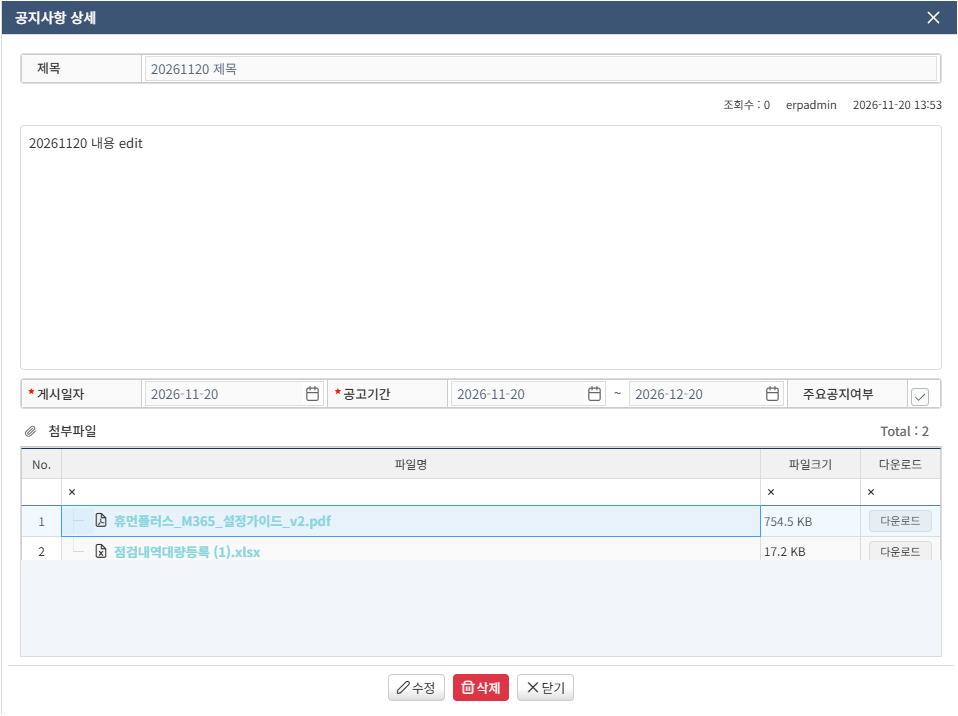

# 협력업체 공지사항 상세 — 화면 스타일 점검 (2026-11-20)

- 대상: `cs_jcAnncBrdDtl` 상세 팝업(조회 모드) · 소스 `pages/cs/jcAnncBrdDtl.js`
- 환경: 로컬 앱(`localhost:8080`) · `erpadmin` · 뷰포트 1691 × 1110 · 스킨 `business` · 테마 `spring-sage`
- 방법: 캡처 확인 → 소스·스타일 대조 → Aside 브라우저로 열린 팝업의 크기·스타일 값을 읽기 전용으로 측정 (데이터 변경 없음)
- 현재 상태: **점검 9건 중 5건 확정(1·4·5·7·9), 1건 철회 후보(2), 1건 미확정(3), 2건 캡처만 확인(6·8). 수정은 아직 하지 않음**
- 관련 문서: [03 요약](03_협력업체공지사항상세_요약.md) · [04 분석](04_협력업체공지사항상세_분석.md)

---

## 1. 결론

| # | 증상 | 판정 | 원인 | 조치 | 담당 |
|---|---|---|---|---|---|
| 1 | 제목 라벨에만 필수 표시 `*`가 없음 | **확정** | 제목은 `ui.editable`일 때만 필수, 게시일자·공고기간은 항상 필수 표시 | 세 항목 표시 기준 통일 | 이 저장소 |
| 2 | 본문 박스 테두리가 다르게 보임 | **철회 후보** | 측정값은 본문 박스와 `FormPanel`이 동일. 눈에 띄는 차이는 7번 때문일 가능성 | 수정 불필요 | — |
| 3 | 창이 낮으면 하단 버튼이 가림 | **미확정** | 캡처 1건뿐이고 재현 전. 가설 하나는 측정으로 기각됨(3-2) | 높이별 재현 후 결정 | 재현 후 판단 |
| 4 | 첨부 2번째 행 아래가 잘림 | **확정** | 시트가 행 높이를 27px로 잡았는데 실제 행은 31px | 플랫폼 전달 | 플랫폼 |
| 5 | 파일명 글자 대비가 낮음 | **확정** | 연한 청록색 굵은 글씨 · 대비 약 1.2~1.7 : 1 | 플랫폼 전달 | 플랫폼 |
| 6 | 파일명 앞 트리 연결선 잔상 | 캡처만 | 미측정 | 측정 후 판단 | 플랫폼 |
| 7 | 제목 박스가 이중 테두리처럼 보임 | **확정** | 같은 색 1px 테두리 3겹 | 플랫폼 전달 | 플랫폼 |
| 8 | 「첨부파일」 제목줄이 박스보다 약 10px 안쪽 | 캡처만 | 미측정. 의도된 여백일 수 있음 | 의도 여부 판단 | 판단 필요 |
| 9 | 첨부 표 아래 빈 영역이 큼 | **확정** | 첨부 패널 높이 180px 고정 + 시트는 행 수만큼만 높이를 잡음 | 의도 여부 판단 후 조정 | 이 저장소 / 플랫폼 |

---

## 2. 항목별 근거

### 1번 — 필수 표시 불일치
- 소스: 제목 `:required="ui.editable"`(273행) · 게시일자 `required`(299행) · 공고기간 `requiredMark`(309행)
- 측정: 게시일자·공고기간 라벨에만 ` *`가 있음. 주요공지여부는 필수가 아니라 표시 없음
- 방안: ① 세 항목 모두 조회 모드에서도 표시 / ② 세 항목 모두 편집 모드에서만 표시 (**결정 필요**)

### 2번 — 본문 박스 테두리 (철회 후보)
| | 본문 박스 `.cs-bordered` | `FormPanel` 바깥 박스 |
|---|---|---|
| 테두리 | 1px solid, 같은 색 | 1px solid, 같은 색 |
| 모서리 | 4px | 4px |
| 폭 · 왼쪽 위치 | 922px · x=18 | 922px · x=18 |

- `.cs-bordered`(`erp-theme.css:2367`)는 `apprv_SiteTnhInfoAprv.js`의 표 셀에서도 쓰므로, 수정하면 다른 화면에 영향이 가는 점도 철회 근거임

### 3번 — 하단 버튼 가림 (미확정)
- 근거: 11/20 신규 등록 직후 캡처에서 오른쪽 세로 스크롤바가 보이고 수정·삭제·닫기 버튼이 보이지 않았음. 이번 큰 창(1110px) 캡처는 정상
- 기각된 가설: 「팝업 안 VBox가 `min-height:auto`라서 줄지 않는다」 → 측정 결과 가운데 영역은 `min-height 0` · `overflow:auto`이고 Footer는 `flex-shrink:0`이라 Footer가 밀려나지 않는 구조. 이 설명으로는 가림이 생기지 않음
- 남은 가설: 팝업이 목록 영역보다 커서 잘림(다이얼로그는 내용 + 약 36px). 다만 계산상 넘치는 양이 최대 약 20px이라 앞 캡처의 큰 가림은 설명되지 않음
- 결론: 높이별 재현(4장 순서 1) 없이는 원인을 정할 수 없음

### 4번 — 첨부 행 잘림 (확정)
- 첨부 표는 IBSheet. 행 2개가 각 31px(실측 30.59px)로 합계 61px인데, 스크롤 컨테이너는 55px · `overflow:hidden` · `scrollHeight 61 > clientHeight 55` → 아래 약 6px이 잘림
- 컨테이너 높이는 2행 × 27px(시트 기본 행 높이로 추정)에 가까움. 실제 행이 31px인 것은 다운로드 버튼(22px) + 셀 여백 때문
- 예상: 행이 N개면 잘림도 N × 약 3.6px로 커짐 (**첨부 3~4건 측정으로 확인 필요**)

### 5번 — 파일명 대비 (확정)
- 글자색 `rgb(138,213,221)` · 굵기 700 · 13px. 배경은 흰색~연한 회녹색(선택 행은 `rgba(63,94,71,0.2)`)
- 직접 계산한 대비 약 1.2~1.7 : 1 (WCAG 기준 4.5 미만)

### 7번 — 제목 박스 3겹 테두리 (확정)
- 입력 칸(1px) → `fw-field`(1px) → `fw-contentpanel`(1px, 모서리 4px). 세 겹 모두 같은 색

### 9번 — 첨부 빈 영역 (확정)
- 첨부 패널 높이 228px 중 시트 본문은 약 55px. 소스의 `FilePanel height="180px"`(335행)와 시트의 행 수 기준 높이가 겹쳐 생김

---

## 3. 팝업 동작 참고 (hmp-core 2.2.125 소스 + 측정)

### 3-1. 크기 규칙
| 항목 | 내용 |
|---|---|
| 기본값 | `mode` 기본 `dialog`, 크기를 안 주면 1200 × 800 |
| 단위 | 숫자(px)만 지원. `'90%'` 같은 비율 지정은 안 되는 것으로 보임(추정) |
| 클램핑 | `width > 화면폭 − 16`, `height > 화면높이 − 16`이면 줄임 |
| 화면 기준 | 팝업은 **목록 화면의 iframe 문서 안**에 그려지므로 화면 높이는 브라우저 높이가 아니라 **목록 iframe 높이**(이번 1024 = 브라우저 1110 − 셸 머리줄 약 85) |
| 이 팝업 | 폭 960 × 높이 716 = 머리줄 34 + 내용 680 + 테두리, 목록 영역 가운데 |
| 임계 (계산) | 목록 iframe 높이 696 미만(브라우저 약 781 미만)이면 내용 높이가 줄고, 716 미만(약 801 미만)이면 팝업이 목록 영역보다 큼 |
| 다른 옵션 | `slide`(화면의 2/5) · `float`(420 × 600, 이동·크기 조절) · `window`(터치·MDI·전체화면은 `dialog`로 전환) · `titlebar:false` · `serviceName` · `keepAlive` |

규칙 문서는 이 저장소에 따로 없음. 출처: `hmp-core-2.2.125.jar`의 `static/js/vue/framework.js`(`openPopup` 12950~13050행) · `static/css/framework.css`

### 3-2. 팝업 안 레이아웃 (측정)
| 요소 | 값 |
|---|---|
| 팝업 문서 | 높이 680 · 스크롤 없음 |
| 가운데 영역 | `fw-vbox flex-grow-1 overflow-auto min-h-0` · 높이 616 · `min-height 0` |
| Footer | 높이 44 · `flex-shrink:0` |

---

## 4. 남은 작업

| 순서 | 작업 | 상태 | 선행 조건 |
|---|---|---|---|
| 1 | **높이별 재현 (3번)**: 브라우저 높이 900 · 820 · 800 · 780 · 700 · 600에서 팝업을 새로 열어 팝업 높이 · 스크롤바 · Footer 가림 기록 | 미수행 | 창 높이를 직접 조절하거나 에뮬레이션 허락 |
| 2 | **첨부 건수별 측정 (4번 예상 검증)**: 0 · 1 · 2 · 3 · 4 · 6건에서 컨테이너 높이와 잘림 기록 | 미수행 | 시험 글 수정 허락(로컬 앱이 공유 DB에 연결됨) |
| 3 | 필수 표시 통일 (1번) | 미착수 | 표시 방식 결정(① 또는 ②) |
| 4 | 3번 수정 | 대기 | 순서 1 결과 |
| 5 | 플랫폼 담당에 전달 (4 · 5 · 7번, 6 · 9번은 측정 후): 2장의 측정값과 캡처 첨부 | 미착수 | 순서 2 후 보강 가능 |
| 6 | 재확인: 조회·수정·작성 3개 모드 × 창 크기 × 첨부 0·1·3건, 전·후 캡처를 `rsrc`에 저장 | 대기 | 순서 3~5 |
| 7 | 이 문서 상태 갱신, 6 · 8 · 9번 판단 | 대기 | — |

- 철회: 「`.cs-bordered` 테두리 정합」(2번)은 값이 같아 작업하지 않음

---

## 5. 측정 방법과 한계
- 도구: Aside 브라우저(`aside repl`)로 사용자가 열어 둔 팝업에 연결해 크기·스타일 값을 읽음
- 자동 더블클릭으로는 팝업이 열리지 않아 **팝업은 사용자가 직접 연 상태에서 측정**함
- 대비는 도구 값이 아니라 직접 계산함(반투명 배경을 흰색 위에 합성해 가정)
- 6 · 8번은 캡처로만 보았고 값을 재지 않았음
- 2 · 3장 수치는 모두 로컬 앱 1회 측정값이며 개발서버에서는 확인하지 않았음

## 근거 파일 (products-erp-h)
- `app/src/main/resources/pages/cs/jcAnncBrdDtl.js` (273 · 288 · 299 · 309 · 335행)
- `app/src/main/resources/pages/cs/jcAnncBrdLst.js` (팝업 크기 `width 960, height 680` · 141 · 173행)
- `app/src/main/resources/static/css/erp-theme.css` (2367행 `.cs-bordered`)
- `hmp-core-2.2.125.jar` → `static/js/vue/framework.js` · `static/css/framework.css`
