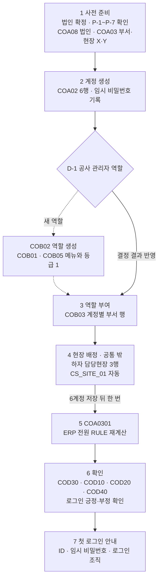

# 신규 입사자 6계정 설정 — 요약

- 작성일: 2026-11-24
- 원문: 같은 폴더의 `신규입사자-계정설정-시나리오.md` (근거 파일·줄 번호, 화면별 상세, 다이어그램 5종은 원문에 있습니다)
- 대상: erp-h `http://localhost:8080/`, 작업자 erpadmin, 상단메뉴 '공통'
- 이 요약에는 새 사실을 넣지 않았습니다. 괄호 안 번호(3.2, 7.1, D-1 등)는 원문의 절·항목 번호입니다.

---

## 1. 결론

- 공통에서 **반드시 거칠 화면은 3개**입니다. 사용자정보 **COA02**(계정 6행), 사용자 **COB03**(역할 부여), 그리고 6계정 저장 뒤 한 번 누르는 **COA0301** HR정보동기화입니다(로그인 때는 RULE 재계산이 돌지 않습니다).
- 공사 관리자 역할(계정1·2)을 새로 만들기로 하면 **COB02 → COB01·COB05**가 더해집니다(D-1).
- 현장 담당자(계정4~6)의 현장 배정은 공통 밖, **하자 › 담당현장(cs_chrSite)**에서 합니다. 이 저장이 CS_SITE_01을 자동으로 줍니다.
- 법인 구분은 user_company가 아니라 **역할을 부여한 조직(부서)의 법인**으로 정해집니다. 그래서 부서를 어디로 주느냐가 범위를 결정합니다.

## 2. 계정별 설정 한눈에

법인 A·B는 **제안(추정)이 A=HI, B=HS**이며 운영자가 확정해야 합니다(D-0). 사용자ID는 예시입니다.

| 계정 | 법인 | COA02 소속 부서 | COB03 부여 조직 · 역할 | 하자 담당현장 | 볼 범위 |
|---|---|---|---|---|---|
| 계정1 공사 관리자 | A(HI) | HI 본사 부서(예 HI1100) | 같은 부서 · 공사 관리자 역할 | — | 법인 A 공사 |
| 계정2 공사 관리자 | B(HS) | HS 본사 공사 부서 | 같은 부서 · 공사 관리자 역할(계정1과 같은 역할) | — | 법인 B 공사 |
| 계정3 하자 관리자 | B(HS) | HS 본사 하자 부서(예 HS1930) | 같은 부서 · CS_MNG_01 + CS_COMMON | **등록 안 함** | 법인 B 하자 전체 |
| 계정4 현장 담당1 | B(HS) | 현장 X | 현장 X · CS_COMMON | (현장 X, 계정4) | 현장 X |
| 계정5 현장 담당2 | B(HS) | 현장 X | 현장 X · CS_COMMON | (현장 X, 계정5) | 현장 X |
| 계정6 현장 담당3 | B(HS) | 현장 Y | 현장 Y · CS_COMMON | (현장 Y, 계정6) | 현장 Y |

- 계정3을 전 법인 관리자로 정하면 CS_MNG_01 대신 CS_ADMIN을 줍니다(D-2).
- 계정4~6에게 **CS_SITE_01을 COB03에서 직접 주지 않습니다.** 담당현장 저장이 자동으로 줍니다.

## 3. 작업 순서

1. **사전 준비**
   - 법인 A·B 코드를 확정합니다(D-0).
   - 시작 전 확인 P-1~P-7을 봅니다. COA02가 여는 화면, RowScope·현장 검사 스위치, 담당현장 연동 역할 설정, HI 현장 유무 등입니다(4.1). **P-3 RowScope는 ENFORCE, P-4 현장 검사는 Y가 요구 값입니다.** 아니면 법인·현장 분리의 부정 확인이 성립하지 않으며, 값을 올릴지는 전 시스템에 영향이라 운영 결정입니다(D-9).
   - COA08에서 법인 A·B가 ERP 사용 Y이고 회사가 1건 이상인지 봅니다.
   - COA03에서 소속 부서와 현장 X·Y가 있는지 보고, 없으면 만듭니다.
   - 법인 A가 HI라면 COA03·COB03을 메뉴에서 열어 법인 HI로 조회되는지 먼저 봅니다(7.1 1-0).
2. **계정 생성** — COA02에서 6행을 만듭니다. 임시 비밀번호 창은 한 번만 뜨므로 바로 적어 둡니다.
3. **역할 부여**
   - D-1에서 새 역할로 정했다면 COB02에서 역할(예 `CM_ADMIN`)을 만들고, CM 메뉴를 붙여 조회등급을 값 1로 맞춥니다.
   - 이어서 COB03에서 2장 표대로 부여합니다. 시작일은 처리일(오늘)로 둡니다.
4. **현장 배정** — 하자 › 담당현장에 3행을 저장합니다. 계정3은 넣지 않습니다.
5. **반영(필수, 한 번)** — COA0301은 계정 하나가 아니라 ERP 전원을 재계산합니다. 6계정을 모두 저장한 뒤 한 번 누릅니다. **로그인·조직 전환 때는 RULE 재계산이 돌지 않아**, 건너뛰면 RULE 역할(HQ_COMMON·SITE_COMMON)이 배치 전까지 부여되지 않습니다(원문 5장 5단계).
6. **확인** — 권한이력 화면과 실제 로그인으로 확인합니다(5장).
7. **안내** — 사용자ID, 임시 비밀번호, 로그인 때 고를 조직을 본인에게 알립니다.

> **원문 안의 순서 차이:** 공사 관리자 역할에 메뉴를 붙이는 순서가 원문 두 곳에서 다릅니다.
> - 5장 본문: COB05 메뉴 붙이기 → COB01 등급 맞추기
> - 7.1 표: COB01 트리로 붙이기 → 빠진 메뉴만 COB05 → COB01 다시 맞추기
>
> 둘 다 **마지막을 COB01 등급 맞추기로 끝내면** 결과가 같습니다. 끝난 뒤 COD30에서 모든 CM 행이 등급 1인지 보십시오(V-1).

## 4. 공통 화면 구분

| 구분 | 화면 |
|---|---|
| 해야 함 | COA02 사용자정보, COB03 사용자, COA0301 HR정보동기화(6계정 저장 뒤 한 번 — 로그인 때는 RULE 재계산이 안 돕니다) |
| 조건부 | COA03(부서·현장이 없을 때), COB02·COB05·COB01(새 공사 관리자 역할), COA04(계정4~6 주소속이 현장이 아닐 때 현장 겸직), COB06·COB07(모바일·대시보드가 필요할 때) |
| 확인만 | COA01, COA08, COD30, COD10, COD20, COD40, COD50, COZ80·COZ81·COZ82(선택) |
| 해당 없음 | 나머지 화면(거래처, 휴일, 코드관리, 직무연동, 부서별겸직, 커뮤니티, 공통기능, 시스템관리 대부분) |

## 5. 확인 방법

| 구분 | 핵심 확인 |
|---|---|
| 권한이력 | COD30: 공사 관리자 역할의 CM 행이 **모두 등급 1**(0·3 없음). COD10: CS_SITE_01 아래 계정4·5 = 현장 X, 계정6 = 현장 Y, 계정3 없음. COD20: CS_COMMON이 다른 역할과 같은 조직에 있음. COD40: 오늘 GRANT 기록. COA0301 뒤 COD20에 RULE 행(계정1~3 HQ_COMMON, 계정4~6 SITE_COMMON)이 생깁니다(원문 V-10) |
| 로그인 · 보여야 함 | 계정1은 HI 공사 현장만, 계정2는 HS 공사 현장만, 계정3은 HS 하자 현장 전체, 계정4·5는 현장 X만, 계정6은 현장 Y만 |
| 로그인 · 안 보여야 함 | 계정1·2는 상대 법인 현장과 공통 관리 메뉴, 하자 메뉴가 안 보여야 합니다. 계정4·5는 현장 Y, 계정6은 현장 X가 안 보여야 합니다. 계정4~6은 법인 HI 하자 자료가 0건이어야 합니다 |

- 공사(CM)의 법인 거름은 플랫폼 RowScope에 의존합니다. N-1·N-2를 확인할 때 서버 로그의 `[row-scope] PARSE_FAIL`도 보십시오.

## 6. 꼭 피할 실수

| 실수 | 결과 |
|---|---|
| COB01에서 라벨 「전사(법인)」을 고름 | 값 0 = ALL이라 법인 구분이 사라집니다. **값 1 = 라벨 「전사」**를 고릅니다 |
| COB05로 붙일 때 「전체조회」를 체크하지 않음 | 등급 3(SELF)으로 들어갑니다 |
| 계정1·2를 BIZ_ADMIN으로 대신함 | 공통 전체 관리자 권한이 붙고 CM 범위가 ALL이 됩니다 |
| 계정1·2에 현장 겸직이나 다른 법인 부서 부여 | 현장담당자로 판정되어 일부 공사 저장이 막히거나, 법인 범위가 합쳐집니다 |
| 계정3을 담당현장에 등록 | 관리자여도 그 현장으로 좁혀집니다 |
| 계정4~6 담당현장 등록을 빠뜨림 | 담당현장 0건이면 **전 현장이 보입니다** |
| CS_SITE_01을 COB03에서 직접 줌 | 자동 부여가 생기지 않아, 나중에 담당현장을 지워도 권한이 남습니다 |
| 사용자구분을 P(협력업체)로 넣음 | 담당현장 연동이 CS_PTNR_01을 줍니다. **C(정직)**로 넣습니다 |
| 계정4~6 사용자ID가 15자를 넘음 | 하자 담당자ID 칸(15자)에 들어가지 않습니다 |
| 같은 사람의 역할을 서로 다른 조직에 줌 | 로그인 때 고른 조직의 역할만 켜집니다 |
| COB03 시작일을 미래 입사일로 둠 | 입사일 전에는 로그인 조직이 없고, CS_SITE_01(오늘)과 시작일이 어긋납니다 |

- COA02의 법인은 저장 뒤 바꿀 수 없습니다.
- 새 계정은 하자 담당자 파인더에 안 나올 가능성이 높습니다(미확인). 담당현장 화면에서 담당자ID를 직접 입력합니다.

## 7. 운영자가 정할 것

| 번호 | 결정 | 권장 · 제안 |
|---|---|---|
| D-0 | 법인 A·B 실제 코드 | A=HI, B=HS (추정) |
| D-1 | 계정1·2 공사 관리자 역할 | ① 새 ASSIGN 역할 + CM 등급 1 (권장). 역할 코드·이름, CM 메뉴 범위, 수정 등급도 정해야 합니다 |
| D-2 | 계정3 역할 | CS_MNG_01(법인 B만) 또는 CS_ADMIN(전 법인) |
| D-3 | 계정1~3 소속 부서 | 본사 부서. 계정1·2는 현장 부서 금지 |
| D-4 | 새 역할을 시드에도 넣을지 | 개발자 결정 |
| D-5 | 계정4~6 모바일·하자 대시보드 | 필요 여부 확인 |
| D-6 | 공사 관리자의 승인초기화 권한 | 역할 11290/11291 신설 또는 코드 변경 |
| D-7 | 계정4~6 현장 소속 방식 | ① 주소속 = 현장 (권장). ② 본사 + COA04 현장 겸직(CONCURRENT) |
| D-8 | 법인 A=HI일 때 HI 현장 준비 | HI에는 현장 부서가 지금 0건입니다. 준비하지 않으면 계정1의 공사 데이터가 0건이고 L-3·N-1 검증이 되지 않습니다 |

## 8. 진행 전에 확인할 위험

- **erpadmin이 HI를 다룰 수 있는지**(U-3): 실측에서 HI 조회가 막혔습니다. 화면에서 열면 통과할 가능성이 크지만 미확인입니다. 막히면 erpadmin에게 HI 부서 조직으로 관리 역할을 주거나 `org_id='*'` 부여가 필요합니다.
- **COA02가 여는 화면**(P-1, U-1): DB 판에 따라 이식본·새 화면·hmp 원본 중 하나입니다. hmp 원본이면 ERP 로그인에 필요한 연결 정보가 안 생길 수 있어 개발자와 먼저 확인합니다.
- **권한관리 화면 구현**(U-2): COB01·COB02·COB03·COB05의 칸·버튼 이름은 실제 화면에서 맞춰 봐야 합니다.
- **hmp H1 수정 반영 여부**(U-5): 반영되지 않았다면 이식본으로 만든 계정의 부서 소속·RULE 판정이 빌 수 있습니다.
- 원문의 저장 결과는 소스와 설계 문서로 예상한 것입니다. 계정 생성, 역할 부여, 담당현장 등록은 실제로 해 보지 않았습니다.
