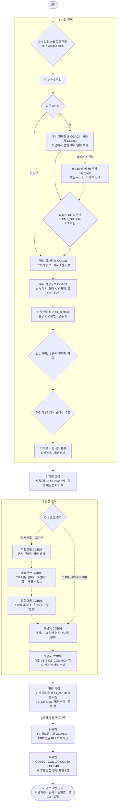
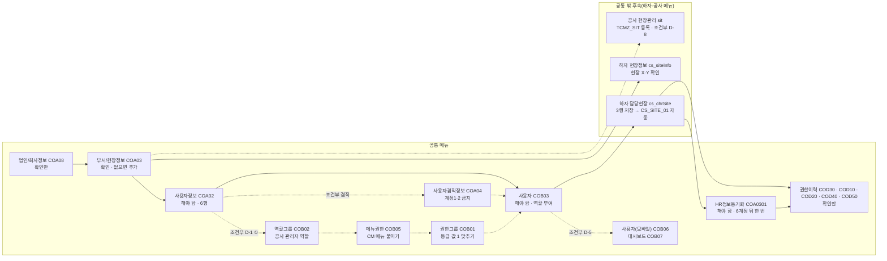
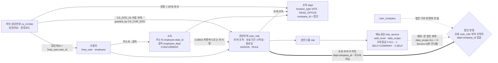
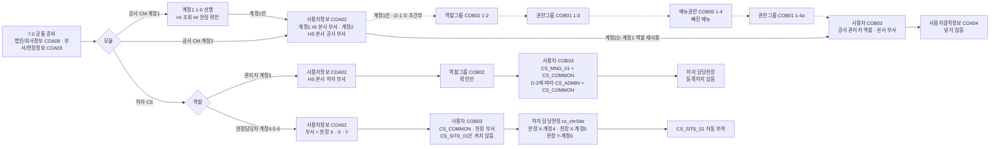
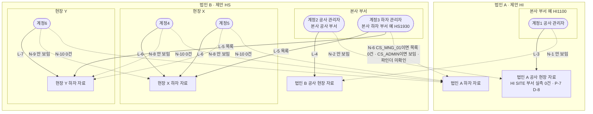

# 신규 입사자 6계정 생성·권한 설정 시나리오 (erp-h 상단메뉴 '공통')

- 작성일: 2026-11-23
- 작업자: erpadmin
- 대상 시스템: erp-h `http://localhost:8080/`
- 근거 경로 줄임말
  - `erp-h/` = `d:/root/docs/DEV/vsc_workspaces/hmp202061112-herp/products-erp-h/`
  - `CA/` = `erp-h/docs/work/common-asis/`
  - `52권한` = `CA/52-설계-화면-권한.md`
  - `S6` = `erp-h/docs/work/common-admin/S6-role-codes.md`
  - `PLAT` = `erp-h/docs/work/common-admin/dev-guide/PLATFORM.md`
  - `ISSUES` = `erp-h/docs/work/common-admin/ISSUES-20261109.md`
  - `PF/` = platform-hmp 소스 `D:/root/docs/DEV/vsc_workspaces/hmp202061112-hmpcoms/platform-hmp/` (2026-11-24 한시 참조로 확인한 근거에만 씁니다)
  - `메뉴문서` = 같은 폴더의 `erph-menu-erpadmin-dom-공통.md`
  - `실측` = 2026-11-23 erpadmin 세션에서 조회 API만 부른 결과입니다. 저장·삭제 API는 부르지 않았습니다.
- 다이어그램 5종 위치: ① 전체 프로세스 흐름(5장 머리) ② 공통 화면 간 작업 순서(6장 머리) ③ 권한 모델 관계(6.3 끝) ④ 계정별 설정 흐름(7장 머리, 7.0 앞) ⑤ 데이터 범위 분리도(7.7 끝)

---

## 1. 목적

erpadmin으로 신규 입사자 6명의 계정을 만들고, 각자 맡은 업무(공사·하자)와 데이터 범위(법인 또는 현장)에 맞게 권한을 줍니다. 이 문서는 그 순서와 상단메뉴 '공통'의 화면별 작업을 정리합니다.

## 2. 대상 계정

| 계정 | 법인 | 모듈 | 역할 | 현장 조건 | 볼 수 있어야 하는 범위 |
|---|---|---|---|---|---|
| 계정1 | 법인 A | 공사(CM) | 관리자 | 없음 (본사 소속) | 법인 A의 공사 데이터 전체 |
| 계정2 | 법인 B | 공사(CM) | 관리자 | 없음 (본사 소속) | 법인 B의 공사 데이터 전체 |
| 계정3 | 법인 B | 하자(CS) | 관리자 | 없음 (본사 소속) | 법인 B의 하자 현장 전체 |
| 계정4 | 법인 B | 하자(CS) | 현장별 담당자1 | 현장 X | 현장 X만 |
| 계정5 | 법인 B | 하자(CS) | 현장별 담당자2 | 현장 X (계정4와 같음) | 현장 X만 |
| 계정6 | 법인 B | 하자(CS) | 현장별 담당자3 | 현장 Y (계정4와 다름) | 현장 Y만 |

## 3. 전제

### 3.1 법인 A·B의 실제 코드

요청에는 법인 A·B가 실제로 어느 법인인지 적혀 있지 않습니다. 실측으로 사용 중인 법인은 아래 3개입니다(실측 `/sys/company/list`, `/coz/getGrd_CoCodeFind {ACTION:'CORP'}`).

| 코드 | 이름 | ERP 사용 | 건설법인 | 부서·현장 (실측 `/sys/dept/list`) |
|---|---|---|---|---|
| HS | 휴먼건설 | Y | Y | 625건 (SITE 613, HEAD_OFFICE 12) |
| HI | 휴먼산업 | Y | Y | 2건 (HI1100 경영지원팀, HI1300 건설현장. 둘 다 HEAD_OFFICE) |
| HR | 휴먼프라퍼티 | Y | N | 1건 (HR1100 경영지원팀) |

- **제안(추정): 법인 A = HI, 법인 B = HS.**
  - 하자 현장과 하자 데이터가 HS에 몰려 있습니다. 하자 담당현장 11행의 현장 4곳이 모두 HS 현장입니다(실측 `/csc/getGrd_ChrSite`).
  - 현장(SITE) 부서는 HS에만 있습니다. 그래서 계정4~6의 현장 X·Y는 HS에서만 고를 수 있습니다(실측).
- 이 배정은 실측에서 끌어낸 추정입니다. **운영자가 확정해야 합니다.** 다르게 정하면 문서의 HI/HS를 실제 코드로 바꿔 읽으십시오.
- 아래 예시 값(사번, 사용자ID, 부서코드)은 설명용입니다. 실제 값으로 바꾸십시오.

### 3.2 erpadmin의 현재 권한

- erpadmin은 SYS_ADMIN·BIZ_ADMIN 외에 업무·하자 역할 11개를 더 가지고 있습니다. 모두 13역할이고, **모두 DEPT HS1910 한 조직에 부여**되어 있습니다(`erp-h/docs/work/common-admin/TEST-ACCOUNTS-20261112.md:12`, `ISSUES:304` '13역할@DEPT HS1910', `erp-h/db/common-admin/P3-04-roles.sql:124`).
  - 하자 역할도 가진 계정이므로, erpadmin으로 본 하자 화면 결과(예: P-6 ZZV_SEED1)는 새 계정이 볼 결과와 다를 수 있습니다.
- erpadmin의 법인 소속(user_company)은 HS/MAIN 1건이고(실측 `/sys/hmp-user/companies`), 로그인 법인도 HS입니다(실측 `/dpt/getFrm_LoginCorp`). 다만 user_company는 법인 거부 판정에 쓰이지 않습니다(아래).
- 실측에서 HI 법인 자료를 `/dpt`·`/auth`·`/usr/deptCrent` 계열 API로 조회하면 「권한이 없는 법인(HI)입니다.」로 막혔습니다. 이 API를 쓰는 화면은 COA03·COB03·COA04입니다(`erp-h/app/src/main/resources/pages/co/deptMng.js:118`, `authMapp.js:190-209`, `deptCrent.js:147,153`). 실측 호출에 `X-Service-Id` 헤더를 실었는지는 기록이 없어 미확인입니다.
- 거부 판정 방식(`WorkCorpRequestAdvice`·`WorkCorp`):
  - 요청 본문의 법인 칸을 **사용자의 유효한 ERP user_role 부여 조직이 속한 법인(dept.company_id) 집합**과 비교합니다(`erp-h/app/src/main/java/hmplus/erp/common/support/WorkCorp.java:157-176`, `erp-h/app/src/main/resources/mybatis/mapper/erp-common-workCorp.xml:17-25`). user_company(`selectHomeCorp`, 같은 xml :9-11)는 이 판정에 쓰이지 않습니다. erpadmin은 부여 조직이 HS1910 하나라 HI가 이 집합에 없습니다.
  - 예외 1: `org_id='*'` 전체 부여가 있으면 통과합니다(`WorkCorp.java:171`, `workCorp.xml:27-33`).
  - 예외 2: 요청 헤더 `X-Service-Id`가 전 법인 화면(SCREEN_APIS에 오른 COA02·COA03·COA04·COB00·COB01·COB03)이고, 요청 경로가 그 화면의 API이며, 사용자 역할 중 그 화면 data_scope가 ALL인 것이 있으면 검사와 채움을 모두 건너뜁니다(`WorkCorp.java:205-223,267-292`, `WorkCorpRequestAdvice.java:61-63`). 시드상 BIZ_ADMIN은 COA02·COA03·COA04·COB03이 auth_level 3·ALL입니다(`co-75-asis-rename.sql:793,796,799,829`).
- **따라서 화면에서 정상으로 열면(헤더 포함) erpadmin도 HI를 다룰 수 있을 가능성이 큽니다(미확인).** 법인 A가 HI라면 계정1 작업 전에 COA03·COB03을 화면에서 법인 HI로 열어 보십시오. 그래도 막히면 해법은 user_company가 아니라 erpadmin에게 HI 부서(예: HI1100) 조직으로 관리 역할을 부여하는 것(로그인 때 그 조직을 골라야 함)이나 `org_id='*'` 전체 부여입니다(10.2 U-3).

### 3.3 근거와 한계

- 근거는 erp-h 저장소의 소스·설계 문서와, 2026-11-23 erpadmin 세션의 읽기 전용 실측입니다.
- hmp 플랫폼 저장소(core·feature-*)는 열지 않았습니다. 플랫폼 동작은 erp-h 안 문서(PLAT, 52권한 등)를 근거로 적었습니다.
- 저장 동작(계정 생성, 역할 부여, 담당현장 등록)은 실제로 해 보지 않았습니다. 저장 결과는 소스와 설계 문서로 예상한 것입니다.
- **권한관리 화면(COB01·COB02·COB03·COB05)이 지금 어느 구현으로 열리는지 확실하지 않습니다.** 메뉴문서상 소스는 erp-h 이식본(`pages/co/authGrp.js` 등)이고(메뉴문서:84-98), 52권한의 동작 설명은 hmp 신규 화면 설계 기준입니다. 화면의 버튼·칸 이름은 실제 화면에서 맞춰 보십시오.
- **COA02 사용자정보가 여는 화면도 DB 판에 따라 다릅니다**(4.2절).

---

## 4. 시작 전에 꼭 확인할 것

### 4.1 확인 질의·실측 목록

| 번호 | 확인할 것 | 방법 | 왜 필요한가 |
|---|---|---|---|
| P-1 | COA02의 실제 화면 | `SELECT program_path FROM HMP.program WHERE system_id='ERP' AND program_id='COA02'`. 또는 COA02를 열고 네트워크 탭을 봅니다 | 화면마다 입력 칸과 저장 결과가 다릅니다(4.2) |
| P-2 | 부서 현장 구분 상태 | `SELECT location_type, COUNT(*) FROM HMP.dept GROUP BY location_type` (`CA/brief/COA03.md:260`) | 현장 = `dept.location_type='SITE'` 입니다(`CA/50-설계-데이터.md:16`). 실측으로 HS SITE 613건은 확인했습니다 |
| P-3 | RowScope 스위치 — **요구 값 ENFORCE** | CONFIG `SECURITY/data-scope.row-filter`가 ENFORCE인지 봅니다. 값은 OFF·LOG·ENFORCE 3단이고 코드 기본값은 OFF입니다(`PF/`core `RowScopeGuard.java:143-153`) | ENFORCE가 아니면 공사(CM) 화면이 전 법인을 보여 주고(`ISSUES:33`, `PLAT:480-490`) 부정 확인 N-1·N-2가 성립하지 않습니다. 값을 올릴지는 전 시스템에 영향이라 운영 결정입니다(D-9) |
| P-4 | 하자 현장 검사 스위치 — **요구 값 Y** | CONFIG `deptAuthCheck.enabled`가 Y인지 봅니다. 기본값 false, dev 프로필만 Y입니다(`erp-h/app/src/main/resources/db/module/erp/install/common/cs-10_config.sql:10-13`) | Y가 아니면 타 현장 직접 조회 거부(`CSZ_DEPT_AUTH_SITE_DENIED`)가 동작하지 않아 부정 확인 N-8·N-9가 성립하지 않습니다. 값을 올릴지는 전 시스템에 영향이라 운영 결정입니다(D-9) |
| P-5 | 담당현장 연동 역할 설정 | CONFIG `ERP/CS auth.chr-site.grant-role.internal` (기본 CS_SITE_01) | 비어 있으면 담당현장 저장이 `CS_CHR_SITE_NO_GRANT_ROLE`로 거부됩니다(`erp-h/app/src/main/java/hmplus/erp/cs/csb/service/ChrSiteGrantService.java:105-111`) |
| P-6 | erpadmin의 ZZV_SEED1 담당현장 행 | 하자 › 담당현장에서 erpadmin 행 확인 | 시험 시드가 erpadmin을 ZZV_SEED1 담당자로 넣습니다(`erp-h/db/cs-test/cs-flow-seed-ZZV_SEED1-mssql.sql:88-89`). 실측으로 하자 현장정보 조회 결과가 ZZV_SEED1 1건뿐이었습니다(실측 `/csb/getGrd_SiteInfoList`). erpadmin은 하자 역할도 가진 계정이라 새 계정과 결과가 다를 수 있습니다(3.2) |
| P-7 | 법인 A(HI)의 현장 | `SELECT company_id, location_type, COUNT(*) FROM HMP.dept WHERE company_id='HI' GROUP BY company_id, location_type`와 `TCMZ_SIT` 중 HI 현장 행 | 실측으로 HI SITE 부서 0건입니다(3.1). CM 현장 파인더는 SITE 부서와 INNER JOIN하므로 0건이면 계정1의 공사 데이터와 L-3·N-1 검증이 성립하지 않습니다(8.2, D-8) |

### 4.2 COA02가 여는 화면 세 가지

| COA02 `program_path` | 화면 | 근거 |
|---|---|---|
| `organization/employee` | hmp 원본 임직원 관리(좌우 분할, 계정 탭) | install 시드 `erp-h/app/src/main/resources/db/module/erp/install/common/co-75-asis-rename.sql:20-21` |
| `organization/user-info` | 설계서의 새 사용자정보 화면 | `erp-h/db/common-asis/W4-menu-rewire-COA02-04-08-mssql.sql:3-4,17-18`, `CA/brief/COA02.md:337` |
| (행 없음) `pages/co/usrMng.js` | erp-h 이식본 | 설계상 사용 안 함(`CA/71-매핑-화면-API.tsv:3`, `CA/brief/COA02.md:337`). 메뉴문서:22는 71 tsv에서 추정한 값입니다(메뉴문서:7) |

- 네트워크 탭으로 구분하는 법: `/sys/user-info/*`면 새 화면, `/sys/employee/*`와 `/sys/employee-user/*`면 hmp 원본, `/hmp-user/save`와 `/usr/setFrm_UserLink`면 이식본입니다.
- 새 화면이 열리는데 `user-info` SERVER 서비스 행이 없으면 `/sys/user-info/*`가 403입니다. 11/23 erpadmin 실측이 있고, 연결 SQL ② 단계가 이 행을 넣습니다(`W4-menu-rewire-COA02-04-08-mssql.sql:6,23-26`). 이 SQL이 적용됐는지는 미확인입니다.
- 6.8절과 7장의 COA02 단계는 **이식본 `usrMng.js`와 새 화면 `user-info`** 기준입니다. 두 화면은 같은 칸을 씁니다(`CA/brief/COA02.md:281-302`). hmp 원본 `employee.js`로 열리면 6.9절을 보십시오.

---

## 5. 전체 프로세스 흐름

마름모는 운영자 결정(D-*)이나 조건 분기, 점선은 조건부·선택 단계입니다. 공사 관리자 역할을 새로 만들 때는 COB05 메뉴 붙이기 → COB01 등급 맞추기 순입니다(아래 3단계 2).
7.1 표(그림 ④)는 순서가 조금 다릅니다. COB01 트리로 먼저 붙이고(1-3), 트리에 없어 빠진 메뉴만 COB05로 더한 뒤(1-4), COB01로 다시 맞춥니다(1-4a). 두 곳 모두 마지막 단계는 COB01 등급 맞추기입니다.

1. **사전 준비**
   1. 법인 A·B 코드를 확정합니다(3.1).
   2. 4.1의 P-1~P-6을 확인합니다. P-3·P-4는 값 확인이 아니라 **요구 값(ENFORCE·Y)으로 맞춥니다**(아니면 9장 부정 확인 N-1·N-2·N-8·N-9가 성립하지 않습니다. D-9).
   3. 법인 A가 HI라면 COA03·COB03을 화면에서 법인 HI로 열어 막히지 않는지 봅니다. 막히면 erpadmin에게 HI 부서 user_role 부여(또는 `org_id='*'` 부여)가 필요합니다(3.2, U-3).
   4. 법인 A가 HI라면 HI 소속 현장(SITE) 부서와 CM 현장(`TCMZ_SIT`)이 있는지 봅니다. 지금 HI에는 SITE 부서가 0건이라 계정1이 볼 공사 현장도 0건입니다(3.1, 8.2, P-7, D-8).
   5. COA08에서 법인 A·B가 ERP 사용 Y이고 회사(사업자)가 1건 이상인지 확인합니다.
   6. COA03에서 소속 부서와 현장 X·Y를 확인하고, 없으면 만듭니다.
   7. 하자 › 현장정보에 현장 X·Y가 있는지 확인합니다(공통 밖, 8.1).
   8. 계정1·2에 줄 '공사 관리자' 역할을 어떻게 할지 정합니다(10.1 D-1).
   9. 계정3에 줄 하자 관리자 역할을 정합니다(10.1 D-2).
   10. 처리일과 입사일이 같은지 봅니다. 이 문서는 **입사 당일 처리**를 전제로 합니다(7.0 아래 '시작일' 참고).
2. **계정 생성** — COA02 사용자정보에서 6행을 만듭니다. 사번·사용자ID·이름·법인·소속 부서·입사일을 넣습니다. 임시 비밀번호를 받아 적습니다.
3. **권한 부여**
   1. (D-1에서 새로 만들기로 했다면) COB02에서 공사 관리자 역할을 만듭니다.
   2. COB05에서 그 역할에 공사(CM) 메뉴를 붙이고(「전체조회」 체크 = 값 1 법인 범위), 이어서 COB01 상세권한에서 모든 CM 행의 조회등급을 값 1(라벨 「전사」)로, 수정을 켬으로 맞춥니다. **메뉴 붙이기(COB05)를 먼저, 등급 맞추기(COB01)를 나중에** 합니다(7.1 1-3·1-4).
   3. COB03에서 계정1·2·3에 역할을 줍니다. 부여 조직은 각자의 본사 부서입니다.
   4. COB03에서 계정4·5·6에 CS_COMMON을 각자의 현장 부서로 줍니다.
4. **데이터 범위 / 현장 배정** — 하자 › 담당현장(cs_chrSite)에 (현장 X, 계정4), (현장 X, 계정5), (현장 Y, 계정6) 3행을 저장합니다. 이 저장이 CS_SITE_01을 각 현장에 자동으로 줍니다(공통 밖, 8.1).
5. **반영(필수, 6계정 저장을 모두 끝낸 뒤 한 번만)** — COA0301 HR정보동기화는 그 계정 하나가 아니라 **ERP 사용자 전원**의 발령 규칙 권한(RULE)을 다시 계산합니다(`recomputeAll("ERP")`). 토스트의 부여·회수 건수도 전원 기준입니다(`erp-h/app/src/main/java/hmplus/erp/co/dept/service/DeptMngService.java:181,198-207`). **로그인·조직 전환 때는 RULE 재계산이 돌지 않습니다.** 재계산 호출처는 소속 변경 이벤트·주기 배치(ROLE_RULE_SYNC)·직무연동 저장 3곳뿐이고(`PF/`core `LoginServiceImpl.java`에 호출 없음, `RoleRuleRecomputeListener.java:38-47`, `RoleRuleSyncJob.java:33`, `JobLinkController.java:70`; erp-h 쪽 호출도 `DeptMngService.java:200` 하나), 주소속만으로 만든 신규 계정은 생성 때 소속 변경 이벤트도 나지 않습니다. 건너뛰면 RULE 역할(HQ_COMMON·SITE_COMMON)이 배치 시각까지(배치가 꺼져 있으면 무기한) 부여되지 않으므로 이 단계는 필수입니다. `CA/50-설계-데이터.md:721`의 「로그인 때도 돈다」는 서술은 플랫폼 코드와 다릅니다. RULE 행 생성 확인은 V-10입니다. HQ_COMMON·SITE_COMMON이 붙는 것은 hmp H1 수정이 반영됐을 때입니다(U-5, 6.8 위험 항목).
6. **확인** — COD30·COD10·COD20·COD40으로 확인하고, 각 계정으로 로그인해 긍정·부정 확인을 합니다(9장).
7. **첫 로그인 안내** — 사용자ID, 임시 비밀번호, 로그인 때 고를 조직(부서·현장)을 본인에게 알립니다.

---

## 6. 공통 화면별 작업표 (40화면)

표기: **해야 함** = 이 입사 건에서 저장 작업이 필요합니다. **확인만** = 조회로 상태만 봅니다. **조건부** = 결정이나 상태에 따라 작업합니다. **해당 없음** = 이 입사 건과 관계없습니다.

실선은 이 입사 건에서 꼭 거치는 순서, 점선은 조건부·선택 단계입니다. 화면별 구분(해야 함·조건부·확인만)은 아래 표와 6.6을 따릅니다.

### 6.1 기초정보관리

| 화면 (serviceId) | 구분 | 할 일 | 계정별 차이 | 근거 |
|---|---|---|---|---|
| 공통코드 (COA01) | 확인만 | 입사·소속 처리용 코드를 새로 넣을 필요는 없습니다. 필요하면 `CO_HO_SITE_DIV`(B 본사, H 현장)와 `CMN_USER_TYPE`(EMPLOYEE·PARTNER_USER)이 있는지만 봅니다 | 없음 | `erp-h/app/src/main/resources/db/module/erp/install/common/co-deptMng-tree.sql:30-36`, `CA/52-설계-화면-기초정보.md:195,214`. 새 코드가 필요하다는 근거는 찾지 못했습니다 |
| 사용자정보 (COA02) | **해야 함** | 6행을 만듭니다(6.8 칸 설명). 역할은 이 화면에서 생기지 않습니다(삭제할 때는 역할을 함께 지웁니다) | 법인·부서가 계정마다 다릅니다 | `erp-h/app/src/main/resources/pages/co/usrMng.js:539-552`. 역할 미생성: 저장 흐름 `usrMng.js:180-232`에 user_role 생성 호출이 없음(`/sys/employee/save`·`/hmp-user/save`·`/hmp-user/reset-password`·`/sys/extension/save`·`/usr/setFrm_UserLink`만 부름). 삭제 시 역할 삭제: `usrMng.js:312-340`(`/sys/role-manage/user-role-delete`) |
| 부서/현장정보 (COA03) | 확인 / 조건부 | 소속 부서와 현장 X·Y가 있는지 봅니다. 없으면 추가합니다 | 계정1: 법인 A 본사 부서. 계정2·3: 법인 B 본사 부서. 계정4·5: 현장 X. 계정6: 현장 Y | `CA/brief/COA03.md:248,262,272`, `erp-h/app/src/main/java/hmplus/erp/co/dept/service/DeptMngService.java:232-254` |
| HR정보동기화 (COA0301, 메뉴에 안 보이는 하위 화면) | **해야 함**(6계정 저장 뒤 한 번) | 6계정 저장을 모두 끝낸 뒤 **한 번만** [확인]을 누릅니다. ERP 전 사용자 RULE을 다시 계산하므로 부여·회수 건수는 전원 기준입니다. 로그인·조직 전환 때는 RULE 재계산이 돌지 않아, 건너뛰면 RULE 역할이 배치 시각까지 부여되지 않습니다(5장 5단계, V-10). 적용일자는 오늘만 됩니다 | H1 수정이 반영됐다면(U-5) 계정4~6은 SITE_COMMON, 계정1~3은 HQ_COMMON이 붙을 것으로 예상합니다. 미반영이면 RULE 행이 생기지 않으며, 이때도 ASSIGN 부여만으로 로그인·업무 권한은 동작합니다 | `DeptMngService.java:181,188-209,197`, `DeptMngController.java:58-59`, `CA/brief/COA0301.md:256,263,278`, `CA/50-설계-데이터.md:23,415,721` |
| 법인/회사정보 (COA08) | 확인만 | 법인 A·B가 사용여부 Y로 보이는지, 회사(사업자)가 1건 이상인지 봅니다 | 법인 A·B 두 법인 | `CA/brief/COA08.md:263,265,276`. 실측: HI·HS·HR 사용 Y |
| 거래처관리 (COA05) | 해당 없음 | 6명 모두 내부 직원입니다. 협력업체 계정이 아닙니다 | — | 요청 내용 |
| 휴일관리 (COA20) | 해당 없음 | — | — | — |
| 코드관리 › 국가코드 (COA07) · 통화코드 (COA06) · 환율정보 (COA09) · 은행정보 (COA11) | 해당 없음 | — | — | — |

### 6.2 권한관리

| 화면 (serviceId) | 구분 | 할 일 | 계정별 차이 | 근거 |
|---|---|---|---|---|
| 권한그룹 (COB01) | 조건부(계정1·2) | 새 공사 관리자 역할의 공사(CM) 메뉴 사용을 켜고, 상세권한의 등급 칸(이식본 머리글 「조회등급」, 52권한 설계명 '권한등급')을 **값 1, 화면 라벨 「전사」**(=SELF+법인 범위)로 둡니다. **라벨 「전사(법인)」은 값 0 = ALL이므로 고르지 마십시오.** 법인 구분이 사라집니다. '기존권한 복사'(BIZ_ADMIN 원본)를 쓰면 행마다 값 1로 바꿔야 합니다 | 계정1·2만. 하자 역할은 이미 있어 손대지 않습니다 | `52권한:245,256,290,338-354,347`. 값 0=ALL(라벨 「전사(법인)」), 1=SELF+COMPANY(라벨 「전사」), 3=SELF(라벨 「기본/소속」)(`erp-h/work/common-asis/co77/ko-supplement-review.tsv:17-20`, `erp-h/app/src/main/java/hmplus/erp/co/auth/service/AuthAprcWriteService.java:299-311`). 선택지는 SYS12 lookup(`pages/co/authGrp.js:61`), 머리글 `AUTH_GRP_AUTH_GRD`=「조회등급」(`authGrp.js:630`, `authGrp.i18n.json:11`) |
| 역할그룹 (COB02) | 조건부(계정1·2) / 확인만(계정3~6) | 직접 부여(ASSIGN) 역할을 새로 만듭니다. 예: 코드 `CM_ADMIN`, 이름 「공사 관리자」. 사용자 패널은 읽기 전용입니다. 하자 역할 8개가 있는지 확인합니다 | 계정1·2용 1개만 만듭니다. 법인마다 따로 만들 필요는 없습니다(부여 조직이 법인을 정함) | `52권한:481-482,493,500`, 이름 규칙 `S6:13,17`. 실측: CM 역할 0개, 하자 역할 8개 |
| 메뉴권한 (COB05) | 조건부(계정1·2) / 확인만 | 메뉴 하나 기준으로 권한그룹을 붙입니다. 이식본에서 **「전체조회」 체크 = 등급 1(SELF+COMPANY, 법인 범위), 해제 = 3(SELF)**입니다. ALL이 아닙니다. 공사 관리자 역할에 새로 붙이는 메뉴는 **「전체조회」를 체크해야** 법인 범위가 됩니다. COB01에서 등급 1로 둔 메뉴는 여기서 체크된 것으로 보입니다. 붙인 뒤 COB01에서 등급·수정을 다시 맞춥니다(7.1 1-3) | 계정1·2용 역할만 | `erp-h/app/src/main/resources/pages/co/authMnu.js:79,253`(AUTH_GRD check trueValue 1·falseValue 3), `erp-h/app/src/main/java/hmplus/erp/co/auth/service/AuthMnuService.java:117-118`(빈 값=3), `AuthAprcWriteService.java:299-311`(1→SELF+COMPANY). 52권한:711의 'data_scope ALL ↔ 전체조회'는 hmp 신규 화면 설계라 이식본과 다릅니다 |
| 직무연동 (COB08) | 해당 없음 | 직무(CMN_JOB)와 본사권한(DT)·현장권한(DY)을 잇는 자동 부여입니다. 6계정 모두 직접 부여로 구성합니다 | — | `52권한:881,900,903`. AS-IS 원천 0행(`CA/30-data-org-auth.md:94`) |
| 사용자겸직정보 (COA04) | 해당 없음(기본) / 조건부 | 기본 입사 처리에는 필요 없습니다. 주소속은 COA02의 부서입니다. **계정1·2(공사 관리자)에게 현장 겸직·파견을 넣지 마십시오.** 현장담당자로 판정되어 일부 공사 저장이 막힙니다. 계정4~6의 주소속을 현장으로 두지 않는 경우에는, 여기서 현장 겸직(CONCURRENT)을 넣어 COB03 목록에 현장 행이 나오게 하는 방법이 있습니다(6.3) | 계정1·2: 넣지 않음. 계정3: 운영상 필요할 때만. 계정4~6: 주소속이 현장이 아니면 현장 겸직 | `erp-h/app/src/main/resources/mybatis/mapper/erp-co-authMapp.xml:45-67`, `CA/52-설계-화면-권한.md:1060-1066`, `erp-h/app/src/main/java/hmplus/erp/common/deptauth/SiteAuthService.java:36-42`, `erp-h/app/src/main/resources/mybatis/mapper/erp-common-siteStaff.xml:13-32` |
| 부서별겸직정보 (COB00) | 해당 없음(기본) | COA04와 같은 표(employee_dept)를 부서 기준으로 봅니다. COA04를 쓰지 않으면 할 일이 없습니다 | — | `52권한:1262-1266` |
| 대시보드 (COB07) | 조건부 | 하자 현장용 홈 화면을 역할이나 사용자 기준으로 걸고 싶을 때만 씁니다. 다음 로그인부터 적용됩니다 | 필요하면 계정3~6 | `52권한:1462`. 대시보드 서비스로 실측된 것은 `db_dashBoardCS` 1개입니다(52권한 A7) |
| 사용자 (COB03) | **해야 함** | 사용자 1명 × 부서 1행 목록에서, 부여할 부서 행을 골라 역할 사용을 켭니다 | 6.3절 표 | `52권한:1611-1612,1630-1633`, 키 {usrId, corpCd, deptCd}(`erp-h/app/src/main/resources/pages/co/authMapp.js:172-173`) |
| 사용자(모바일) (COB06) | 조건부 | 모바일 앱을 쓸 사람에게만 MOBILE_USER를 줍니다. 하자 현장 범위와는 관계없습니다 | 필요하면 계정4~6 | `52권한:1795-1806`. 필요 여부 미확인(D-5) |

### 6.3 COB03에서 줄 역할 (계정별)

| 계정 | 부여 조직(부서 행) | 줄 역할 | COB03에서 주지 않는 것 |
|---|---|---|---|
| 계정1 | 법인 A 본사 부서 | 공사 관리자 역할(D-1) | 현장 부서 부여 |
| 계정2 | 법인 B 본사 부서 | 공사 관리자 역할(D-1) | 현장 부서 부여 |
| 계정3 | 법인 B 본사 하자 부서 | CS_MNG_01 + CS_COMMON (D-2에서 CS_ADMIN으로 정하면 CS_ADMIN + CS_COMMON) | 담당현장 등록 |
| 계정4 | 현장 X | CS_COMMON | **CS_SITE_01** (담당현장 등록이 자동으로 줌) |
| 계정5 | 현장 X | CS_COMMON | **CS_SITE_01** |
| 계정6 | 현장 Y | CS_COMMON | **CS_SITE_01** |

- 한 사람의 역할은 같은 조직에 줘야 함께 켜집니다. 로그인 때 고른 조직의 부여 역할만 활성 역할이 되기 때문입니다(`CA/30-data-org-auth.md:194`, HC-29 `erp-h/db/common-admin/P3-04-roles.sql:8`).
- CS_COMMON은 하자 팝업·파인더의 공용 역할(화면 0개)이라, 하자 역할을 가진 사람 전원에게 함께 줍니다(`S6:34`). 지금도 꼭 필요한지는 R-6 진행 상태에 달려 있어 미확인입니다.
- 실측 선례: 하자 현장담당 예시 계정은 `CS_COMMON|DEPT|B6H132|HS|ASSIGN`, `CS_SITE_01|DEPT|B6H132|HS|ASSIGN`이었습니다. 하자 관리자 예시는 소속 HS1930 CS팀에 `CS_ADMIN`·`CS_APRV_01`·`CS_COMMON`을 받았습니다(실측 `/sys/role-manage/user-role-list`).
- CS_SITE_01을 COB03에서 같은 현장에 직접 주면 안 되는 이유: 같은 날 같은 키로 사람이 준 부여가 있으면 담당현장 연동이 부여를 새로 만들지 않습니다. 그러면 나중에 담당현장 행을 지워도 권한이 남습니다(`ChrSiteGrantService.java:72-78`).
- COB03 목록에는 주소속(employee.dept_id)과 유효 겸직(employee_dept `assign_type='CONCURRENT'`)만 나옵니다(`52권한:1611,1631`, 이식본 목록 SQL `erp-h/app/src/main/resources/mybatis/mapper/erp-co-authMapp.xml:45-67`). DISPATCH(파견)는 이식본 목록에 나오지 않습니다(같은 파일 :67). 그래서 계정4~6의 현장 행에 CS_COMMON을 주려면 둘 중 하나가 필요합니다.
  - 방법 1(권장, 7장 기준): COA02에서 주소속을 각자 현장 부서로 둡니다.
  - 방법 2: 주소속은 본사 부서로 두고, COA04에서 현장 겸직(CONCURRENT)을 넣어 COB03 목록에 현장 행이 나오게 합니다. 선례 h.site01도 주소속은 HS1358이고 현장 B6H132는 employee_dept DISPATCH였는데 B6H132에서 CS_COMMON·CS_SITE_01을 받았습니다(`CA/50-설계-데이터.md:346,758`, 6.3 실측 선례). 즉 부여 조직이 주소속일 필요는 없습니다. 다만 그 부여는 시드 SQL로 넣은 것이고 DISPATCH는 COB03 목록에 안 나오므로, 화면으로 하려면 CONCURRENT여야 합니다.

법인 범위는 user_company가 아니라 user_role 부여 조직의 `dept.company_id`로 정해집니다(3.2). 한 사람의 역할은 같은 조직에 줘야 로그인 때 함께 켜집니다.

### 6.4 권한이력

| 화면 (serviceId) | 구분 | 할 일 | 근거 |
|---|---|---|---|
| (권한현황) 권한그룹-메뉴 (COD30) | 확인만 | 새 공사 관리자 역할의 CM 메뉴와 권한등급 1(SELF+법인 범위. COB01 라벨 「전사」), CS_MNG_01·CS_SITE_01 메뉴 구성을 봅니다 | `52권한:1953-1966,2060` |
| (권한현황) 권한그룹-사용자 (COD10) | 확인만 | CS_SITE_01 아래 계정4·5가 현장 X, 계정6이 현장 Y로 나오는지 봅니다. 유효 부여만 나옵니다 | `52권한:2123-2136,148` |
| (권한현황) 사용자-권한그룹 (COD20) | 확인만 | 계정마다 역할·부서(법인)가 맞는지, CS_COMMON이 같은 조직에 있는지 봅니다 | `52권한:2286-2298` |
| (변경이력) 사용자 (COD40) | 확인만 | erpadmin 작업과 담당현장 연동 부여가 GRANT로 남았는지 봅니다. 자동 조회가 아니니 기간이나 사용자명을 넣고 조회합니다 | `52권한:2440-2452,2559-2567`, `ChrSiteGrantService.java:31-32` |
| (변경이력) 권한그룹 (COD50) | 조건부 확인 | 새 역할을 만들었다면 메뉴 부여 기록을 봅니다. 변경대상 칸은 비어 있습니다 | `52권한:150` (D-14) |
| (접속이력) 개인정보 (COD60) | 해당 없음 | — | — |

- 시드상 COD40~60에는 BIZ_ADMIN 부여가 없고 SYS_ADMIN만 있습니다(co-75 role_service 집계). erpadmin은 SYS_ADMIN이 있어 볼 수 있습니다.
- 전환 전 AS-IS 이력은 넘어오지 않았습니다(D-13, `52권한:149`).

### 6.5 커뮤니티 · 공통기능 · 시스템관리

| 화면 (serviceId) | 구분 | 할 일 |
|---|---|---|
| 공지사항 (COC01) | 해당 없음 | 필요하면 입사 안내 공지를 올릴 수 있습니다. 권한 설정과는 관계없습니다 |
| 시스템승인-Sample (COG01) · 시스템승인-Dialog (COG02) · 전자메일·SMS-Template (COG03) · 문서양식관리 (COG10) · 전자서명검증 (COG20) · 인증서유효기간 (COG30) | 해당 없음 | — |
| 도움말 (COZ05) · 메뉴정보 (COZ04) · 에러로그 (COZ09) · 결재로그 (COZ07) · DB객체관리 (COZ9001) | 해당 없음 | 메뉴정보(COZ04)는 메뉴 자체를 바꾸는 화면이라 이 작업에서 건드리지 않습니다 |
| 시스템접속로그 (COZ80) · 세션모니터링 (COZ82) | 확인만(선택) | 첫 로그인 뒤 접속 기록이 남았는지 볼 때 씁니다. 화면 칸은 확인하지 않았습니다(미확인) |
| 시스템접근통제 (COZ81) | 확인만(선택) | 허용 IP 관리 화면입니다(program `system/allowed-ip`, 메뉴문서:111). 입사자 접속이 IP로 막힐 때만 봅니다. 사용자별 제한이 있는지는 미확인입니다 |

### 6.6 요약

- **해야 함:** COA02, COB03, COA0301(6계정 저장 뒤 한 번. 로그인 때는 RULE 재계산이 돌지 않습니다)
- **조건부로 해야 함:** COA03(부서·현장이 없을 때), COB02·COB05·COB01(공사 관리자 역할을 새로 만들 때. COB05 메뉴 붙이기 → COB01 등급 맞추기 순), COB06·COB07(모바일·대시보드가 필요할 때), COA04(겸직이 필요할 때. 계정4~6 주소속이 현장이 아니면 현장 겸직. 계정1·2는 금지)
- **확인만:** COA01, COA08, COD30, COD10, COD20, COD40, COD50, COZ80·COZ81·COZ82(선택)
- **해당 없음:** COA05, COA20, COA07, COA06, COA09, COA11, COB08, COB00, COD60, COC01, COG01·02·03·10·20·30, COZ05·04·09·07·9001

### 6.7 등급 요건 (erpadmin이 할 수 있는지)

| 화면 | erpadmin 부여 | 근거 |
|---|---|---|
| COA02 | BIZ_ADMIN 3·ALL. 비밀번호 초기화는 등급 3 버튼 | `co-75-asis-rename.sql:793-795`, `usrMng.js:537` |
| COA03 | BIZ_ADMIN 3. 저장 API `@AuthLevel(2)` | `CA/brief/COA03.md:308`, `DeptMngController.java:50-51` |
| COA08 | 저장 등급 3. BIZ_ADMIN 저장에는 CONFIG `ORG/company.admin.allowed-roles`(ERP=BIZ_ADMIN) 필요(적용 여부 미확인) | `CA/brief/COA08.md:376-378,455` |
| COA04·COB00 | BIZ_ADMIN 3·ALL | co-75 role_service |
| COB07·COD40~60 | SYS_ADMIN만 | co-75 role_service 집계 |
| `/sys/role-service/list` | **erpadmin 403** | 실측 |

### 6.8 COA02 입력 칸 (이식본·새 화면 공통)

| 칸 | 필수 | 저장되는 곳 | 입사자에게 넣을 값 |
|---|---|---|---|
| 사번 EMPNO | 화면상 아님 | `employee.employee_no` | **반드시 넣습니다.** 직원 행이 있어야 부서·겸직·RULE 판정이 됩니다(`usrMng.js:186-193`) |
| 사용자ID USR_ID | 필수, 신규 때만 편집 | `hmp_user.user_id` = `login_id` | 형식 `[A-Za-z0-9._@-]{1,100}`(`CA/brief/COA02.md:332`). 하자 담당현장의 담당자ID는 15자까지라(`erp-h/app/src/main/resources/db/module/erp/install/mssql/cs-01-cs-tables.sql:1433-1456`) **계정4~6은 15자 이내**로 합니다 |
| 사용자명 USR_NM | 필수, 신규 때만 | `employee.emp_name`, `user_i18n` | 실명 |
| 법인코드 CORP_CD | 필수, 신규 때만 | `employee.company_id`, `user_company` | 계정1: 법인 A, 계정2~6: 법인 B. **저장 뒤에는 바꿀 수 없습니다** |
| 부서코드 DEPT_CD | 설계 필수(`CA/brief/COA02.md:314`) | `employee.dept_id` | 6.3절 부여 조직과 같은 부서 |
| 사용자구분 USR_KND | 기본 C | `hmp_user.user_type` | **C(정직, EMPLOYEE).** P(협력업체)로 넣으면 담당현장 연동이 CS_PTNR_01을 줍니다(`ChrSiteGrantService.java:116-122`) |
| 사용여부 USE_YN | 기본 체크 | `hmp_user.status` | 체크(ACTIVE) |
| GW | 기본 체크 | `hmp_user_ext.gw_yn` | 운영 기준에 따릅니다 |
| 시작일자 STR_DT | 아님 | `employee.join_date` | 입사일. 계정 유효기간이 아닙니다(`docs/work/common-admin/dev-guide/brief/ca-employee.md` §8) |
| 종료일자 END_DT | 아님 | `employee.resign_date` | 비워 둡니다 |
| 비고 | 아님 | `hmp_user_ext.rmks` | 선택 |

- 새 행의 법인 기본값은 조회조건 법인입니다. 조회조건 처음 값은 로그인 법인(HS)입니다(`usrMng.js:69-72,362-373`).
- 같은 사용자ID가 있으면 `USR_MNG_USR_ID_EXISTS`로 멈춥니다(`usrMng.js:117-128`).
- 이식본은 행마다 직원 → 계정 → 임시 비밀번호 → 확장정보 → 연결(user_system·user_company·user_i18n) 순서로 저장하고 트랜잭션으로 묶지 않습니다. 중간 실패 시 그 행에서 멈추고 다시 조회합니다(`usrMng.js:87-90,170-232`, `erp-h/app/src/main/java/hmplus/erp/co/user/service/UsrMngLinkService.java:48-81`). 새 화면은 `/sys/user-info/save` 한 번으로 묶어 저장합니다(`CA/brief/COA02.md:260,311`).
- 임시 비밀번호 창은 **한 번만** 뜨고 저장도 로그도 남지 않습니다(`CA/brief/COA02.md:331`). 바로 받아 적습니다.
- 위험: 이식본으로 만든 계정은 `user_id`와 `employee_id`(법인-사번)가 다릅니다. hmp H1 수정이 들어가지 않았다면 부서 소속·RULE 판정·헤더 부서 목록이 빕니다(`CA/50-설계-데이터.md:410,415`). 수정 여부는 미확인입니다(U-5).

### 6.9 COA02가 hmp 원본 `employee.js`로 열리는 경우

- 왼쪽 직원 목록에서 행을 추가하고, 오른쪽 「임직원 정보」(회사·사번·직원명·부서·입사일 등), 「계정 정보」(로그인ID·상태 등) 폼에 넣습니다(`CA/21-tobe-screens.md:331-345`).
- 사용자구분·GW·비고 칸은 없습니다(`ca-employee.md` §1).
- 정적 추적으로 본 저장 표에 **user_system(ERP)·user_company·user_i18n이 없습니다**(`CA/21-tobe-screens.md:343`). 이 화면만으로 ERP 로그인이 되는지는 미확인입니다(U-4). 이 경우 진행 전에 개발자와 확인하십시오.

---

## 7. 계정별 시나리오

공통 준비(모든 계정): 5장 1단계(사전 준비)를 끝낸 상태에서 시작합니다. 예시 값은 설명용입니다.

- **시작일(모든 계정의 COB03 부여):** 이 문서는 **입사 당일 처리**를 전제로, COB03 부여 시작일을 처리일(오늘)로 둡니다. 담당현장 연동 부여(CS_SITE_01)는 시작일이 늘 오늘입니다(`erp-h/app/src/main/java/hmplus/erp/cs/csb/service/ChrSiteGrantService.java:56,86`). COB03 시작일을 미래 입사일로 두면 같은 현장의 CS_COMMON(입사일부터)과 CS_SITE_01(오늘부터)의 시작일이 어긋나고, 입사일 전에는 로그인 조직 목록에 고를 조직이 없습니다(로그인 목록 = 유효 user_role 부여 조직, `CA/30-data-org-auth.md:190,195` · 하자 판정도 시작일이 미래인 부여 제외, `erp-h/app/src/main/java/hmplus/erp/cs/csz/service/CsDeptAuthService.java:74`). 입사 전에 미리 처리해야 한다면 시작일은 오늘로 두고, 입사 전 접속은 COA02 사용여부나 첫 로그인 안내 시점으로 통제하십시오.
- **COA0301 HR정보동기화는 계정별 단계가 아닙니다.** 6계정을 다 저장한 뒤 한 번만 누릅니다(필수, 5장 5단계).

번호는 7.1~7.6 표의 순서 번호입니다. 점선은 조건부 단계이며, COA0301은 계정별 단계가 아니라 그림에 넣지 않았습니다.
1-0은 계정1(법인 A=HI)만의 선행 단계라 계정2는 바로 COA02(2-1)로 갑니다. 역할 만들기 순서는 7.1 표대로 COB01(1-3) → 빠진 메뉴만 COB05(1-4) → COB01(1-4a)입니다. 5장(그림 ①·②)의 'COB05 → COB01'과 다르지만, 마지막 단계가 COB01 등급 맞추기라는 점은 같습니다.

### 7.0 공통 준비 단계

| 순서 | 화면 | 작업 | 기대 결과 | 확인 |
|---|---|---|---|---|
| 0-1 | 법인/회사정보 (COA08) | 사용여부 「예」로 조회 | HI·HS(·HR)가 보입니다 | 실측과 같은지 |
| 0-2 | 같은 화면 | 법인 A·B를 골라 회사(사업자) 그리드 확인 | 1건 이상. 사업자번호 없는 기본 사업장은 그리드에 안 보입니다(`CA/brief/COA08.md:265`) | 부서 저장 때 회사코드가 필수라서 필요합니다(`DeptMngService.java:232-235`) |
| 0-3 | 부서/현장정보 (COA03) | 조회조건 법인 HS로 조회. 본사(B) 공사 부서, 본사 하자 부서(예: HS1930 CS팀, 실측), 현장 X·Y(H)가 있는지 검색 | 있는 부서는 코드를 적어 둡니다 | 현장 X·Y는 하자 현장정보에도 있어야 합니다(8.1) |
| 0-4 | 같은 화면 | 없는 부서는 [추가] → 본사구분, 부서코드(10자 이내, 전역 유일), 부서명, 법인코드, 회사코드, 사용여부 Y → [저장] | 저장 뒤 목록에 나옵니다. 본사구분을 비우면 본사(HEAD_OFFICE)로 저장됩니다 | `DeptMngService.java:241-242,253-254`, `deptMng.js:269,274` |
| 0-5 | 같은 화면 | 메뉴에서 연 화면으로 법인 HI(법인 A)의 공사 소속 본사 부서 확인(실측 후보: HI1100 경영지원팀, HI1300 건설현장 — 둘 다 HEAD_OFFICE). HI 현장(SITE) 부서가 있는지도 봅니다 | 화면 호출(X-Service-Id 포함)은 BIZ_ADMIN ALL 면제로 통과할 가능성이 큽니다(3.2). 막히면 erpadmin에게 HI 부서 user_role 부여가 필요합니다. HI SITE 부서가 없으면 계정1이 볼 공사 현장이 0건입니다(8.2) | 실측(헤더 유무 미확인), `WorkCorp.java:205-223` |

### 7.1 계정1 — 법인 A(HI) 공사 관리자

| 순서 | 화면 (serviceId) | 작업 / 입력값 예시 | 저장 후 기대 결과 | 확인 방법 |
|---|---|---|---|---|
| 1-0 | (선행) | COA03·COB03을 **메뉴에서 연 화면으로**(X-Service-Id 포함) 법인 HI로 조회해 봅니다. 그래도 「권한이 없는 법인(HI)」로 막히면 erpadmin에게 HI 부서(예: HI1100) 조직으로 관리 역할을 부여하고(COB03, 로그인 때 그 조직 선택) 또는 `org_id='*'` 전체 부여를 받습니다(3.2, U-3). 또 HI 현장(SITE) 부서·CM 현장(`TCMZ_SIT`)이 있는지 확인합니다(P-7, D-8) | COA03·COB03에서 HI 조회가 막히지 않습니다. HI 현장이 1건 이상 있습니다 | COA03을 법인 HI로 조회 |
| 1-1 | 사용자정보 (COA02) | 조회조건 법인 HI로 바꿔 조회 → [추가] → 사번 `예: 2611001`, 사용자ID `예: hi.cm01`, 이름, 법인 HI, 부서 = HI 본사 부서(예: HI1100), 구분 C, 사용여부 체크, 시작일자 = 입사일 → [저장] | 임시 비밀번호 창이 뜹니다. 다시 조회하면 행이 보이고 법인명·부서명이 채워집니다 | 다시 조회. 로그인실패횟수 0 |
| 1-2 | 역할그룹 (COB02) | (D-1에서 새 역할로 정했을 때) 새 ASSIGN 역할 `예: CM_ADMIN` 「공사 관리자」 추가 → 저장 | 역할 목록에 나옵니다 | COB01 목록에도 보이는지 |
| 1-3 | 권한그룹 (COB01) | 새 역할 선택 → 메뉴사용권한 트리에서 공사(CM) 메뉴 사용 켬 → 상세권한(칸 이름 「조회등급」)에서 수정 켬(등급 2 이상), 인쇄·엑셀 Y, **값 1 = 라벨 「전사」** → 저장. **「전사(법인)」(값 0)은 ALL이라 고르지 마십시오** | 공사 메뉴가 그 역할에 붙습니다 | COD30에서 권한등급 1 확인 |
| 1-4 | 메뉴권한 (COB05) | COB01 트리에 없어 빠진 메뉴가 있으면 메뉴별로 권한그룹 추가 → **「전체조회」 체크**(=등급 1 법인 범위, 해제 시 3=SELF)·「수정」 체크 → 저장 | 추가한 행이 등급 1로 들어갑니다 | COD30 |
| 1-4a | 권한그룹 (COB01) | 1-4에서 메뉴를 더했다면 다시 COB01 상세권한에서 새로 붙은 행의 조회등급을 값 1(「전사」), 수정을 켬으로 맞추고 저장 | 모든 CM 행이 등급 1·수정 가능 | V-1 |
| 1-5 | 사용자 (COB03) | 계정1의 (사용자, HI 본사 부서) 행 선택 → 공사 관리자 역할 사용 켬 → 시작일 = 처리일(오늘, 입사 당일 처리 전제) → 저장 | user_role (계정1, DEPT, HI 부서, 공사 관리자, ASSIGN) | COD20 |
| 1-6 | 사용자겸직정보 (COA04) | **넣지 않습니다.** 현장 겸직이 있으면 현장담당자로 판정됩니다 | — | COA04에서 계정1 겸직 0건 |

- 계정1을 BIZ_ADMIN으로 대신하면 공통 전체 관리자 권한이 함께 붙고 CM 범위가 ALL이라 법인 구분이 사라집니다(`S6:27`, `erp-h/db/cm-module/README.md:18,43-44`, 실측: CM 메뉴를 가진 역할은 BIZ_ADMIN 하나).

### 7.2 계정2 — 법인 B(HS) 공사 관리자

계정1과 같고 법인·부서만 다릅니다.

| 순서 | 화면 | 작업 / 입력값 예시 | 기대 결과 | 확인 |
|---|---|---|---|---|
| 2-1 | 사용자정보 (COA02) | 조회조건 HS → [추가] → 사용자ID `예: hs.cm01`, 법인 HS, 부서 = HS 본사 공사 부서(코드 미확인, 0-3에서 확인) → [저장] | 임시 비밀번호 창 | 다시 조회 |
| 2-2 | COB02·COB01·COB05 | 계정1에서 만든 공사 관리자 역할을 그대로 씁니다. 새로 만들지 않습니다 | — | — |
| 2-3 | 사용자 (COB03) | 계정2의 (사용자, HS 본사 공사 부서) 행에 공사 관리자 역할 사용 켬 → 저장 | user_role (계정2, DEPT, HS 부서, 공사 관리자) | COD20 |
| 2-4 | COA04 | 넣지 않습니다 | — | — |

- 같은 역할로 법인이 갈리는 이유: 등급 1(SELF+COMPANY)은 플랫폼 RowScope에서 로그인 때 고른 부여 조직의 법인(dept.company_id)으로 풀립니다(`PLAT:413,417,482`).
  - 단, 모듈 쪽 판정(`erp-h/app/src/main/java/hmplus/erp/common/deptauth/ErpDeptAuthService.java:76-95`, `CsDeptAuthService.java:36-38,69-90`)과 법인 거부(`WorkCorp.java:157-176`)는 로그인 조직 하나가 아니라 **사용자의 유효한 부여 전체**를 합칩니다. 계정마다 부여 조직이 하나뿐이면 결과가 같습니다.
  - **법인 분리 조건: 계정1·2에 다른 법인 조직 부여나 겸직을 넣지 않습니다.** 넣으면 법인 범위가 합쳐져 넓어집니다.

### 7.3 계정3 — 법인 B(HS) 하자 관리자

| 순서 | 화면 | 작업 / 입력값 예시 | 기대 결과 | 확인 |
|---|---|---|---|---|
| 3-1 | 사용자정보 (COA02) | 조회조건 HS → [추가] → 사용자ID `예: hs.cs01`, 법인 HS, 부서 = HS 본사 하자 부서(예: HS1930 CS팀) → [저장] | 임시 비밀번호 창 | 다시 조회 |
| 3-2 | 역할그룹 (COB02) | 확인만. CS_MNG_01·CS_COMMON(또는 CS_ADMIN)이 있는지 | 실측으로 있음 | — |
| 3-3 | 사용자 (COB03) | (사용자, HS 본사 하자 부서) 행에 **CS_MNG_01 + CS_COMMON** 사용 켬 → 저장 (D-2에서 전 법인 관리자로 정하면 CS_ADMIN + CS_COMMON) | user_role 2행, 같은 부서 | COD20 |
| 3-4 | (하자 메뉴) 담당현장 | **등록하지 않습니다.** 등록하면 관리자 역할이 있어도 SQL 단계에서 그 현장으로 좁혀집니다(`erp-h/app/src/main/java/hmplus/erp/cs/csa/service/SiteAuthService.java:53-65`, `erp-h/app/src/main/resources/mybatis/mapper/erp-csz-csCodeFind.xml:20-36`) | — | 담당현장 목록에 계정3이 없음 |

- CS_MNG_01은 법인 범위(SELF+COMPANY)입니다. 실측 선례로 HI 부서에 CS_MNG_01을 받은 사람이 HS 자료 0건을 봤습니다(`ISSUES:264,275`, `erp-h/app/src/main/java/hmplus/erp/cs/csz/service/CsDeptAuthService.java:86-96`).
- CS_ADMIN은 ALL이라 법인 A 현장도 봅니다(`ISSUES:262,305`, `CsDeptAuthService.java:59-66`).

### 7.4 계정4 — 법인 B(HS) 하자 현장 담당자1 (현장 X)

| 순서 | 화면 | 작업 / 입력값 예시 | 기대 결과 | 확인 |
|---|---|---|---|---|
| 4-1 | 사용자정보 (COA02) | 조회조건 HS → [추가] → 사용자ID `예: hs.site01`(15자 이내), 법인 HS, **부서 = 현장 X**(예: 실측 하자 현장 B8H176), 구분 C → [저장] | 임시 비밀번호 창 | 다시 조회 |
| 4-2 | 사용자 (COB03) | (사용자, 현장 X) 행에 **CS_COMMON** 사용 켬 → 저장. **CS_SITE_01은 켜지 않습니다** | user_role (계정4, DEPT, 현장 X, CS_COMMON) | COD20 |
| 4-3 | (하자 메뉴) 담당현장 | 행 추가: 현장코드 = 현장 X, 담당자ID = 계정4 사용자ID → 저장 (8.1 참고) | CS_SITE_01@현장 X가 자동 부여됩니다(granted_by `CS_CHR_SITE`) | COD20·COD40 |

### 7.5 계정5 — 법인 B(HS) 하자 현장 담당자2 (현장 X, 계정4와 같음)

계정4와 **완전히 같은 현장 값**을 씁니다. 다른 것은 사용자ID뿐입니다.

| 순서 | 화면 | 작업 | 기대 결과 | 확인 |
|---|---|---|---|---|
| 5-1 | 사용자정보 (COA02) | 사용자ID `예: hs.site02`, 법인 HS, 부서 = **현장 X** → [저장] | 임시 비밀번호 창 | 다시 조회 |
| 5-2 | 사용자 (COB03) | (사용자, 현장 X) 행에 CS_COMMON 켬 → 저장 | user_role (계정5, DEPT, 현장 X, CS_COMMON) | COD20 |
| 5-3 | (하자 메뉴) 담당현장 | 행 추가: 현장 X, 계정5 → 저장 | 담당현장 목록에 현장 X 행이 2개(계정4·5) | 화면은 같은 현장+같은 사람 조합만 중복으로 막습니다(`erp-h/app/src/main/resources/pages/cs/chrSite.js:125-128`). 표 PK는 (담당자, 현장)이라 한 현장에 여러 명을 둘 수 있습니다(`cs-01-cs-tables.sql:1456`). 실측 선례: B8H176에 5명 |

### 7.6 계정6 — 법인 B(HS) 하자 현장 담당자3 (현장 Y, 계정4와 다름)

| 순서 | 화면 | 작업 | 기대 결과 | 확인 |
|---|---|---|---|---|
| 6-1 | 사용자정보 (COA02) | 사용자ID `예: hs.site03`, 법인 HS, 부서 = **현장 Y**(현장 X가 아닌 HS 현장, 예: C1H101) → [저장] | 임시 비밀번호 창 | 다시 조회 |
| 6-2 | 사용자 (COB03) | (사용자, 현장 Y) 행에 CS_COMMON 켬 → 저장 | user_role (계정6, DEPT, 현장 Y, CS_COMMON) | COD20 |
| 6-3 | (하자 메뉴) 담당현장 | 행 추가: 현장 Y, 계정6 → 저장 | CS_SITE_01@현장 Y | COD10에서 현장 X 아래에 계정6이 없음 |

### 7.7 계정4·5·6 차이 한눈에

| 항목 | 계정4 | 계정5 | 계정6 |
|---|---|---|---|
| COA02 부서 | 현장 X | 현장 X | 현장 Y |
| COB03 CS_COMMON 조직 | 현장 X | 현장 X | 현장 Y |
| 담당현장 행 | (현장 X, 계정4) | (현장 X, 계정5) | (현장 Y, 계정6) |
| 자동 CS_SITE_01 조직 | 현장 X | 현장 X | 현장 Y |
| 볼 수 있는 현장 | X | X | Y |
| 서로 보이는가 | 계정5와 같은 현장 자료를 봄 | 계정4와 같은 현장 자료를 봄 | 계정4·5의 현장 X 자료를 보지 못함 |

실선은 볼 수 있어야 하는 범위(9.2 L-*), 점선은 보이지 않아야 하는 부정 확인 대상(9.3 N-*)입니다. 계정1의 L-3·N-1은 HI 현장이 1건 이상일 때만 검증이 됩니다(P-7). N-3·N-5·N-7(메뉴 노출)은 그림에서 뺐습니다.

---

## 8. 공통 밖에서 해야 할 후속 작업

### 8.1 하자(CS) 메뉴

| 화면 | 할 일 | 근거 |
|---|---|---|
| 현장정보 (cs_siteInfo) | 현장 X·Y의 `TCSA_SITE_INFO` 행이 있는지 확인합니다. 없으면 담당현장 기준 조회에서 빠집니다 | `erp-h/app/src/main/resources/mybatis/mapper/erp-csa-siteAuth.xml:50-63` |
| 담당현장 (cs_chrSite) | (현장 X, 계정4), (현장 X, 계정5), (현장 Y, 계정6) 3행을 저장합니다. 계정3은 넣지 않습니다 | `ChrSiteService.java:48-82`, `ChrSiteGrantService.java:55-98` |

- 담당현장 저장 경로는 `/csc/setGrd_ChrSite`(등급 2)이고, 같은 트랜잭션에서 (담당자, DEPT, 현장, ERP, CS_SITE_01)을 시작일 오늘·종료일 없음으로 부여합니다. 행을 지우면 이 표지가 붙은 부여만 회수합니다(`erp-h/app/src/main/java/hmplus/erp/cs/csb/controller/ChrSiteController.java:43-53`, `ChrSiteGrantService.java:80-103,131-140`).
- 현장이 dept `location_type='SITE'`가 아니면 `CS_CHR_SITE_NO_ORG_UNIT`로 거부됩니다(`ChrSiteGrantService.java:124-129`).
- 담당자 파인더(csUser)는 옛 표 `VPLUS40.TCOZ_USR_INFO`에서 `USR_ID LIKE '3%'`인 사람만 보여 줍니다(`erp-csz-csCodeFind.xml:154-175`). COA02는 이 표를 쓰지 않으므로(`CA/brief/COA02.md:266`) **새 계정은 파인더에 안 나올 가능성이 높습니다(미확인).** 신규 행에서 담당자ID를 직접 입력합니다. 담당자명은 비어 보일 수 있습니다(`erp-csb-chrSiteQ.xml:29-42`).
- 담당자ID는 `hmp_user.user_id`와 같아야 합니다(`ChrSiteGrantService.java:107`). 현장코드는 화면에서 6자까지입니다(`chrSite.js:227-228`).
- erpadmin의 ZZV_SEED1 담당현장 행이 남아 있으면 erpadmin의 현장 파인더에 ZZV_SEED1만 나올 수 있습니다. 이때는 현장코드를 직접 입력합니다(P-6).
- 하자 › 모바일사용자(cs_mobileUsr)·엔지니어 승인관리(cs_mobileUsrAprv)는 협력업체용이라 계정3~6에는 해당이 없습니다(`pages/cs/mobileUsr.js:2,17-28`, `pages/cs/mobileUsrAprv.js:2`).

### 8.2 공사(CM) 메뉴

- CM 현장 파인더는 `TCMZ_SIT`를 HMP.dept(`location_type='SITE'`)와 INNER JOIN합니다(`erp-h/app/src/main/resources/mybatis/mapper/erp-cmz-cmCodeFind.xml:96-98`). RowScope COMPANY 범위도 그 법인의 부서·현장으로 풀리고, 허용 코드가 없으면 0건입니다(`PLAT:482,487`).
- **법인 A=HI이면 전제 조건이 있습니다.** 실측으로 HI에는 SITE 부서가 0건입니다(3.1). 그러면 계정1이 볼 공사 현장은 0건이고, L-3·N-1은 「법인 HI 현장만」과 「아무것도 없음」을 구별하지 못해 검증이 되지 않습니다. 법인 A 공사 관리자가 실제로 일하려면 COA03에서 HI 현장(SITE) 부서를, CM 현장관리(sit) '신규등록'으로 `TCMZ_SIT` 행을 먼저 갖춰야 합니다(`erp-h/app/src/main/resources/mybatis/mapper/erp-cmz-sit.xml:227-239`). 이를 할지는 D-8, 확인은 P-7입니다.
- 법인 B=HS 쪽(계정2)은 HS SITE 부서가 있으므로, 현장 X·Y를 CM에서도 써야 할 때만 `TCMZ_SIT` 등록이 필요합니다.
- CM에는 사람별 현장 배정 표가 없습니다. 공사 관리자는 법인 범위로 충분합니다(`erp-cmz-cmCodeFind.xml:347-404`).
- 승인초기화(aprvLst)를 공사 관리자가 해야 한다면 하드코딩된 역할 `11290`/`11291`이 필요합니다(`erp-h/app/src/main/java/hmplus/erp/cm/cmz/service/AprvLstService.java:162-168`). 지금 역할 목록에 없습니다(실측 29개 역할). D-6.

### 8.3 모바일

- 계정4~6이 하자 모바일 앱을 쓴다면 공통 COB06에서 MOBILE_USER를 (사용자, 현장) 단위로 줍니다(`52권한:1795-1806`). AS-IS에는 CSM01 '하자모바일 사용' 그룹이 있었습니다(`erp-h/docs/work/common-admin/S1-role.tsv:31`). 필요 여부는 D-5.

---

## 9. 검증 체크리스트

### 9.1 권한이력 화면

| 번호 | 화면 | 확인 항목 | 기대 |
|---|---|---|---|
| V-1 | COD30 | 공사 관리자 역할 → CM 메뉴 목록, 권한등급 | **모든 CM 행이 권한등급 1**(SELF+COMPANY, COB01 라벨 「전사」). 0(ALL, 라벨 「전사(법인)」)과 3(SELF, COB05에서 「전체조회」 미체크로 붙은 행)이 없음. 수정 권한도 모든 행에 있음 |
| V-2 | COD30 | CS_SITE_01 → 하자 메뉴 | 권한등급 3(SELF) |
| V-3 | COD10 | 공사 관리자 역할 → 사용자 | 계정1(HI 부서), 계정2(HS 부서) |
| V-4 | COD10 | CS_SITE_01 → 사용자 | 계정4·5 = 현장 X, 계정6 = 현장 Y. 계정3 없음 |
| V-5 | COD10 | CS_MNG_01(또는 CS_ADMIN) → 사용자 | 계정3 = HS 본사 하자 부서 |
| V-6 | COD20 | 계정별 역할 | 6.3절 표와 같음. CS_COMMON이 CS_SITE_01·CS_MNG_01과 **같은 조직**에 있음 |
| V-7 | COD20 | 계정1·2 | 현장 부서 부여가 없음 |
| V-8 | COD40 | 오늘 기간으로 조회 | 계정1~6 GRANT 기록. 계정4~6의 CS_SITE_01 GRANT가 담당현장 연동으로 남음 |
| V-9 | COD50 | (새 역할을 만든 경우) | 새 역할의 메뉴 부여 기록 |
| V-10 | COD20 | COA0301 실행 뒤 계정1~6의 RULE 부여 | 계정1~3에 HQ_COMMON, 계정4~6에 SITE_COMMON이 **RULE**로 보입니다(H1 수정 반영 전제, U-5·6.8). 행이 없으면 COA0301 미실행이나 H1 미반영을 의심합니다 |

- 보조: COB03에서 사용자명을 더블클릭하면 메뉴권한 미리보기가 나옵니다(`52권한:1629,1747`).

### 9.2 실제 로그인 — 긍정 확인

| 번호 | 계정 | 확인 | 기대 |
|---|---|---|---|
| L-1 | 전원 | 임시 비밀번호로 로그인 | 로그인 성공. 첫 로그인 비밀번호 변경 강제 여부는 미확인(U-9) |
| L-2 | 전원 | 헤더 조직 선택 | 부여한 조직만 나옵니다(`CA/30-data-org-auth.md:190-195`) |
| L-3 | 계정1 | 공사 메뉴 노출, 현장 파인더 | 공사 메뉴가 보이고 법인 HI 현장만 나옵니다. **전제: HI SITE 부서와 `TCMZ_SIT` 행이 1건 이상(P-7).** 없으면 0건이라 이 확인은 법인 분리의 증거가 되지 않습니다 |
| L-4 | 계정2 | 공사 메뉴, 현장 파인더 | 법인 HS 현장만 나옵니다 |
| L-5 | 계정3 | 하자 현장 목록(목록 API)과 현장 파인더(CS_SITE·CS_SITE_STEP)를 **따로** 확인 | 목록 API: HS 현장 전부(선례 h.cs01 실측, `ISSUES:258-266`은 목록 API 행 수). 파인더: 담당현장 0건이면 `TCSA_SITE_INFO` 전 현장을 돌려주고 SQL에 법인 조건이 없습니다(`erp-csz-csCodeFind.xml:20-36`, `CsCodeFindService.java:66-76`, `SiteAuthService.java:53-65` → `erp-csa-siteAuth.xml:76-86`). HS만 나오는지는 RowScope(P-3)·deptAuthCheck(P-4)에 달려 있습니다(미확인) |
| L-6 | 계정4·5 | 하자 현장 목록, 담당현장 | 현장 X만. 담당현장에 현장 X 2행(계정4·5) |
| L-7 | 계정6 | 하자 현장 목록 | 현장 Y만 |

### 9.3 실제 로그인 — 부정 확인

| 번호 | 계정 | 확인 | 기대 |
|---|---|---|---|
| N-1 | 계정1 | 공사 화면에서 HS 현장이 보이는가 | 0건. HS 법인으로 조회하면 「권한이 없는 법인(HS)」 오류(`WorkCorpRequestAdvice.java:25-36`, `erp-h/app/src/main/java/hmplus/erp/common/support/WorkCorp.java:56-74,139-148`). `schCorpCd`를 보내는 화면 예: `pages/cm/acctgCstCpr.js`, `pages/cm/plnReg.js`. HI 현장이 0건이면(P-7) HS 0건이 분리의 증거가 되지 않습니다 |
| N-2 | 계정2 | 공사 화면에서 HI 현장 | 0건 / 같은 오류 |
| N-3 | 계정1·2 | 공통 › 권한관리·기초정보관리 메뉴 | 보이지 않음(BIZ_ADMIN을 주지 않았으므로). BIZ_COMMON 등 자동 역할로 보이는 메뉴는 예외입니다 |
| N-4 | 계정1·2 | 공사 실행통제예외 저장 등 본사 전용 작업 | 거부되지 않음(현장담당자가 아니므로). 거부되면 현장 겸직이 들어간 것입니다(`erp-h/app/src/main/java/hmplus/erp/cm/cma/service/EbgtXcptCtlService.java:62-63`, `FndReqWorkService.java:73-75`) |
| N-5 | 계정1·2 | 하자 메뉴 | 보이지 않음 |
| N-6 | 계정3 | 하자 자료 중 법인 HI 현장 — 목록 API와 현장 파인더를 나눠 확인 | 목록 API: 0건(CS_MNG_01일 때. 선례 h.cs02 실측). 현장 파인더: 파인더와 FCSA_SITE_AUTH 동치 SQL에는 법인 조건이 없어(`erp-csz-csCodeFind.xml:20-36`, `erp-csa-siteAuth.xml:76-86`) HI 현장이 0건이 되는지는 RowScope ENFORCE(P-3)와 deptAuthCheck(P-4)에 달려 있습니다(미확인). CS_ADMIN이면 보입니다 |
| N-7 | 계정3~6 | 공사 메뉴 | 보이지 않음 |
| N-8 | 계정4·5 | 현장 Y 자료(계정6 현장) 조회 | 목록에 없음. 직접 현장 Y로 요청하면 `CSZ_DEPT_AUTH_SITE_DENIED`(`CsDeptAuthService.java:97-98`. 현장 검사 스위치 P-4가 켜져 있을 때) |
| N-9 | 계정6 | 현장 X 자료 | 목록에 없음 / 같은 오류 |
| N-10 | 계정4~6 | 법인 HI 하자 자료 | 0건 |

- 공사(CM)의 법인 거름은 플랫폼 RowScope에 의존합니다. CM 매퍼·서비스에는 사용자 기준 법인·현장 조건이 없습니다(`erp-cmz-cmCodeFind.xml:96-121`, `erp-cmz-fcmzSit.xml:8`, `PLAT:480-490`). 파싱에 실패한 SQL은 거르지 않은 채 나갑니다(`ISSUES:33`). **N-1·N-2를 할 때 서버 로그의 `[row-scope] PARSE_FAIL`도 함께 보십시오.**
- 하자 SQL 단계는 담당현장 0건이면 전 현장을 돌려줍니다(`SiteAuthService.java:53-65`, `erp-csa-siteAuth.xml:76-86`). 11/09 결정 D-7은 이 규칙을 폐지했지만 코드는 아직 그대로입니다(`S6:82`, `erp-h/docs/work/cm-module/00-작업기준서.md:73`). **계정4~6의 담당현장 등록이 빠지면 N-8·N-9가 실패할 수 있습니다.**
- **P-3이 ENFORCE, P-4가 Y가 아니면 N-1·N-2·N-8·N-9는 성립하지 않습니다**(4.1, D-9). 그 상태의 결과는 분리의 증거가 되지 않습니다.

---

## 10. 미확인 사항과 결정이 필요한 사항

### 10.1 운영자가 정해야 하는 것

| 번호 | 결정할 것 | 선택지 | 참고 |
|---|---|---|---|
| D-0 | 법인 A·B의 실제 코드 | 제안 A=HI, B=HS | 3.1 |
| D-1 | 계정1·2의 공사 관리자 역할 | ① 새 ASSIGN 역할(예 `CM_ADMIN`) + CM 메뉴 권한등급 1 ② BIZ_ADMIN 부여(법인 구분 안 됨, 공통 전체 관리자 권한이 붙음) | 실측: CM 역할 0개. 권장 ①. 역할 코드·이름, CM 메뉴 범위(시드 150 서비스 전부인지, 실측 BIZ_ADMIN의 CM 117+3 메뉴인지), 수정 등급(2 또는 3)도 정해야 합니다 |
| D-2 | 계정3 역할 | CS_MNG_01(법인 B만, 등급 3은 11개 화면) / CS_ADMIN(전 법인, 업무관리자) | 요청 문구상 CS_MNG_01. 「관리자」로 충분한지 확인 필요(`erp-h/db/common-admin/P3-05-role-service.sql:1208`) |
| D-3 | 계정1~3의 소속 부서 | 본사 부서 권장. 계정1·2는 현장 부서 금지(현장담당자 판정) | `SiteAuthService.java:36-42` (common/deptauth) |
| D-4 | 새 역할을 화면으로만 만들지, `db/cm-module` 시드에도 넣을지 | — | 개발자 결정 |
| D-5 | 계정4~6의 모바일(COB06 MOBILE_USER), 하자 대시보드(COB07) 필요 여부 | — | — |
| D-6 | 공사 관리자의 승인초기화 권한 | 역할 11290/11291 신설 또는 코드 변경 | `AprvLstService.java:162-168` |
| D-7 | 계정4~6의 현장 소속을 어떻게 둘지 | ① 주소속 = 현장(권장, 7장 기준) ② 주소속 = 본사 + COA04 현장 겸직(CONCURRENT) — COB03 목록에 현장 행이 나옴. DISPATCH(파견)는 COB03 목록에 안 나오므로 화면 부여용으로는 쓸 수 없음 | `S6:33`, `erp-co-authMapp.xml:45-67`, 6.3 |
| D-8 | 법인 A=HI일 때 HI 현장 준비 | ① COA03에 HI SITE 부서 + CM 현장관리에 `TCMZ_SIT` 등록 ② 이번에는 계정만 만들고 현장 준비는 뒤로 미룸(그동안 계정1 공사 데이터 0건, L-3·N-1 검증 불가) | 8.2, P-7 |
| D-9 | P-3(RowScope)·P-4(현장 검사)가 요구 값(ENFORCE·Y)이 아닐 때 올릴지 | 올리면 이 6계정만이 아니라 전 시스템의 조회 범위·거부 동작이 바뀝니다. 올리지 않으면 법인·현장 분리가 동작하지 않고 N-1·N-2·N-8·N-9 검증도 성립하지 않습니다 | 4.1 P-3·P-4, `PF/`core `RowScopeGuard.java:143-153` |

### 10.2 조사로 확인하지 못한 것

| 번호 | 미확인 내용 | 확인 방법 |
|---|---|---|
| U-1 | COA02·COA04가 지금 여는 화면, `user-info` SERVER 서비스 행 유무 | P-1 질의, 네트워크 탭 |
| U-2 | 라이브 COB01·COB02·COB03·COB05가 52권한 설계와 같은 칸·버튼인지(특히 COB01 상세권한 '권한등급'으로 법인 범위 저장, COB02에 상세권한 그리드가 있는지) | 화면 실측 |
| U-3 | 화면에서(X-Service-Id 포함) erpadmin이 HI를 다룰 수 있는지. 실측에서 HI 조회가 막혔으나 그 호출에 헤더를 실었는지는 미확인. 법인 거부 판정은 user_company가 아니라 user_role 부여 조직의 법인과 화면 data_scope ALL 면제를 봅니다(3.2) | COA03·COB03을 메뉴에서 열어 법인 HI로 조회. 막히면 erpadmin에게 HI 부서 user_role 부여(COB03) 또는 `org_id='*'` 부여 |
| U-4 | hmp 원본 `employee.js`로 열릴 때 hmp_user·user_system·user_company가 만들어지는지 | 시험 계정으로 저장 뒤 조회 |
| U-5 | hmp H1 수정 반영 여부(user_id ≠ employee_id 계정의 부서 소속) | `CA/50-설계-데이터.md:410,415` |
| U-6 | RowScope 스위치 현재 값과 CM SQL 파싱 성공 여부, 하자 현장 검사 스위치 | P-3·P-4, 로그 |
| U-7 | 담당현장 등록 시 자동 부여가 실제로 동작하는지(쓰기라 미실측), CS_SITE_01의 grantable_org_types에 DEPT가 있는지 | `erp-h/db/common-admin/P34-chr-site-grant-mssql.sql:7,73-74` |
| U-8 | CS_COMMON을 지금도 함께 줘야 하는지(R-6), 담당현장 연동이 CS_COMMON을 주지 않는다는 점 | 개발자 확인 |
| U-9 | 임시 비밀번호 첫 로그인 때 비밀번호 변경 강제 여부 | 근거는 `usrMng.js:216` 주석뿐 |
| U-10 | 이식본 경로의 `/hmp-user/*`·`/sys/extension/*` 권한 판정 경로 | 저장 시 403 여부 |
| U-11 | erpadmin의 tenant(새 계정 tenant가 됨). 실측으로 계정 61건 tenantId는 모두 DEFAULT | `usrMng.js:297-303` |
| U-12 | HS 본사 공사 부서 코드, 현장 X·Y로 쓸 실제 현장 코드 | COA03 조회 |
| U-13 | `HO_SITE_DIV`·`SITE_DIV(CO80xx)` 코드의 정확한 뜻 | COA01 |
| U-14 | 팝업·파인더 API가 호출 화면 상속으로 403 없이 통과하는지(CM에는 CS_COMMON 같은 앵커 역할이 없음) | 계정1·2 로그인 실측 |
| U-15 | 새 계정이 하자 담당자 파인더(TCOZ_USR_INFO 기반)에 나오는지 | 담당현장 화면 |
| U-16 | 실측의 `/sys/role-service/list` 403 때문에 역할별 서비스 목록은 `/auth/getGrd_AuthMenuList`로만 봤습니다 | — |

---

## 검토 이력

- 2026-11-23 검증자 이슈 14건을 근거 파일로 대조했습니다. **반영 14건, 미반영 0건**(일부는 표현을 근거 범위로 좁혀 반영).
- 3.2·U-3·1-0·0-5: 법인 거부 기준을 user_company에서 「유효 user_role 부여 조직의 법인 + 화면 data_scope ALL 면제(X-Service-Id)」로 고치고, `/sys/hmp-user/companies` 추정을 지웠습니다. erpadmin은 13역할@HS1910으로 고쳤습니다.
- COB01·COB05: 값 1 = 라벨 「전사」, 「전사(법인)」=0=ALL 경고, 이식본 머리글 「조회등급」, COB05 「전체조회」 체크=1·해제=3을 소스 근거로 적고, 순서를 COB05 → COB01(1-4a)로 바꿨습니다. V-1 기대값은 「0·3 없음」입니다.
- COA0301은 6계정 저장 뒤 한 번만 누르는 전원 재계산 단계로 옮기고(1-7·4-4 삭제), RULE 기대 결과에 H1 조건을 달았습니다. COB03 시작일은 입사 당일 처리(오늘)를 전제로 정리했습니다.
- 계정4~6 현장 소속 대안(COA04 CONCURRENT), 법인 A=HI의 SITE 0건 전제(P-7·D-8·L-3·N-1), 하자 파인더의 법인 조건 부재(L-5·N-6), 모듈 판정의 부여 전체 합산(7.2)을 더했습니다. COA02 역할 미생성 근거를 저장 흐름(:180-232)으로 바꿨습니다.
- 2026-11-23 다이어그램 5종 추가(전체 프로세스 흐름 5장, 공통 화면 작업 순서 6장 머리, 권한 모델 관계 6.3 끝, 계정별 설정 흐름 7장 머리, 데이터 범위 분리도 7.7 끝). 본문 내용만 그렸고 새 사실은 넣지 않았습니다.
- 2026-11-24 권한 부여 시험 보강 2건. ① P-3·P-4를 '값 확인'에서 '요구 값(ENFORCE·Y)'으로 바꾸고 D-9(올릴지 결정)를 더했습니다. ② COA0301을 선택에서 **필수**로 바꿨습니다 — platform-hmp 한시 참조로 로그인·조직 전환 때 RULE 재계산이 없음을 확인(호출처는 소속 변경 이벤트·배치·직무연동 저장 3곳, erp-h 쪽은 `DeptMngService.java:200` 하나). V-10(COD20 RULE 행 확인)을 더하고 그림 ①·②의 COA0301을 실선으로 바꿨습니다. 5장 5단계의 「로그인 때도 돈다」 근거는 플랫폼 코드와 달라 바로잡았습니다.
