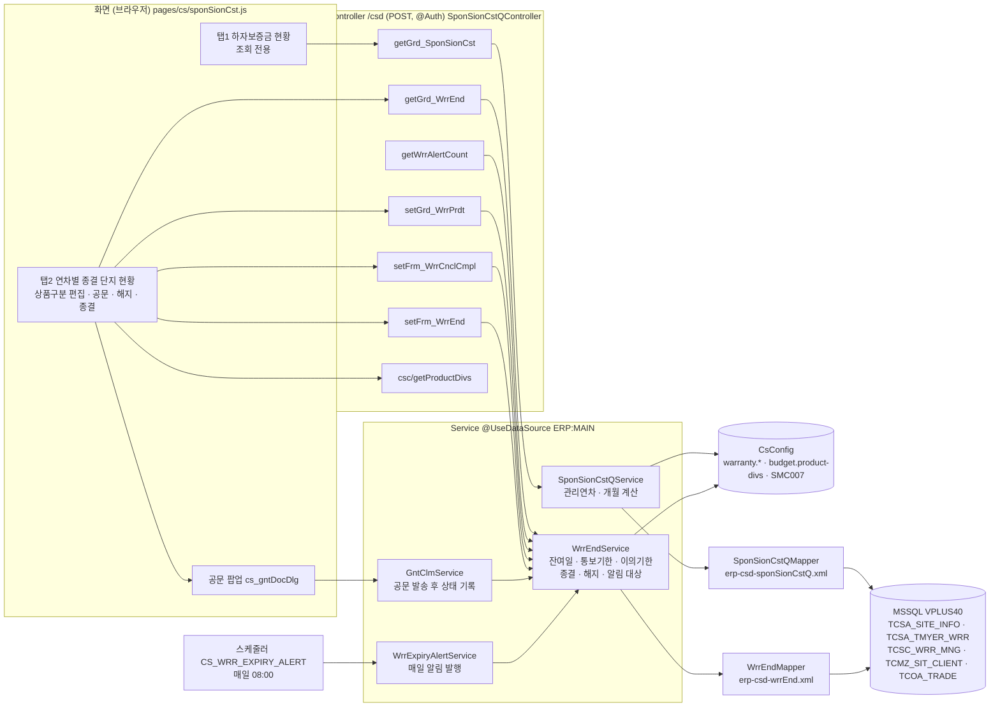
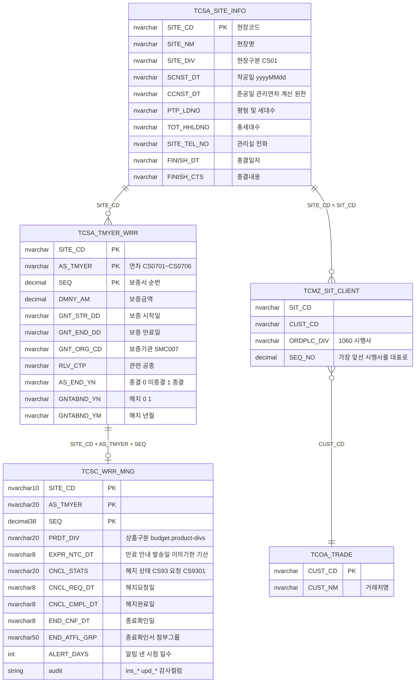
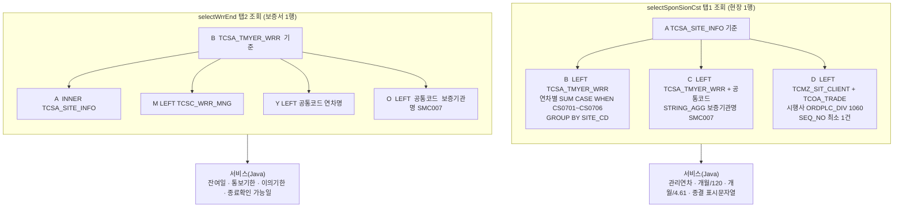
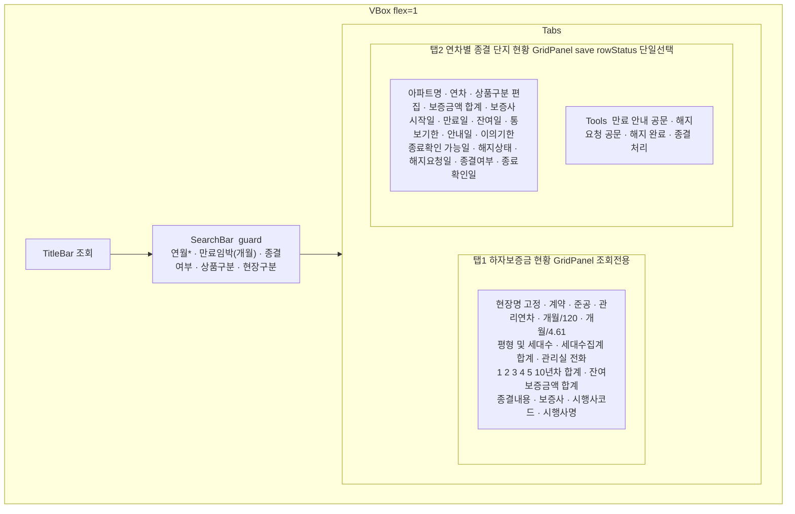
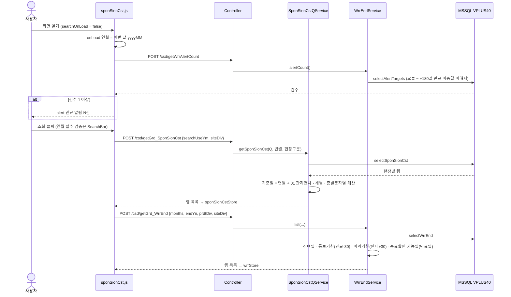
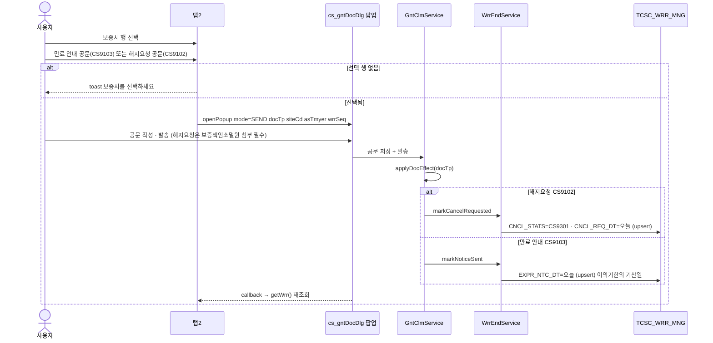
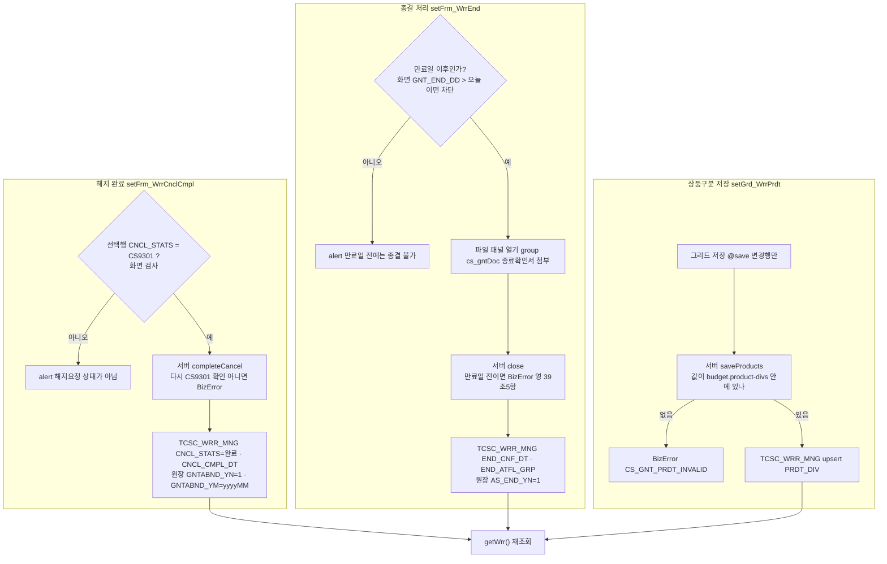
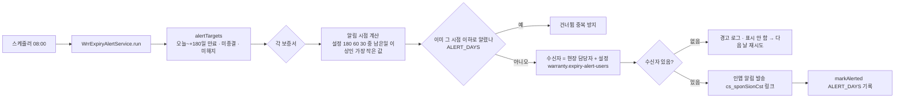

# 하자 > 하자보수비 > 현황조회 > 보증현황 — 테이블 · Query · 화면 · 이벤트 흐름 (2026-11-23)

> 대상: `products-erp-h` 의 `cs_sponSionCst` (기능 #12 담보책임기간·연차별 종결, 법령 영 §39 · 규칙 L-01~03·L-12). 아래 다이어그램은 Mermaid 입니다(VS Code Markdown Preview Mermaid 확장, GitHub 등에서 렌더링).
> 근거 파일: `pages/cs/sponSionCst.js` · `SponSionCstQController` · `SponSionCstQService` · `WrrEndService` · `WrrExpiryAlertService` · `GntClmService` · `erp-csd-sponSionCstQ.xml` · `erp-csd-wrrEnd.xml` · `install/mssql/cs-56-gnt-clm.sql`
> 수치(건수·금액)는 로컬(localhost:8080) 읽기전용 조회 결과이며 2026-11-23 기준이다.

---

## 1. 전체 계층 구조



---

## 2. 테이블 (ERD)

`TCSA_SITE_INFO`(현장)와 `TCSA_TMYER_WRR`(연차별 보증서 원장)가 중심이고, 새로 만든 `TCSC_WRR_MNG` 가 보증서 1건당 관리 기록(상품구분·안내·해지·종결·알림)을 담는다. 실제 DB 외래키(FK)는 없고 쿼리 조인으로만 연결된다.



연차 코드(`AS_TMYER`): `CS0701`=1년차 · `CS0702`=2년차 · `CS0703`=3년차 · `CS0704`=4년차 · `CS0705`=5년차 · `CS0706`=10년차(5 초과). 화면 컬럼 「10년차」는 `CS0706` 합계다.

---

## 3. Query 구성



| 쿼리 | 호출 시점 | 비고 |
|---|---|---|
| `selectSponSionCst` | 조회(탭1) | MSSQL 한정(`STRING_AGG … WITHIN GROUP`). 현장구분 조건만 SQL에서 적용. 연월은 SQL에 안 쓰고 Java 계산 기준일 |
| `selectWrrEnd` | 조회(탭2) · 공문/해지/종결 후 재조회 | 조건: 만료임박(`GNT_END_DD <= 오늘+N개월`) · 종결여부 · 상품구분 · 현장구분 |
| `selectWrr` | 해지 완료 · 종결 처리 · 공문 초안 | 보증서 1건. 상태 검증용 |
| `selectAlertTargets` | 화면 진입 알림 건수 · 매일 배치 | 오늘 ~ 가장 큰 알림 시점(기본 180일) 안에 만료 · 미종결 · 미해지 |
| `selectChargePersons` | 배치 수신자 | `TCSB_CHR_SITE` 현장 담당자(종료일 없거나 미래) |
| `updateMng` / `insertMng` | 상품구분 · 안내 · 해지 · 종결 · 알림 기록 | **upsert**: UPDATE 0건이면 INSERT (`WrrEndService.upsertMng`) |
| `updateWrrAbandon` | 해지 완료 | 원장 `GNTABND_YN='1'`, `GNTABND_YM=yyyyMM` |
| `updateWrrEnd` | 종결 처리 | 원장 `AS_END_YN='1'` |

### 3-1. 탭1 실행용 전체 SQL (MSSQL)

MyBatis `<include refid="…HmpCodeFn.comCode"/>`(`erp-common-hmpCode.xml:185-212`)와 `#{…}` 파라미터를 풀어 쓴 것이다. **변수(`DECLARE`)를 쓰지 않고 값을 직접 넣어** DBeaver 등에서 `Ctrl+Enter`로 그대로 실행된다. 공통코드 서브쿼리는 이 쿼리가 쓰는 칸(`COM_CD`, `HRNK_CD`, `CD_NM`)만 남긴 축약형이며 원본과 결과가 같다(원본은 25칸 전체를 내놓지만 나머지는 미사용). 바꿀 값: `N'SMC007'`(보증기관 그룹), 현장구분 조건(주석 처리된 줄 해제).
관리연차·개월 계산(`calMonth` · `cal120` · `cal461` · `finish`)은 SQL이 아니라 Java가 하므로 이 SQL 결과에는 없다.

```sql
SELECT A.SITE_CD             AS siteCd
      ,A.SITE_NM             AS siteNm
      ,A.SCNST_DT            AS scnstDt
      ,A.CCNST_DT            AS ccnstDt
      ,A.PTP_LDNO            AS ptpLdno
      ,A.TOT_HHLDNO          AS totHhldno
      ,A.SITE_TEL_NO         AS siteTelNo
      ,B.TMYER1              AS tmyer1
      ,B.TMYER2              AS tmyer2
      ,B.TMYER3              AS tmyer3
      ,B.TMYER4              AS tmyer4
      ,B.TMYER5              AS tmyer5
      ,B.TMYER10             AS tmyer10
      ,COALESCE(B.TMYER1,0) + COALESCE(B.TMYER2,0) + COALESCE(B.TMYER3,0)
     + COALESCE(B.TMYER4,0) + COALESCE(B.TMYER5,0) + COALESCE(B.TMYER10,0) AS dmnyAm
      ,A.FINISH_DT           AS finishDt
      ,A.FINISH_CTS          AS finishCts
      ,C.GNT_ORG_NM          AS gntOrgNm
      ,D.CUST_CD             AS custCd
      ,D.CUST_NM             AS custNm
  FROM VPLUS40.TCSA_SITE_INFO A
       LEFT JOIN
       ( SELECT SITE_CD AS SITE_CD
               ,SUM(CASE WHEN AS_TMYER = 'CS0701' THEN DMNY_AM END) AS TMYER1
               ,SUM(CASE WHEN AS_TMYER = 'CS0702' THEN DMNY_AM END) AS TMYER2
               ,SUM(CASE WHEN AS_TMYER = 'CS0703' THEN DMNY_AM END) AS TMYER3
               ,SUM(CASE WHEN AS_TMYER = 'CS0704' THEN DMNY_AM END) AS TMYER4
               ,SUM(CASE WHEN AS_TMYER = 'CS0705' THEN DMNY_AM END) AS TMYER5
               ,SUM(CASE WHEN AS_TMYER = 'CS0706' THEN DMNY_AM END) AS TMYER10
           FROM VPLUS40.TCSA_TMYER_WRR
          GROUP BY SITE_CD
       ) B
       ON A.SITE_CD = B.SITE_CD
       LEFT JOIN
       ( SELECT C1.SITE_CD AS SITE_CD
               ,STRING_AGG(C2.CD_NM, ',') WITHIN GROUP (ORDER BY C2.CD_NM) AS GNT_ORG_NM
           FROM VPLUS40.TCSA_TMYER_WRR C1
                INNER JOIN (
                    SELECT F.code_id       AS COM_CD
                         , F.code_group_id AS HRNK_CD
                         , F.code_name     AS CD_NM
                      FROM HMP.fn_code(NULL, NULL) F
                ) C2
                        ON C1.GNT_ORG_CD = C2.COM_CD
          WHERE C2.HRNK_CD = N'SMC007'                       -- #{suretyOrgGroup} 보증기관 공통코드
          GROUP BY C1.SITE_CD
       ) C
       ON A.SITE_CD = C.SITE_CD
       LEFT JOIN
       ( SELECT D1.SIT_CD  AS SITE_CD
               ,D1.CUST_CD AS CUST_CD
               ,D2.CUST_NM AS CUST_NM
           FROM VPLUS40.TCMZ_SIT_CLIENT D1
                INNER JOIN VPLUS40.TCOA_TRADE D2
                        ON D1.CUST_CD = D2.CUST_CD
          WHERE D1.ORDPLC_DIV = '1060'                        -- 발주처구분 시행사
            AND D1.SEQ_NO = (SELECT MIN(D3.SEQ_NO)
                               FROM VPLUS40.TCMZ_SIT_CLIENT D3
                                    INNER JOIN VPLUS40.TCOA_TRADE D4
                                            ON D3.CUST_CD = D4.CUST_CD
                              WHERE D3.SIT_CD     = D1.SIT_CD
                                AND D3.ORDPLC_DIV = '1060')
       ) D
       ON A.SITE_CD = D.SITE_CD
 WHERE 1 = 1
   -- AND A.SITE_DIV = N'CS0101'                              -- #{siteDiv} 현장구분(CS01) — 필요할 때만 해제
 ;
```

### 3-2. 탭2 실행용 전체 SQL (MSSQL)

`wrrCols` + `wrrFrom`(공통코드 2회 조인)을 풀어 쓴 것이다. 아래 `WHERE`의 3개 조건 중 필요한 것만 주석을 해제한다. 잔여일·통보기한·이의기한·종료확인 가능일은 Java 계산이라 이 SQL 결과에는 없다.

```sql
SELECT B.SITE_CD, A.SITE_NM, B.AS_TMYER, Y.CD_NM AS AS_TMYER_NM, B.SEQ AS WRR_SEQ, B.RLV_CTP, B.DMNY_AM,
       B.GNT_STR_DD, B.GNT_END_DD, B.GNT_ORG_CD, O.CD_NM AS GNT_ORG_NM,
       COALESCE(B.AS_END_YN, '0') AS AS_END_YN, COALESCE(B.GNTABND_YN, '0') AS GNTABND_YN, B.GNTABND_YM,
       M.PRDT_DIV, M.EXPR_NTC_DT, M.CNCL_STATS, M.CNCL_REQ_DT, M.CNCL_CMPL_DT, M.END_CNF_DT, M.END_ATFL_GRP, M.ALERT_DAYS
  FROM VPLUS40.TCSA_TMYER_WRR B
       INNER JOIN VPLUS40.TCSA_SITE_INFO A ON A.SITE_CD = B.SITE_CD
       LEFT JOIN VPLUS40.TCSC_WRR_MNG M ON M.SITE_CD = B.SITE_CD AND M.AS_TMYER = B.AS_TMYER AND M.SEQ = B.SEQ
       LEFT JOIN (SELECT F.code_id AS COM_CD, F.code_group_id AS HRNK_CD, F.code_name AS CD_NM
                    FROM HMP.fn_code(NULL, NULL) F) Y
              ON Y.COM_CD = B.AS_TMYER                                          -- 연차명 (그룹 조건 없음)
       LEFT JOIN (SELECT F.code_id AS COM_CD, F.code_group_id AS HRNK_CD, F.code_name AS CD_NM
                    FROM HMP.fn_code(NULL, NULL) F) O
              ON O.COM_CD = B.GNT_ORG_CD AND O.HRNK_CD = N'SMC007'              -- 보증기관명
 WHERE 1 = 1
   -- AND B.GNT_END_DD IS NOT NULL AND B.GNT_END_DD <= N'20270523'              -- 만료임박(개월) : 오늘 + N개월(yyyyMMdd)
   AND COALESCE(B.AS_END_YN, '0') = N'0'                                        -- 종결여부 (화면 기본 미종결, 전체는 이 줄 삭제)
   -- AND M.PRDT_DIV = N'아파트'                                                -- 상품구분
   -- AND A.SITE_DIV = N'CS0101'                                                -- 현장구분
 ORDER BY B.GNT_END_DD, B.SITE_CD, B.AS_TMYER, B.SEQ;
```

---

## 4. 화면 구성 (`sponSionCst.js`)



| 구성 | 설명 |
|---|---|
| ViewModel | `search{searchUseYm, months, endYn('0'), prdtDiv, siteDiv}` · `activeTab` · `selWrr` · `lookup`(상품구분·현장구분 CS01·종결여부·해지상태 CS93) · `wrrStore`(key SITE_CD+AS_TMYER+WRR_SEQ) · `sponSionCstStore`(key siteCd) |
| 필드 표기 | 탭1은 **camelCase**(DTO `SponSionCstQRow` 별칭), 탭2는 **UPPER_SNAKE**(맵 응답). 다른 CS 화면 관례(UPPER_SNAKE)를 탭1에 그대로 옮기면 안 된다(소스 주석) |
| 탭1 그리드 | 조회전용 · 필터 가능 · 현장명 1열 고정 · 합계행(`summaryScope=filtered`) · 합계 라벨은 순번 칸(`rowNumSummaryLabel`) · `siteCd`는 key로만 보유(컬럼 미선언) |
| 탭2 그리드 | 상품구분만 편집 가능 · 단일 선택 · 앞 2열 고정 · `@save → saveWrr`(변경된 행만) · 버튼은 선택행이 있어야 활성 |
| 화면 속성 | `dirtyCheck:false` · `searchOnLoad:false`(열 때 자동 조회 없음) |

---

## 5. 이벤트 흐름

### 5-1. 열기 · 조회



조회조건을 바꾸면 `onSearchFieldChange`가 두 그리드를 비우고 헤더 필터를 해제한다(재조회 필요).

### 5-2. 만료 안내 · 해지요청 공문



### 5-3. 해지 완료 · 종결 처리 · 상품구분 저장



### 5-4. 만료 알림 배치 (`CS_WRR_EXPIRY_ALERT`, 매일 08:00)



---

## 6. 로컬 실데이터 확인 결과 (읽기전용 조회, 2026-11-23)

| 항목 | 결과 |
|---|---|
| 탭1 (연월 202611, 현장구분 전체) | **12건** — 보증금액 있는 현장 4곳(`ZZV_SEED1` · `B6H132` · `B5H048` · `B8H176`), 나머지 8곳은 보증금 0 |
| 탭1 합계 | 세대수 3,991 · 1년차 101 · 2년차 704,836,317 · 3년차 1,879,562,976 · 4년차 0 · 5년차 1,174,726,860 · 10년차 939,782,488 · **잔여보증금액 4,698,908,742** |
| 탭1 값 없는 칸 | 준공일 없음 1(`70H905`) · 보증금 0 · 8 · 보증사 없음 8 · 시행사 없음 11 · 종결내용 0 |
| 탭2 (종결여부 전체 = 미종결) | **22건**(종결 `AS_END_YN=1` 0건) — 현장 `B6H132` 9 · `ZZV_SEED1` 9 · `B5H048` 2 · `B8H176` 2 |
| 탭2 연차 분포 | 1년차 2 · 2년차 6 · 3년차 4 · 5년차 4 · 10년차 6 |
| 탭2 만료일 분포 | 2022: 1 · 2023: 1 · 2024: 4 · 2025: 4 · 2026: 2 · 2027: 4 · 2032: 6 (최소 2022-05-19 ~ 최대 2032-12-28) |
| 이미 만료된 미종결 | **12건**(잔여일 < 0) · 만료임박 6개월 조건 조회도 12건 |
| 알림 대상 건수(`getWrrAlertCount`) | **0** — 오늘~180일 안에 만료되는 미종결 보증서 없음(가장 가까운 것 2027-12-28, 400일 후) |
| 상품구분 / 안내 / 해지요청 기록 | 상품구분 설정 0건 · 만료 안내 발송 0건 · 해지요청 상태 0건 |
| 해지 완료(`GNTABND_YN=1`) | 2건 — `B6H132` · `ZZV_SEED1` 의 2년차(해지 2024-12) |
| 상품구분 선택지 | 아파트 · 상가 · 오피스텔 (`budget.product-divs`) |
| 시드 중복 | `ZZV_SEED1`과 `B6H132`의 현장명·착공/준공일·평형·세대수(499)·연차별 보증금·보증사가 **모두 동일** → 합계 중 2,349,454,220 이중 |

---

## 7. 코드를 읽으며 확인한 점

- **조회조건 적용 범위가 탭마다 다르다**: 연월 = 탭1만(데이터 필터가 아니라 관리연차 계산 기준일, 필수 입력). 만료임박(개월) · 종결여부 · 상품구분 = 탭2만. 현장구분 = 두 탭 모두(SQL `A.SITE_DIV`). 탭1은 연월로 행을 거르지 않는다.
- **관리연차 계산은 Java**: `기준일 = 연월 + '01'`, Oracle `MONTHS_BETWEEN` 재현(일자 차이를 31로 나눔, 양쪽이 월말이면 정수). 관리연차 = `ROUND(개월/12, 0)`, `개월/120` = `ROUND(개월/120, 2)*100`, `개월/4.61` = `TRUNC(개월/4.61, 2)`. 준공일이 없으면 계산값은 빈칸이다.
- **연차 코드 하드코딩**: SQL이 `CS0701~CS0706`을 직접 쓴다. 설정 `warranty.year-code-map`(`CsConfig.warrantyYearCode`)은 이 쿼리에서 참조하지 않는다.
- **보증사 중복**: `STRING_AGG(C2.CD_NM, ',')`에 `DISTINCT`가 없어 같은 보증기관의 보증서 수만큼 이름이 반복된다.
- **해지·종결 보증서도 탭1 합계에 포함**: `B` 서브쿼리가 `TCSA_TMYER_WRR` 전체를 연차별로 합산하며 `AS_END_YN`·`GNTABND_YN` 조건이 없다. 컬럼 헤더는 「잔여보증금액」이다.
- **MSSQL 한정**: 매퍼 머리주석에 `STRING_AGG … WITHIN GROUP`이 Oracle에서 ORA-00923으로 실패함을 실측했다고 적혀 있다. Oracle/PG 전환 시 Java로 문자열 집계를 옮기는 작업이 필요하다고 명시.
- **시행사 1건 대표**: 시행사가 여러 곳인 현장에서 행이 복제되어 합계가 부풀던 문제(G4-067, 실측 `JH1805` 3건)를 `SEQ_NO` 최소값 1건만 붙이는 방식으로 고쳤다.
- **서버 이중 검증**: 해지 완료(해지요청 상태 `CS9301`)와 종결 처리(만료일 이후)는 화면과 서버가 각각 검사한다. 서버는 이미 종결된 보증서를 다시 종결하는 것을 막지 않는다(`close`에 `AS_END_YN` 검사 없음) — 재종결 시 `END_CNF_DT`가 덮어써진다.
- **상품구분은 목록 포함만 검사**: 서버는 `budget.product-divs` 안의 값인지만 확인한다. 값을 지우는(null) 저장은 허용된다.
- **조회 API에 현장 권한 조건 없음**: 탭1·탭2 쿼리 모두 현장 권한(데이터스코프) 조건이 SQL에 없고 `@Auth` 로그인만 확인한다. 서비스 등록의 데이터스코프 설정과의 관계는 확인하지 못했다.
- **문서 불일치**: 컨트롤러 Javadoc `POST /api/cs/spon-sion-cst-q/getSponSionCst` ≠ 실제 `POST /csd/getGrd_SponSionCst`. JS 주석이 참조하는 `docs/poc/cs_gap/sponSionCst.md` · `docs/poc/cs_src/…`는 저장소에 없다.
- **알림 배치 수신자**: 담당자(`TCSB_CHR_SITE`)가 없고 `warranty.expiry-alert-users`도 비어 있으면 알림이 나가지 않고 매일 재시도 로그만 남는다. 진입 시 알림창은 건수 API 실패를 조용히 넘긴다(`showMessage:false`).
